# Flujo: Autenticación, Sesiones, MFA y Cambio de Contraseña (`autenticacion-y-mfa`)

- **Estado:** `SINCRONIZADO_Y_VERIFICADO`
- **Última Actualización:** 2026-11-16
- **Módulo / Actores:** `auth` / `users` / `employees` / `admin` — Actores: `Administrador`, `Supervisor_Elevado`, `Supervisor`, `Fiscalizador`, `Reloj_Control`, `Usuario`, `Kiosk_Employee`, `Archivado`, cliente SPA (`useStore`/`authSlice`) y cliente Socket.IO.
- **Puntos de Entrada:**
  - **UI:** `#/` (`ROUTES.LOGIN`), `#/kiosk` (`ROUTES.KIOSK`), `Header` (`[data-testid="mfa-setup-button"]`, `[data-testid="security-modal-button"]`, `[data-testid="header-logout-button"]`), modales `MFALoginModal`, `MFASetupModal`, `ForceChangePasswordModal`, `ChangePasswordModal`, overlay `SessionExpiredOverlay`, `ProtectedRoute` y `PersistentLayoutContainer`.
  - **API:** `POST /api/auth/login`, `POST /api/auth/kiosk-login`, `POST /api/auth/logout`, `POST /api/auth/mfa/setup`, `POST /api/auth/mfa/verify`, `POST /api/auth/mfa/validate`, `ALL /api/auth/*` (`BETTER_AUTH_ENABLED=true`, dormido por `[DUDA-04]`), `PUT /api/users/:id`, `GET /api/users`, `POST /api/users`, `PUT /api/employees/:id`, `POST /api/employees/bulk`, `POST /api/admin/purge-sessions`, `POST /api/admin/reset-password`, `POST /api/admin/restore`, `DELETE /api/maintenance/clear-database`.
  - **Tiempo real / Jobs:** Socket.IO (`io.use`, `auth:force_logout`, sweep cada `30000ms`), `MaintenanceService.rotateAuditLogs` (inicio y job diario).

---

## 1. Diagrama del Flujo (Estado Verificado)

```mermaid
flowchart TD
  Start["Inicio SPA / Boot (useStore._verifyAuth)"] --> HasStored{"sessionStorage currentUser y authService.isAuthenticated validos?"}
  HasStored -->|"No (huerfano / expirado / Kiosk)"| ClearBoot["Limpia currentUser y authToken; ProtectedRoute redirige a #/ sin 401"]
  HasStored -->|"Si"| CheckForceBoot{"mustChangePassword == true?"}
  CheckForceBoot -->|"Si"| ForceModal["ForceChangePasswordModal bloqueante (difiere sync, socket y rutas)"]
  CheckForceBoot -->|"No"| RestoreOK["Restaura currentUser e inicia initializeAppData + useSocketEvents"]

  ClearBoot --> LoginUI["LoginPage (#/) o Kiosk (#/kiosk)"]
  LoginUI -->|"Login estandar (BETTER_AUTH_ENABLED=false)"| LegacyLogin["POST /api/auth/login (skipUnauthorized: true, skipRateLimit: false)"]

  LegacyLogin --> SchemaCheck["validateRequest LoginSchema (.min(1) + non-whitespace)"]
  SchemaCheck -->|"400 VALIDATION_ERROR"| LoginErr["Error HTTP 400 antes de throttle/audit"]
  SchemaCheck -->|"Valido"| RateLimit["throttle: inspectLoginFailures (ip:username)"]
  RateLimit -->|"429 bloqueado"| RateToast["Evento global rate_limited (toast unico)"]
  RateLimit -->|"Permitido"| AuthCheck["AuthService.authenticate (bcrypt + role != Archivado)"]

  AuthCheck -->|"Invalido"| FailRec["recordLoginFailure + audit LOGIN_FAILED + 401"]
  AuthCheck -->|"Archivado"| Archived403["403 ForbiddenError (sin auditar)"]
  AuthCheck -->|"Valido + mfaEnabled=true"| MFAPending["Responde mfaRequired=true + mfaToken JWT (5m, jti, credentialStamp)"]
  AuthCheck -->|"Valido + mfaEnabled=false"| CreateSess["AuthService.createSession (FOR UPDATE + advisory lock + lastLogin + eviccion LRU)"]

  MFAPending --> MFAModal["MFALoginModal (sin cierre por backdrop) -> POST /api/auth/mfa/validate"]
  MFAModal --> MFAValidate["AuthService.validateMFALogin (FOR UPDATE + tx.verification jti unico + 5 fallos/5m -> 429)"]
  MFAValidate -->|"TOTP valido"| CreateSess
  MFAValidate -->|"TOTP invalido / 429"| MFAAudit["Audita MFA_FAILED + mantiene modal"]

  CreateSess --> Resp200["200 sessionResponse (JWT + role con guion bajo + mfaEnabled + mustChangePassword)"]
  Resp200 --> HandleSuccess["authSlice._handleSuccessfulLogin (wipeAllData si cambia userId + queryCache)"]
  HandleSuccess --> CheckForce{"mustChangePassword == true?"}
  CheckForce -->|"Si"| ForceModal
  CheckForce -->|"No"| GuardCheck["ProtectedRoute + useSocketEvents + queries con role-gate"]
  ForceModal -->|"PUT /api/users/:selfId 200"| CompleteForce["completeForcePasswordChange (invalidateQueries + initializeAppData + navega)"]
  CompleteForce --> GuardCheck

  LoginUI -->|"Kiosk PIN 4 digitos"| KioskPost["POST /api/auth/kiosk-login (KioskLoginSchema -> throttle)"]
  KioskPost --> KioskVerify["AuthService.verifyKioskPin (FOR UPDATE, status=Activo, 5 fallos -> isPinBlocked=true)"]
  KioskVerify -->|"Valido"| KioskJWT["JWT stateless Kiosk_Employee (5m) aislado en sessionStorage kioskToken"]
  KioskJWT --> KioskGuard["authenticate verifica status=Activo + KIOSK_ALLOWED_PATHS (metodo + ruta + selfId)"]

  GuardCheck --> ReqAuth["Requests HTTP con Authorization Bearer (sin ?token=; descargas Blob)"]
  ReqAuth --> AuthMW["createAuthenticate: JWT -> ActiveSession (SHA-256) -> role != Archivado"]
  AuthMW -->|"isForcePasswordChange=true"| ForceGate{"PUT /api/users/:selfId, POST /api/auth/logout o /api/health*?"}
  ForceGate -->|"No (/mfa/*, negocio, Socket.IO)"| Force403["403 Debe actualizar su contrasena temporal"]
  ForceGate -->|"Si"| AllowReq["Asigna request.user y context.username"]
  AuthMW -->|"Archivado / inactivo"| Archived403
  AuthMW -->|"ActiveSession ausente/expirada"| Unauth401["401 -> evento window unauthorized"]

  AllowReq -->|"Header data-testid=mfa-setup-button (solo Administrador sin MFA)"| MFASetup["POST /api/auth/mfa/setup (409 si ya activo) -> POST /api/auth/mfa/verify (400 sin setup)"]
  AllowReq -->|"Header security-modal-button (todos los roles)"| ChangePwd["ChangePasswordModal -> PUT /api/users/:selfId (sin GET /api/users)"]
  AllowReq -->|"Cambio clave/rol o Archivo"| RevokeSessions["Revoca ActiveSession (EXCEPT_CURRENT vs ALL) + emitForceLogoutToUser/Employee"]

  GuardCheck --> SocketConn["Socket.IO handshake (rechaza Archivado, isForcePasswordChange y Kiosk inactivo)"]
  SocketConn --> SocketLoop["deliver() y sweep 30s -> authorizeSocketTokens (fail-closed)"]

  Unauth401 --> AppExpiry["App.tsx listener unico -> SessionExpiredOverlay (3s) -> authSlice.logout()"]
  AppExpiry --> LogoutClient["authService.logout(): POST /api/auth/logout con Bearer antes de removeToken()"]
  LogoutClient --> ClearClient["Purga SAPHRPortalQueryCache, sessionStorage.clear() y hash a #/"]
  LogoutClient --> LogoutBE["authFlows.logout: resuelve actorUsername real, borra ActiveSession y emite auth:force_logout"]
```

---

## 2. Comportamiento Documentado en Código (Estado Verificado)

### 2.1 Boot, restauración de sesión y redirección de sesión huérfana en Frontend

1. `AppProviders` (`frontend/src/contexts/AppProviders.tsx:16-41`) envuelve la aplicación en `HashRouter` y `PersistQueryClientProvider` con el persister `SAPHRPortalQueryCache` (IndexedDB, `maxAge` de 24h, allowlist `PERSISTED_QUERY_ROOTS` que excluye explícitamente `SENSITIVE_QUERY_ROOTS` como `users`, `auditLogs`, `kpis`, `health`, `integrityStatus`, `system` en `frontend/src/lib/queryCache.ts:20-91`).
2. Al importarse el store `useStore` (`frontend/src/store/useStore.ts:34-35`), se ejecuta automáticamente `useStore.getState()._verifyAuth()`.
3. `_verifyAuth()` (`frontend/src/store/slices/authSlice.ts:70-110`) lee `sessionStorage.getItem(STORAGE_KEYS.CURRENT_USER)` (`"currentUser"`, `frontend/src/constants.ts:50`) y exige además `authService.isAuthenticated()` (`frontend/src/services/authService.ts:160-177`):
   - `authService.isAuthenticated()` lee `authToken` desde `authTokenStore` (`"authToken"`), normaliza el payload JWT `base64url` (`-`/`_` y padding `=`), y verifica `typeof payload.exp === "number" && payload.exp * 1000 > Date.now() && payload.role !== "Kiosk_Employee"`.
   - Si falta `currentUser`, falta `authToken`, el JWT expiró o pertenece a `Kiosk_Employee`, `_verifyAuth()` limpia `sessionStorage.removeItem(STORAGE_KEYS.CURRENT_USER)`, ejecuta `authService.removeToken()` y fija `{ currentUser: null, isAuthenticated: false, isAuthLoading: false }` sin emitir peticiones HTTP (`0` respuestas `401`).
   - En enrutamiento (`frontend/src/App.tsx:249-256`, `frontend/src/router/ProtectedRoute.tsx:21-23` y `frontend/src/components/layout/PersistentLayout.container.tsx:12-15`), toda ruta protegida o layout envuelto en `<ProtectedRoute>` / `PersistentLayoutContainer` redirige síncronamente mediante `<Navigate to={ROUTES.LOGIN} replace />` cuando `!isAuthenticated || !currentUser || currentUser.mustChangePassword`, evitando pantallas en blanco ante sesiones huérfanas.
   - Si la sesión es válida: normaliza `role` con guion bajo (`replace(/ /g, "_")`), valida `QUERY_CACHE_OWNER_KEY` en `localStorage` (purgando `SAPHRPortalQueryCache` + `queryClient.clear()` si cambia el `user.id`, `authSlice.ts:88-90`), fija `{ currentUser, isAuthenticated: true, isAuthLoading: false }` y **solo si `!user.mustChangePassword`** (`authSlice.ts:94-101`) lanza `initializeAppData()` en segundo plano (`frontend/src/store/slices/syncSlice.ts:296-329`).

### 2.2 Login estándar (`LoginPage` → `POST /api/auth/login`), Role Normalization, `lastLogin` y Rate Limit

1. `LoginPage` (`frontend/src/features/auth/pages/LoginPage.tsx:25-37,103-105`): si `isAuthenticated && currentUser && !currentUser.mustChangePassword`, redirige mediante `navigate(getDefaultRouteForRole(currentUser.role, isControlInternoEnabled), { replace: true })` y retorna `null`. Si `mustChangePassword === true`, permanece montada en `#/` para completar `ForceChangePasswordModal`. En pie de página muestra `SimpleConnectionIndicator` (`GET /api/health/ready` cada `30000ms`, `frontend/src/hooks/queries/useHealthQuery.ts:118-122,175-182`) y enlace a `ROUTES.KIOSK` (`"/kiosk"`, `LoginPage.tsx:253-262`).
2. Al enviar `<form data-testid="login-form">` (`LoginPage.tsx:56-81,159-250`), `useAppForm` (`frontend/src/hooks/useAppForm.ts`) valida con `loginFormSchema` (`frontend/src/schemas/forms/auth.ts:19-24`), que exige `requiredText("El usuario").min(1)` (rechaza vacío o solo espacios) y `password` `.min(1)`, manteniendo `normalize: (values) => values` (sin `trim`), protección anti-doble envío y foco en `[aria-invalid="true"]`.
3. `authSlice.login(username, password)` (`frontend/src/store/slices/authSlice.ts:112-157`) fija `isAuthLoading: true`, programa un `overlayTimer` de `300ms` y llama a `authService.login`:
   - **Modo productivo activo (`VITE_BETTER_AUTH_ENABLED !== "true"` por `[DUDA-04]`)** (`authService.ts:83-100`): invoca `POST /api/auth/login` vía `apiRequest<LoginResponse>` (`frontend/src/services/apiClient.ts:347-349`), donde `ANONYMOUS_AUTH_PATH` suprime únicamente el evento `"unauthorized"` (`skipUnauthorized: true`), mientras `skipRateLimit` permanece `false` para emitir `"rate_limited"` ante HTTP `429`. Si retorna `data.token`, lo guarda en `sessionStorage["authToken"]`. En `LoginPage.tsx:73-75`, `if (hasHttpStatus(error, 429)) return;` evita duplicar el toast global de `rate_limited` (`frontend/src/store/useStore.ts:41-58`, que formatea `Math.ceil(retrySeconds)`).
   - _(Rama strangler `VITE_BETTER_AUTH_ENABLED === "true"` en `authService.ts:60-82` permanece inactiva por `[DUDA-04]`.)_
4. En el backend (`backend/src/modules/auth/http/routes.ts:51-61`), `POST /api/auth/login` ejecuta `preHandler: [validateRequest("body", LoginSchema), throttle]` (**validación de esquema antes del rate limiter**):
   - `LoginSchema` (`backend/src/models/schemas/auth-user.schemas.ts:51-61`) exige `username` `.min(1)` + `.refine((value) => value.trim().length > 0)` y `password` `.min(1)`. Cadenas vacías o solo espacios en `username` responden `400 VALIDATION_ERROR` sin consumir cuota de `throttle` ni auditar `LOGIN_FAILED`.
   - `throttle` (`routes.ts:43-50`) invoca `inspectLoginFailures(ip, body)` (`backend/src/services/loginFailures.ts:31-54`) sobre clave `${ip}:${username.trim().toLowerCase()}` usando dos `RateLimiterMemory` (`loginLimiter`: prod `5/60s` bloqueo `60s`, no-prod `30/60s` bloqueo `10s`; `consecutiveFailuresLimiter`: prod `10/24h` bloqueo `1h`, no-prod `50/24h` bloqueo `60s`). Ante agotamiento responde `429` con header `Retry-After` y `{ message }`.
   - `authFlows.login` (`backend/src/modules/auth/application/flows.ts:112-154`) llama `AuthService.authenticate(username, password, ip)` (`backend/src/services/AuthService.ts:77-91`), que busca con `username: { equals: username, mode: "insensitive" }` y verifica `bcryptjs.compare(password, user.passwordHash)`.
   - Si falla contraseña o no existe usuario (`INVALID_CREDENTIALS`), llama `recordLoginFailure`, audita `LOGIN_FAILED` (`category: "OPERATIONS"`, `severity: "WARNING"`, `outcome: "FAILURE"`) y lanza `AuthError` `401` `"Credenciales inválidas"` (`flows.ts:117-129`).
   - Si `user.role === "Archivado"` (`USER_ARCHIVED`), lanza `ForbiddenError` `403` `"Acceso denegado: Su cuenta de usuario está archivada"` sin registrar fallo ni auditar (`flows.ts:130-131`).
   - En autenticación válida calcula `credentialStamp = HMAC-SHA256(JWT_SECRET, JSON.stringify(["auth-credential-version-v1", user.id, user.passwordHash]))` (`AuthService.ts:30-36,90`).
5. **Bifurcación MFA vs Sesión**:
   - Si `user.mfaEnabled === true` (`flows.ts:135-141`), `AuthService.generateMFAPendingToken` (`AuthService.ts:191-209`) firma JWT con `expiresIn: "5m"` y claims `{ id, username, role, mfaPending: true, credentialStamp, jti: crypto.randomUUID() }`, respondiendo `200` `{ mfaRequired: true, mfaToken, userId, message }` sin crear `ActiveSession`. En el cliente, `authSlice.login` cancela `overlayTimer` y fija `{ mfaRequired: true, mfaToken, isAuthLoading: false, isInitialSync: false }`.
   - Si `!user.mfaEnabled` (`flows.ts:142-153`), `AuthService.createSession` (`AuthService.ts:126-189`) crea la `ActiveSession`, actualiza `tx.user.update({ where: { id: userId }, data: { lastLogin: new Date() } })` (`L182-185`) dentro de la misma `withDirectTransaction`, devuelve `canonicalRole(role)` (`L18-19,100`, formato canónico con guion bajo como `"Reloj_Control"`, `"Supervisor_Elevado"`), audita `LOGIN_SUCCESS`, limpia `failures.clear(ip, user.username)` y responde `200` acorde a `sessionResponse` (`backend/src/modules/auth/http/responseSchemas.ts:8-22`, incluyendo `mfaEnabled: user.mfaEnabled` y `mustChangePassword: user.isForcePasswordChange ?? false`).
6. En el cliente (`authSlice._handleSuccessfulLogin`, `authSlice.ts:173-244`): si cambia `localStorage["lastLoggedUserId"]` respecto a `loginResponse.userId`, ejecuta `wipeAllData()`, `resetPersistedQueryCache(loginResponse.userId)`, remueve `lastSyncTime` y setea `{ lastSyncTime: null }`; resuelve `employeeId` desde la respuesta o decodificando `base64url` del JWT; normaliza `role` con guion bajo y construye `user` (`mustChangePassword: loginResponse.mustChangePassword === true`, `mfaEnabled: loginResponse.mfaEnabled ?? options?.mfaVerified === true`):
   - **Si `user.mustChangePassword === true`** (`authSlice.ts:211-225`): guarda `currentUser` en Zustand y `sessionStorage["currentUser"]`, mantiene `isInitialSync: false` y **difiere `initializeAppData()`**, Socket.IO y la navegación de `LoginPage.tsx:65-69` hasta completar el cambio de contraseña.
   - **Si `user.mustChangePassword === false`** (`authSlice.ts:227-243`): activa `isInitialSync: true`, dispara `initializeAppData()` en background y `LoginPage.tsx:66-68` muestra toast `"¡Bienvenido, ${user.username}!"` y navega a `getDefaultRouteForRole(user.role, isControlInternoEnabled)`.

### 2.3 Flujos MFA (Desafío en Login y Enrolamiento / Setup)

1. **Validación MFA en Login (`MFALoginModal` → `POST /api/auth/mfa/validate`)**:
   - `LoginPage.tsx:277` renderiza `<MFALoginModal isOpen={mfaRequired} onSuccess={handleMFASuccess} onCancel={logout} />`. `MfaLoginModalView` (`frontend/src/features/auth/components/MFALoginModal.view.tsx:48-55`) incorpora `role="dialog"`, `aria-modal="true"`, `aria-labelledby="mfa-login-modal-title"` y **suprime `onClick` del backdrop** (solo el botón explícito `"Cancelar"` invoca `onCancel`).
   - `useMfaLoginModalController` (`frontend/src/features/auth/hooks/useMfaLoginModalController.ts:40-88`) filtra `handleCodeChange` a dígitos de máximo 6 caracteres, valida con `mfaLoginFormSchema`, invoca `validateMFACode(code)` y pasa el `user` autenticado retornado a `onSuccess(user ?? undefined)` (`L54-56`), evitando toast duplicado si `hasHttpStatus(error, 429)` (`L59-61`). En `LoginPage.tsx:93-101`, `handleMFASuccess(authenticatedUser)` resuelve `authenticatedUser ?? useStore.getState().currentUser ?? currentUser` eliminando la closure stale y mostrando `"¡Bienvenido, ${user.username}!"` (navegando si `!user.mustChangePassword`).
   - En backend (`backend/src/modules/auth/http/routes.ts:119-129`), `POST /api/auth/mfa/validate` valida `MFAValidateSchema` (`auth-user.schemas.ts:73-78`).
   - `AuthService.validateMFALogin` (`backend/src/services/AuthService.ts:377-472`):
     - Verifica firma/vigencia del JWT `mfaToken` capturando `JsonWebTokenError`/`TokenExpiredError` como `AuthError` `401` (`L381-389`, sin generar `UNHANDLED_ERROR`), y exige `mfaPending === true`, `id`, `credentialStamp` y **`jti` no vacío** (`L390-404`).
     - Dentro de `withDirectTransaction`, ejecuta `SELECT id FROM users WHERE id = ${userId} FOR UPDATE` (`L413`): valida usuario existente, `role !== "Archivado"` (`403`), `credentialStamp` (`401`) y `mfaEnabled && mfaSecret` (`401`).
     - Verifica anti-replay de `jti` consultando `tx.verification.findUnique({ where: { id: "mfa-jti:" + jti } })` (`L423-430`); si ya fue consumido responde `AuthError` `401` `"Token MFA ya utilizado; reinicia el inicio de sesión"`.
     - Si `user.mfaBlockedUntil > now` (`L433-434`), lanza `RateLimitError` (`429`, código `"MFA_RATE_LIMITED"`, `actorUsername: user.username`, header `Retry-After`).
     - Si falla `mfaService.verifyToken(user.mfaSecret, code)` (`speakeasy.totp.verify`, `window: 1`), incrementa `mfaFailedAttempts` dentro de la ventana de 5 minutos (bloqueando al llegar a `5` con `mfaBlockedUntil = now + 5m`) y retorna `{ success: false, actorUsername: user.username, userId: user.id }` (`L441-453`) para commitear el conteo sin consumir el `jti` en intentos fallidos. En `authFlows.validateMFA` (`flows.ts:256-280`), tanto el `RateLimitError` (`429`) como el código inválido (`401`) auditan `MFA_FAILED` (`category: "AUTH"`, `severity: "WARNING"`, `outcome: "FAILURE"`).
     - Si el TOTP es válido (`L454-470`), inserta el registro de consumo en `tx.verification` (`id: "mfa-jti:" + jti`, `identifier: "mfa-jti:" + user.id`, `value: "consumed"`, `expiresAt`) **atómico bajo el lock `FOR UPDATE`**, resetea contadores MFA en `users`, y `flows.ts:283-294` crea la sesión (`createSession`, actualizando `lastLogin`), audita `LOGIN_MFA_SUCCESS`, limpia `failures.clear` y responde `200` `sessionResponse`. (Los registros expirados de `verification` se purgan periódicamente en `MaintenanceService.rotateAuditLogs`, `maintenanceService.ts:74-78`.)
2. **Enrolamiento / Setup MFA (`Header` → `MFASetupModal` → `/api/auth/mfa/setup` y `/api/auth/mfa/verify`)**:
   - **Acceso exclusivo `Administrador` en UI y API (`[DUDA-01]`):** Se retiró el disparador muerto de `UserManagement.view.tsx`. El menú de usuario en `Header.view.tsx:166-175` expone `<button data-testid="mfa-setup-button" aria-label="Configurar MFA">Configurar MFA</button>` únicamente cuando `canConfigureMfa` es `true` (`useHeaderController.ts:69`: `currentUser?.role === "Administrador" && !currentUser.mfaEnabled`), cargando lazy `MFASetupModal.container` (`Header.view.tsx:7-9,219-227`). Al completar la activación, `handleMfaSetupSuccess` (`useHeaderController.ts:58-62`) invoca `markMfaEnabled()` (oculta de inmediato `mfa-setup-button`) e invalida `queryKeys.users()`.
   - `MFASetupModal.view.tsx` (`L68-71,99-106`) agrega `role="dialog"`, `aria-modal="true"`, `aria-labelledby="mfa-setup-modal-title"` y botón `"Cancelar"` en el paso inicial; `useMfaSetupModalController.ts:86-95` soporta cierre con tecla `Escape`.
   - En backend (`backend/src/modules/auth/http/routes.ts:38-42,93-118` y `flows.ts:82-88,223-245`), tanto `POST /api/auth/mfa/setup` como `POST /api/auth/mfa/verify` exigen `options.authenticate` y `adminOnly` (`403` para cualquier rol distinto de `Administrador`).
   - `AuthService.setupMFA` (`AuthService.ts:327-349`) bloquea la fila con `SELECT id FROM users WHERE id = ${userId} FOR UPDATE` dentro de `withDirectTransaction`; si `dbUser.mfaEnabled === true`, lanza `ConflictError` (`409` `"MFA ya se encuentra habilitado para esta cuenta"`) sin desactivar MFA ni sobrescribir el secreto productivo. Si está deshabilitado, genera secreto `speakeasy` (`issuer: "PORTAL"`) y QR Data URL (`mfaService.ts`), persiste `mfaSecret` con `mfaEnabled: false` y retorna `200` `{ qrCode, secret, message }`.
   - `AuthService.confirmMFASetup` (`AuthService.ts:351-375`) bloquea con `FOR UPDATE`; si `!dbUser || !dbUser.mfaSecret` lanza `ValidationError` (`400` `"MFA no configurado. Ejecute la configuración inicial primero."`); si `dbUser.mfaEnabled` lanza `ConflictError` (`409`). Si el TOTP falla, `flows.ts:234-235` lanza `ValidationError` `400`; si acierta, fija `users.mfa_enabled = true`, audita `MFA_ENABLED` y responde `200`.

### 2.4 Cambio Forzado de Contraseña (`isForcePasswordChange`), Cambio Propio y `PUT /api/users/:id`

1. **Orígenes unificados (`[DUDA-08]`):**
   - `backend/src/services/UserService.ts:22` exporta `DEFAULT_TEMPORARY_PASSWORD` (`UserService.DEFAULT_TEMPORARY_PASSWORD` / `DEFAULT_TEMPORARY_PASSWORD`, `[REDACTED]`), compartido por `UserService.ensureEmployeeUser` (`L272`, `isForcePasswordChange: true`) y `EmployeeService.syncEmployeeStatus` al reactivar `Archivado -> Activo` (`EmployeeService.ts:8,198-207`, `isForcePasswordChange: true`), así como por `frontend/src/constants.ts:35` (`DEFAULT_TEMPORARY_PASSWORD`), consumido en `frontend/src/hooks/useUsers.ts:9,71`, `frontend/src/hooks/useEmployees.ts:13,270` y `frontend/src/features/user-management/hooks/useUserManagementData.ts:11,136`.
   - Creación manual vía `POST /api/users` (`backend/src/modules/users/application/flows.ts:92`) fija `isForcePasswordChange: true`.
   - Reseteo administrativo `POST /api/admin/reset-password` → `UserService.forceResetPassword` (`UserService.ts:298-337`): busca `username.trim()` con `mode: "insensitive"`, bloquea `users` con `FOR UPDATE` en `withDirectTransaction`, actualiza `passwordHash` (`bcryptjs` cost 10), fija `isForcePasswordChange: true`, elimina todas las `ActiveSession` del usuario, emite `SocketService.emitForceLogoutToUser(result.userId, { reason: "SESSION_INVALIDATED" })`, audita `FORCE_PASSWORD_RESET` y emite `user:updated`.
2. **Bloqueo estricto en Backend mientras `isForcePasswordChange === true` (`[DUDA-02]`):**
   - `assertAllowedWhileForcePasswordChange` (`backend/src/modules/auth/application/authenticate.ts:74-92`) aplica sobre todas las ramas de `createAuthenticate`:
     - Si `!requestPath` (ej. handshake Socket.IO en `SocketService.initialize`), lanza `ForbiddenError` `403`.
     - En HTTP permite **únicamente**: `PUT /api/users/${user.id}`, `POST /api/auth/logout`, y `/api/health` o `/api/health/*`. Bloquea con `403` `/api/auth/mfa/*`, `DELETE /api/users/:selfId`, `/api/auth/session` y cualquier endpoint de negocio.
3. **Diferimiento en SPA y cierre de `ForceChangePasswordModal` (`[DUDA-02]`):**
   - Mientras `currentUser?.mustChangePassword === true`:
     - `authSlice._handleSuccessfulLogin` (`L211-225`) y `_verifyAuth` (`L94-101`) no disparan `initializeAppData()`.
     - `ProtectedRoute.tsx:21` y `App.tsx:250-254` mantienen la SPA en `ROUTES.LOGIN` (`#/`), sin montar `PersistentLayout` ni navegar al dashboard.
     - `useSocketEvents.ts:35` (`if (!authenticated || !userId || mustChangePassword) return;`) difiere la conexión Socket.IO.
     - `useConfigQuery.ts` (`L15,26,37,48,...`), `useEmployeesQuery.ts` (`L25,39`) y `useUsersQuery.ts` (`L35`) bloquean sus queries con `!isForcePasswordChange` (preservando solo lecturas públicas como `useBrandLogoQuery` y `useKioskEmployeesQuery`).
     - `App.tsx:485-490` monta lazy `<ForceChangePasswordModal isOpen={isForcePasswordChangeModalOpen} onClose={completeForcePasswordChange} />`.
   - `useForceChangePasswordModalController` (`frontend/src/features/auth/hooks/useForceChangePasswordModalController.ts:44,58-66`) llama `useUsers({ enabled: false })` (sin disparar `GET /api/users`), envía `changeOwnPassword({ newPassword })` → `PUT /api/users/${currentUser.id}` con `{ password }` y, al retornar `true`, invoca `await onClose()` (`authSlice.completeForcePasswordChange`, `authSlice.ts:282-294`), que actualiza `mustChangePassword: false` en Zustand + `sessionStorage["currentUser"]`, ejecuta `await queryClient.invalidateQueries()` y `await get().initializeAppData()`, habilitando Socket.IO y activando la redirección de `LoginPage` al destino del rol.
   - `useUsers.changeOwnPassword` (`frontend/src/hooks/useUsers.ts:126-143`) muestra toast de error si `userService.update` falla (`addToast`), y solo ejecuta `refreshUsers()` cuando `currentUser.role` es `"Administrador"` o `"Supervisor_Elevado"`.
4. **Cambio Propio (`ChangePasswordModal`) y Contrato de `PUT /api/users/:id` (`[DUDA-08]`):**
   - `useChangePasswordModalController` (`frontend/src/features/auth/hooks/useChangePasswordModalController.ts:41-85`) **ya no invoca `useUsers()` ni `GET /api/users`**: toma `currentUser` directo de `useAuth()`, mantiene el bloqueo cliente para `{ id: "admin-001", username: "admin" }`, y envía `await userService.update(currentUser.id, { password: payload.password })` (habilitando el cambio propio para todos los roles autenticados sin provocar `403`).
   - En backend (`backend/src/modules/users/http/routes.ts:74-109`):
     - `UpdateUserSchema` (`backend/src/models/schemas/auth-user.schemas.ts:17-25`) declara formalmente `mustChangePassword?: boolean`.
     - `PUT /api/users/:id` permite `Administrador` o propio usuario (`isSelf`); si `!isAdmin`, exige que el payload contenga exclusivamente la clave `"password"` (`L87-95`, rechazando con `403` si intenta enviar `mustChangePassword` o modificar rol/usuario).
     - Calcula `currentTokenHash = SHA-256(accessToken)` y lo pasa como `actorContext` a `userService.updateUser`.
     - `UserService.updateUserWithSessionRevocation` (`UserService.ts:154-218`) dentro de `withDirectTransaction` (`SELECT id FROM users ... FOR UPDATE`): cuando cambia `passwordHash`, cambia `role`, pasa a `"Archivado"` o se activa `isForcePasswordChange = true`, determina el modo de revocación:
       - **`EXCEPT_CURRENT`**: únicamente si es cambio de contraseña voluntario del propio usuario (`actorContext.actorId === id && currentTokenHash`) sin cambio de rol, sin archivado y sin forzar cambio. Elimina todas las demás `ActiveSession` (`tokenHash !== currentTokenHash`) y emite `SocketService.emitForceLogoutToUser(id, { exceptTokenHash, reason: "SESSION_INVALIDATED" })`.
       - **`ALL`**: en cambios administrativos de clave, cambios de rol, archivado o `mustChangePassword: true`; elimina todas las `ActiveSession` del usuario y emite `SocketService.emitForceLogoutToUser(id, { reason: "SESSION_INVALIDATED" })`.

### 2.5 Validación de Request, Concurrencia, Descargas Bearer y Bloqueo de `Archivado`

1. `createFastifyRuntime` (`backend/src/fastify/runtime.ts:38`) exige `process.env.JWT_SECRET` al arranque (aborta si falta).
2. `buildFastifyApp` (`backend/src/platform/fastify/app.ts:240-385`) configura Helmet, CORS (`credentials: false`, `allowedHeaders: ["Content-Type", "Authorization"]`), opcionalmente `app.all("/api/auth/*", betterAuthHandler)` en raíz si `BETTER_AUTH_ENABLED === "true"` (`L272-274`, desactivado por `[DUDA-04]`), y dentro de `protectedApp`:
   - `globalRateLimit` (`max: 5000`, `timeWindow: 15*60*1000`, exime `/api/maintenance*` y `/api/admin*`, retorna `429` `RATE_LIMITED`), más límites dedicados para `/api/admin` (`1000/15m`) y `/api/export` (`10/15m`).
   - Hook `onRequest` de mantenimiento (`503 MAINTENANCE_MODE`, exime `/api/maintenance*` y `/api/admin*`) y `onReady` con `assertMigratedRouteContracts`.
3. **Retiro de `?token=` y descargas binarias (`[DUDA-09]`):**
   - `resolveAccessToken(request.headers.authorization)` (`backend/src/modules/auth/infrastructure/jwt.ts:34-39`, `app.ts:347`) extrae el token **exclusivamente** desde el header `Authorization: Bearer <token>`; cualquier `?token=` en query string es ignorado y resulta en `401`.
   - En frontend, todas las exportaciones (`timeRecordService.downloadExport` en `frontend/src/services/timeRecordService.ts:185-216`, `auditLogService.downloadExport` en `frontend/src/services/auditLogService.ts:164-185`, `useMasterDataExportController.ts:40-45`, `useTimeControl.ts:125-133`, `useReportsTabController.ts:159-167`, `useAuditLogDownload.ts:8-17`) descargan mediante `apiClient` / `apiRequest` con `responseType: "binary"` (enviando `Authorization: Bearer`) + `triggerBrowserDownload(blob, filename)`.
4. **Validación de sesión y bloqueo de `Archivado` (`createAuthenticate`, `backend/src/modules/auth/application/authenticate.ts:94-160`):**
   - Si `!token` → `AuthError` `401`.
   - Verifica JWT (`verifyAccessToken`, `jwt.ts:5-32`) o sesión strangler si `BETTER_AUTH_ENABLED === "true"`.
   - Para usuarios estándar: verifica `ActiveSession` por `SHA-256(token)` (`401` si ausente o expirada, eliminándola si expiró; actualiza `lastActive` si > `60_000ms`), consulta `dbUser` en `users` (`401` si no existe), **rechaza con `403 ForbiddenError` si `dbUser.role === "Archivado"`** (`L155-157`, e igual en rama strangler `L109-111`), y aplica `assertAllowedWhileForcePasswordChange` (`L158`).
   - Adicionalmente, `UserService.listUsers` (`UserService.ts:103-105`), `EmployeeService.listEmployees` (`EmployeeService.ts:230-232`) y `EmployeeService.listClockingOptions` (`EmployeeService.ts:292`) retornan vacío si `authUser.role === "Archivado"` como defensa en profundidad.
5. **Duración, cupo y evicción LRU de `ActiveSession` (`backend/src/services/AuthService.ts`):**
   - **Duración** (`getSessionDurationHours`, `L38-75`): lee `system_configs` (`key = "AUTH_SESSION_DURATIONS"`); fallback: `Administrador: 10h`, `Supervisor_Elevado: 4h`, `Supervisor: 1h`, `Fiscalizador: 1h`, `Reloj_Control: 12h`, `Usuario: 0.03h` (`108s`, confirmado intencional por `[DUDA-06]`), `default: 1h`. La expiración `expiresAt` es fija en creación.
   - **Cupo por rol** (`sessionLimitForRole`, `L93-97`): `Administrador: 10`, `Reloj_Control: 2`, otros roles: `1`.
   - **Emisión atómica** (`createSession`, `L126-189`): firma JWT con `jti: crypto.randomUUID()`, bajo `withDirectTransaction` (`DIRECT_URL`) toma `SELECT id FROM users WHERE id = ${userId} FOR UPDATE`, revalida `expectedCredentialStamp`, `username`, `role` y `employeeId`, adquiere `pg_advisory_xact_lock(hashtext("sess:" + userId))`, conserva las `sessionLimit - 1` sesiones más recientes, elimina el resto, inserta `ActiveSession` y actualiza `users.lastLogin = new Date()`.
6. **Guards de ruta y queries en Frontend:**
   - `ProtectedRoute` (`frontend/src/router/ProtectedRoute.tsx:14-41`) valida `isAuthLoading`, `!isAuthenticated || !currentUser || currentUser.mustChangePassword` -> `<Navigate to={ROUTES.LOGIN} replace />`, y `requiredRoles` -> `getDefaultRouteForRole(currentUser.role)` con `state: { accessDenied: true }` (`AccessDeniedNotifier`). _(Nota menor `[ANOMALÍA-17]`: `LoginPage.tsx` pasa `isControlInternoEnabled` a `getDefaultRouteForRole`, mientras `ProtectedRoute.tsx:34` y `usePersistentLayoutController.ts:66` conservan el default `true`.)_
   - `useUsersQuery` (`frontend/src/hooks/queries/useUsersQuery.ts:19-36`) restringe `enabled` a `hasToken && !isForcePasswordChange && canReadUsers && options.enabled !== false` (donde `canReadUsers` es `currentUserRole === "Administrador" || currentUserRole === "Supervisor_Elevado"`, con guard `if (!canReadUsers) return [];` en `queryFn`), evitando HTTP `403` en vistas compartidas (`Dashboard`, `Logbook`, `ShiftReportModal`) para `Reloj_Control`, `Supervisor`, `Fiscalizador` y `Usuario`.
   - `useEmployeesQuery` (`useEmployeesQuery.ts:13-41`) y `useConfigQuery` (`useConfigQuery.ts:8-55`) condicionan ejecución con `hasToken && !isForcePasswordChange`.

### 2.6 Kiosk Login (`/#/kiosk` → `POST /api/auth/kiosk-login`), Aislamiento `kioskToken`, Allowlist Estricta y PIN

1. Ruta pública `/#/kiosk` (`frontend/src/App.tsx:198-206`). `useEmployees(true)` (`frontend/src/hooks/useEmployees.ts:34-35`) mantiene deshabilitada `useEmployeesQuery` y utiliza únicamente `useKioskEmployeesQuery` (`GET /api/employees/kiosk`, empleados activos).
2. Al completar 4 dígitos, `useKioskData` (`frontend/src/features/kiosk/hooks/useKioskData.ts:132-181`) llama `authService.kioskVerifyPin(employeeId, pin)` → `POST /api/auth/kiosk-login` (`authService.ts:207-237`), que **almacena el JWT recibido en `sessionStorage["kioskToken"]`** (`authTokenStore.setKioskToken`, `frontend/src/services/authToken.ts:13,33-49`) sin pisar `authToken` del portal.
3. Todas las operaciones operativas del Kiosko envían `authScope: "kiosk"` (`useKioskData.ts:44,145,236`; `timeRecordService.getAll` con `filters: { employeeId }`; `timeRecordService.punch`; `employeeService.updateKioskPin`):
   - En `apiClient.ts:379-383`, un HTTP `401` con `authScope === "kiosk"` limpia únicamente `kioskToken` (`authTokenStore.removeKioskToken()`) sin emitir `"unauthorized"` ni alterar `authToken`.
   - `useKioskData` limpia `kioskToken` al desmontar (`L72`), en `resetState` (`L128`, botón `"Atrás"` o fin de marcaje) y en `onLogout` (`L370`, `kiosk-exit-button`), regresando al portal sin HTTP `403`.
4. En backend (`backend/src/modules/auth/http/routes.ts:62-72`), `POST /api/auth/kiosk-login` aplica `preHandler: [validateRequest("body", KioskLoginSchema), throttle]` (`KioskLoginSchema` exige `employeeId` `.min(1)` + non-whitespace y `pin` `.min(1)` en `auth-user.schemas.ts:80-90`).
5. `authFlows.kioskLogin` (`flows.ts:155-204`) → `AuthService.verifyKioskPin` (`AuthService.ts:211-268`) dentro de `withDirectTransaction`:
   - Bloquea con `SELECT id FROM employees WHERE id = ${employeeId} FOR UPDATE`.
   - Si no existe → `404` `{ message: "Empleado no encontrado" }` + `failures.record`.
   - **Si `employee.status !== "Activo"`** (`L220`) → retorna `reason: "ARCHIVED"` (`flows.ts:179-180` responde **`403`** `{ message: "Empleado archivado o inactivo." }` sin registrar intento ni emitir token).
   - Si `employee.isPinBlocked` → `403` `{ message: "PIN bloqueado. Contacte a un administrador." }` + `failures.record`.
   - Compara contra `employee.pin || employee.rut.slice(0, 4)` usando `bcryptjs.compare` si es hash `$2*` (o longitud > 10), o igualdad plana en fallback (`L223-231`).
   - **Éxito**: resetea `pinFailedAttempts = 0` si era `> 0`, firma JWT stateless (`expiresIn: "5m"`) `{ id: "kiosk-" + employee.id, username: employee.name, role: "Kiosk_Employee", employeeId: employee.id }`, limpia `failures.clear`, audita `KIOSK_PIN_SUCCESS` y responde `200` `kioskResponse`.
   - **PIN inválido**: incrementa `pinFailedAttempts`, fija `isPinBlocked = newAttempts >= 5`, llama `failures.record`, audita `KIOSK_PIN_FAILED` y responde `401`.
6. **Allowlist estricta en `createAuthenticate` (`authenticate.ts:35-63,124-143`) y `PUT /api/employees/:id`:**
   - Para `user.role === "Kiosk_Employee"`, `createAuthenticate` consulta `deps.employees.findStatus(employeeId)` y rechaza con **`403 ForbiddenError`** si el empleado no existe o `employee.status !== "Activo"`.
   - Valida método HTTP + ruta + `employeeId` contra `KIOSK_ALLOWED_PATHS`:
     - `POST /api/records/punch`
     - `GET /api/records` (si viene query `employeeId`, todos los valores deben coincidir con `user.employeeId ?? user.id`; además `TimeRecordService.listRecords` acota al `employeeId` autenticado)
     - `PUT /api/employees/:id` (solo si `:id === (user.employeeId ?? user.id)`; en `backend/src/modules/employees/http/routes.ts:79-92` exige `typeof request.body.pin === "string"` y filtra el payload exclusivamente a `{ pin }`)
     - `POST /api/auth/logout`
   - Cualquier otra ruta o recurso (`daily-attendance`, `records/export`, `shifts/*`, `corrections/*`, `holidays/*`, `employeeId` ajeno o actualización sin `pin`) responde **`403`**.
7. **Hashing masivo de PIN y reseteo completo con `pin: null` (`EmployeeService.ts:326-408`):**
   - `EmployeeService.normalizePinForStorage` (`L326-331`) hashea todo PIN de 4 dígitos con `bcryptjs` (`cost 10`), aplicado en `createEmployee` (`L334`), `updateEmployee` (`L351`) y **`createBulkEmployees` (`L380`)**. _(Nota: `syncEmployeeStatus` en reactivación `Archivado -> Activo` asigna `rut.slice(0, 4)` en `L199,213` como PIN inicial, compatible con `verifyKioskPin`.)_
   - `updateEmployee` (`L352,363-364`) fija `isPinBlocked: false` y `pinFailedAttempts: 0` siempre que `data.pin !== undefined` (incluyendo `pin: null` para desbloquear al empleado y restaurar su fallback `rut.slice(0, 4)`).

### 2.7 Logout, Expiración de Sesión (`SessionExpiredOverlay`) y Purga

1. **Orquestación única de expiración en cliente (`App.tsx:114-141`, `[DUDA-03]`):**
   - Se retiró el listener inmediato de `useStore.ts`. Solo `App.tsx` escucha `"unauthorized"` (disparado por `apiClient` ante HTTP `401` portal o por `useSocketEvents` ante `auth:force_logout` cuando `isAuthenticated === true`).
   - Protegido por `isHandlingSessionExpiryRef` y `!useStore.getState().isAuthenticated`, registra `"Session lost (401). Initiating secure logout sequence..."` (`L120`), muestra `<SessionExpiredOverlay />` (`frontend/src/components/ui/SessionExpiredOverlay.tsx:5-45`, con `data-testid="session-expired-overlay"`, `role="alertdialog"`, `aria-modal="true"`) durante `3000ms` y luego ejecuta `logout()` limpiando timeout/refs en el `finally` y en el cleanup del efecto.
2. **Logout en Frontend (`authSlice.logout` + `authService.logout`):**
   - `authSlice.logout` (`authSlice.ts:246-271`) limpia `currentUser`, `isAuthenticated`, `isAuthLoading`, **`mfaRequired: false`**, **`mfaToken: null`** e indicadores de sync.
   - Llama `await authService.logout()` (`authService.ts:140-158`), que **antes** de eliminar `authToken` en el bloque `finally` envía `POST /api/auth/logout` con `Authorization: Bearer` y `skipAuthEvents: true` (si `token` está presente; o `authClient.signOut({})` si `USE_BETTER_AUTH`).
   - Luego ejecuta `await resetPersistedQueryCache(null)`, `sessionStorage.clear()` y navega sin hard reload mediante `window.location.hash = `#${ROUTES.LOGIN}`` (`authSlice.ts:268-270`). `useHeaderController.ts:40-42` delega únicamente en `await logout()` sin navegación paralela en carrera.
3. **Logout en Backend (`POST /api/auth/logout`, `routes.ts:79-92`):**
   - Extrae el token vía `resolveAccessToken(request.headers.authorization)` y llama `authFlows.logout` (`flows.ts:205-222`) → `AuthService.revokeSession(token)` (`AuthService.ts:270-325`):
     - Busca la `ActiveSession` por `SHA-256(token)` (con `user.username`) o, si ya no está en tabla, verifica el JWT (`ignoreExpiration: true`) para resolver `{ userId, username }`.
     - Elimina la `ActiveSession` por `tokenHash`.
     - Emite **`SocketService.emitForceLogoutToSession(tokenHash, { isHash: true, reason: "SESSION_INVALIDATED" })`** (`L319-322`), enviando `auth:force_logout` al socket de esa sesión y desconectándolo tras `50ms`.
     - `authFlows.logout` audita `LOGOUT` con el **`actorUsername` real** resuelto (cayendo a `"ANONYMOUS"` solo si no hubo token válido).
4. **Limpieza y Purga Administrativa:**
   - Expiradas: `createAuthenticate` elimina bajo demanda al detectar `expiresAt < now`, y `MaintenanceService.rotateAuditLogs` (`maintenanceService.ts:68-81`) elimina `activeSession` y `verification` con `expiresAt < now` al iniciar y diariamente.
   - `POST /api/admin/purge-sessions` (`AuthService.purgeSessions`, `AuthService.ts:474-517`): rol `Administrador`; busca `username.trim()` con **`mode: "insensitive"`** (`L485`), borra las `ActiveSession` del usuario objetivo (o de todos excepto `currentUserId` si no se indica `username`), emite **`SocketService.emitForceLogoutToUser(user.id, { reason: "SESSION_INVALIDATED" })`** o **`SocketService.emitForceLogoutAllExcept(currentUserId, { reason: "SESSION_INVALIDATED" })`**, y audita `PURGE_SESSIONS`.
   - Archivado de empleado (`EmployeeService.syncEmployeeStatus`, `EmployeeService.ts:180-193`): en `withDirectTransaction` (`FOR UPDATE`) fija `user.role = "Archivado"`, borra todas sus `ActiveSession` y emite `emitForceLogoutToUser` + `emitForceLogoutToEmployee`.
   - Invalidación global (`AuthService.invalidateAllSessions` + `notifySessionInvalidation`, `AuthService.ts:519-561`): invocada por `POST /api/admin/restore` y `DELETE /api/maintenance/clear-database`, borra todas las `ActiveSession`, emite `auth:force_logout`, desconecta sockets tras `150ms` y audita `INVALIDATE_ALL_SESSIONS`.

### 2.8 Autenticación en Tiempo Real (Socket.IO)

1. `useSocketEvents` (`frontend/src/App.tsx:112`, `frontend/src/hooks/useSocketEvents.ts:33-58`): solo conecta cuando `authenticated && userId && !mustChangePassword` (diferido durante cambio forzado de contraseña). En `handleForcedLogout` (`L150-168`), si `!useStore.getState().isAuthenticated` retorna inmediatamente sin emitir toasts ni `"unauthorized"`; si está autenticado, muestra toast según `reason` (`DATABASE_RESTORE` vs `SESSION_INVALIDATED`) y despacha `window.dispatchEvent(new CustomEvent("unauthorized"))`.
2. `SocketService.initialize` (`backend/src/services/socketService.ts:42-84`) valida CORS/origin con `credentials: false`. En `io.use` (`L58-69`) exige `auth.token` no vacío y llama `authenticateAccessToken(token)` **sin `requestPath`**, por lo que `assertAllowedWhileForcePasswordChange` rechaza con `Unauthorized` cualquier usuario con `isForcePasswordChange === true`, además de rechazar `Archivado` y `Kiosk_Employee` cuyo empleado no esté `"Activo"`.
3. Cada `30000ms` (`L80`) y en cada `deliver()` (`L87-113`), llama en batch `authorizeSocketTokens(tokens)` (`backend/src/services/socketAuthentication.ts:6-91`):
   - Para JWT no-kiosco consulta `activeSession.findMany` (`expiresAt > now`) y `user.findMany` (`id`, `role`, `isForcePasswordChange`), validando `byHash.get(hash) === user.id && dbUser.role === user.role && dbUser.role !== "Archivado" && !dbUser.isForcePasswordChange` (`L60-66`).
   - Para `Kiosk_Employee` consulta `employee.findMany({ where: { id: { in: [...] }, status: "Activo" } })` (`L32-40,53-57`) y desconecta cualquier socket cuyo empleado haya sido archivado o inactivado.
   - Para candidatos `better-auth` (si `BETTER_AUTH_ENABLED === "true"`) consulta `session.findMany` y `user.findMany`, exigiendo `dbUser.role !== "Archivado" && !dbUser.isForcePasswordChange` (`L85`).
   - Desconecta sockets inválidos (`socket.disconnect(true)`) y falla cerrado (`io.disconnectSockets(true)`) ante error BD.
4. `SocketService` expone `emitForceLogoutToUser`, `emitForceLogoutToSession`, `emitForceLogoutToEmployee` y `emitForceLogoutAllExcept` (`socketService.ts:165-235`), que emiten `auth:force_logout` y cierran el socket tras `50ms`. _(Nota de orden al archivar empleado: en `EmployeeFlows.update`, `backend/src/modules/employees/application/flows.ts:94-129`, la auditoría se emite antes que `syncStatus`, por lo que `deliver()` → `authorizeSocketTokens()` puede cerrar el socket inmediatamente como `"io server disconnect"` antes de la entrega de `auth:force_logout`.)_

### 2.9 Modo Strangler Fig (`BETTER_AUTH_ENABLED` / `VITE_BETTER_AUTH_ENABLED`) y Esquema Prisma

1. **Decisión de Fase 4 (`[DUDA-04]`):** El flujo productivo estabilizado y verificado opera con **`BETTER_AUTH_ENABLED=false` y `VITE_BETTER_AUTH_ENABLED=false`** (JWT + `ActiveSession` + `speakeasy`). La activación integral del strangler `better-auth` ([ADR-0031](../adr/0031-better-auth.md)) permanece dormida tras el feature flag y queda diferida para una iteración SDD dedicada posterior.
2. **Esquema Prisma (`backend/prisma/schema.prisma`) y piezas latentes:**
   - `User`, `ActiveSession`, `Session`, `Account`, `Verification` (esta última reutilizada en modo productivo para anti-replay `mfa-jti:${jti}` en `AuthService.validateMFALogin`) y `TwoFactor` coexisten en el esquema.
   - `betterAuth.ts` (`backend/src/modules/auth/infrastructure/betterAuth.ts:1-43`), `runtime.ts:73-96`, `app.ts:272-274`, `routes.ts:75-78`, `routeContracts.ts:28`, `sessionAdapter.ts:1-37` y `authService.ts:60-82,143-144` permanecen inactivos con el flag en `false` (`authenticate.ts:109-111` y `socketAuthentication.ts:85` añaden el guard de `Archivado` / `isForcePasswordChange` sobre la rama latente, pero las anomalías estructurales del modo `BETTER_AUTH_ENABLED=true` —`[ANOMALÍA-08]`, `[ANOMALÍA-09]`, `[ANOMALÍA-10]`— permanecen en `BACKLOG SDD` por `[DUDA-04]`).

**Resumen de cobertura verificada:** Toda la superficie productiva (`BETTER_AUTH_ENABLED=false`) cuenta ahora con cobertura completa unitaria, de integración sobre PostgreSQL efímero, de guardrails frontend y E2E real en `frontend/e2e/auth-security.spec.ts` (`7/7` casos críticos + `83/83` suite funcional Playwright). El único ámbito sin cobertura funcional HTTP/SPA es el strangler `BETTER_AUTH_ENABLED=true` / `VITE_BETTER_AUTH_ENABLED=true`, diferido deliberadamente a ciclo SDD separado (`[DUDA-04]`).

---

## 3. Reglas de Negocio (`BR-XX`)

| ID      | Regla en Código                                                                                                                                                                                                                                                                                                                                                                                                                    | Fuente (`archivo:línea`)                                                                                                                                                                                                                                                                                                                              | Estado                    |
| :------ | :--------------------------------------------------------------------------------------------------------------------------------------------------------------------------------------------------------------------------------------------------------------------------------------------------------------------------------------------------------------------------------------------------------------------------------- | :---------------------------------------------------------------------------------------------------------------------------------------------------------------------------------------------------------------------------------------------------------------------------------------------------------------------------------------------------- | :------------------------ |
| `BR-01` | El `username` se busca case-insensitive en login, `purgeSessions` y `forceResetPassword`, y se guarda en minúsculas al crear/editar usuario; usuarios con `role === "Archivado"` reciben `403` inmediato en login, `mfa/validate`, `createAuthenticate` y Socket.IO, con revocación de `ActiveSession` al archivar.                                                                                                                | `backend/src/services/AuthService.ts:78-88,416-417,484-487`; `backend/src/services/UserService.ts:302-304`; `backend/src/modules/auth/application/authenticate.ts:109-111,155-157`; `backend/src/services/EmployeeService.ts:180-193`                                                                                                                 | `CONFIRMADA`              |
| `BR-02` | `LoginSchema` y `KioskLoginSchema` validan cadenas no vacías ni solo espacios (`400`) antes de `throttle`; todo fallo válido en `login` o `kiosk-login` consume cuota compartida `${ip}:${identificador.toLowerCase()}` (`429` + `Retry-After`) y notifica `rate_limited` en cliente sin duplicar toasts.                                                                                                                          | `backend/src/models/schemas/auth-user.schemas.ts:51-61,80-90`; `backend/src/modules/auth/http/routes.ts:51-72`; `backend/src/services/loginFailures.ts:5-73`; `frontend/src/services/apiClient.ts:347-348,388-390`; `frontend/src/features/auth/pages/LoginPage.tsx:73-75`                                                                            | `CONFIRMADA`              |
| `BR-03` | El desafío MFA (`mfaToken` JWT de `5m`) incluye `jti` único y vincula `id` + `passwordHash` vía `credentialStamp` (HMAC-SHA256); `validateMFALogin` consume atómicamente `mfa-jti:${jti}` en `tx.verification` bajo `FOR UPDATE` solo tras TOTP válido (anti-replay estricto sin quemar intentos fallidos) y actualiza `lastLogin` en login/MFA.                                                                                   | `backend/src/services/AuthService.ts:30-36,182-185,191-209,377-472`; `backend/src/services/maintenanceService.ts:74-78`                                                                                                                                                                                                                               | `CONFIRMADA`              |
| `BR-04` | Cinco códigos TOTP erróneos en `POST /api/auth/mfa/validate` dentro de `5` minutos bloquean MFA por `5` minutos en BD (`429 MFA_RATE_LIMITED` + `Retry-After`); tanto códigos inválidos como `429` auditan `MFA_FAILED` (`FAILURE`).                                                                                                                                                                                               | `backend/src/services/AuthService.ts:432-453`; `backend/src/modules/auth/application/flows.ts:256-280`; `backend/src/utils/AppError.ts:114-124`                                                                                                                                                                                                       | `CONFIRMADA`              |
| `BR-05` | Cupo concurrente de `ActiveSession` por rol (`Administrador: 10`, `Reloj_Control: 2`, resto `1`); evicción LRU atómica bajo `FOR UPDATE` + `pg_advisory_xact_lock`; el logout UI invoca `POST /api/auth/logout` con `Bearer` antes de limpiar `authToken`.                                                                                                                                                                         | `backend/src/services/AuthService.ts:93-97,126-189,270-325`; `frontend/src/services/authService.ts:140-158`                                                                                                                                                                                                                                           | `CONFIRMADA`              |
| `BR-06` | Duración fija de sesión por rol desde `system_configs.AUTH_SESSION_DURATIONS` o fallback (`Administrador: 10h`, `Supervisor_Elevado: 4h`, `Supervisor`/`Fiscalizador: 1h`, `Reloj_Control: 12h`, `Usuario: 0.03h` = `108s` confirmado intencional en `[DUDA-06]`, `default: 1h`).                                                                                                                                                  | `backend/src/services/AuthService.ts:38-75,134`; `docs/tech-debt-register.md` (`D-002`)                                                                                                                                                                                                                                                               | `CONFIRMADA`              |
| `BR-07` | Kiosco exige `employee.status === "Activo"` (`403` si archivado/inactivo en `verifyKioskPin`, `createAuthenticate` y Socket.IO); `5` fallos bloquean PIN (`isPinBlocked=true`); JWT `Kiosk_Employee` (`5m`) vive aislado en `sessionStorage["kioskToken"]`, acotado estrictamente a `KIOSK_ALLOWED_PATHS`; `createBulkEmployees` hashea PIN con `bcryptjs` y `pin: null` desbloquea (`isPinBlocked=false`, `pinFailedAttempts=0`). | `backend/src/services/AuthService.ts:211-268`; `backend/src/modules/auth/application/authenticate.ts:35-63,124-143`; `backend/src/modules/employees/http/routes.ts:74-92`; `backend/src/services/EmployeeService.ts:326-408`; `frontend/src/services/authToken.ts:12-50`; `frontend/src/features/kiosk/hooks/useKioskData.ts:44,72,128,145,236,370`   | `CONFIRMADA`              |
| `BR-08` | Altas (`POST /api/users`, `ensureEmployeeUser`), reactivaciones y `/api/admin/reset-password` unifican `UserService.DEFAULT_TEMPORARY_PASSWORD` / `DEFAULT_TEMPORARY_PASSWORD` con `isForcePasswordChange = true`; backend bloquea todo excepto `PUT /api/users/:selfId`, `POST /api/auth/logout`, `/api/health*` y handshake Socket.IO; SPA difiere sync/queries/socket/navegación hasta `completeForcePasswordChange`.           | `backend/src/services/UserService.ts:22,272,298-337`; `backend/src/services/EmployeeService.ts:8,198-207`; `backend/src/modules/auth/application/authenticate.ts:74-92`; `frontend/src/constants.ts:35`; `frontend/src/store/slices/authSlice.ts:211-225,282-294`; `frontend/src/App.tsx:249-255,485-490`; `frontend/src/hooks/useSocketEvents.ts:35` | `CONFIRMADA`              |
| `BR-09` | Socket.IO opera fail-closed: handshake rechaza `isForcePasswordChange`, `Archivado` y `Kiosk_Employee` inactivo; sweep `30000ms` y `deliver()` revalidan tokens en batch; logout, `purge-sessions`, `updateUser` y archivado emiten `auth:force_logout` y desconectan sockets objetivo.                                                                                                                                            | `backend/src/services/socketService.ts:58-113,165-235`; `backend/src/services/socketAuthentication.ts:6-91`; `backend/src/services/AuthService.ts:319-322,495,501`; `backend/src/services/UserService.ts:208-215`; `backend/src/services/EmployeeService.ts:191-193`                                                                                  | `CONFIRMADA`              |
| `BR-10` | En cliente, las credenciales de login y cambio de contraseña viajan sin recorte de espacios (`normalize: (values) => values`).                                                                                                                                                                                                                                                                                                     | `frontend/src/features/auth/pages/LoginPage.tsx:59`; `frontend/src/features/auth/hooks/useChangePasswordModalController.ts:56`; `frontend/src/features/auth/hooks/useForceChangePasswordModalController.ts:55`                                                                                                                                        | `CONFIRMADA`              |
| `BR-11` | Los inputs MFA en cliente se restringen a `6` dígitos numéricos y toda nueva contraseña exige mínimo `6` caracteres con confirmación idéntica; enrolamiento MFA es exclusivo de `Administrador` vía `Header` (`data-testid="mfa-setup-button"`) y backend (`/mfa/setup` `409` si ya activo; `/mfa/verify` `400` sin setup).                                                                                                        | `frontend/src/schemas/forms/auth.ts:47-104`; `frontend/src/components/layout/Header.view.tsx:166-175`; `frontend/src/hooks/layout/useHeaderController.ts:53-69`; `backend/src/modules/auth/http/routes.ts:38-42,93-118`; `backend/src/services/AuthService.ts:327-375`                                                                                | `CONFIRMADA`              |
| `BR-12` | `ChangePasswordModal` opera para todos los roles autenticados enviando `{ password }` a `PUT /api/users/:selfId` sin llamar `GET /api/users` (preservando bloqueo sobre `admin-001`/`admin`); `PUT /api/users/:id` restringe `mustChangePassword` a `Administrador` (`403` no-admin) y revoca sesiones (`EXCEPT_CURRENT` vs `ALL`).                                                                                                | `frontend/src/features/auth/hooks/useChangePasswordModalController.ts:59-84`; `backend/src/models/schemas/auth-user.schemas.ts:23`; `backend/src/modules/users/http/routes.ts:74-109`; `backend/src/services/UserService.ts:154-218`                                                                                                                  | `CONFIRMADA`              |
| `BR-13` | `_verifyAuth` exige `storedUser && authService.isAuthenticated()` (JWT vigente no-kiosco) antes de hidratar, purgando `SAPHRPortalQueryCache` al cambiar `userId`; sesiones huérfanas redirigen a `#/` vía `ProtectedRoute` / `PersistentLayoutContainer` con `0` respuestas `401`.                                                                                                                                                | `frontend/src/store/slices/authSlice.ts:70-110,180-190,262-270`; `frontend/src/services/authService.ts:160-177`; `frontend/src/router/ProtectedRoute.tsx:21-23`; `frontend/src/components/layout/PersistentLayout.container.tsx:12-15`                                                                                                                | `CONFIRMADA`              |
| `BR-14` | Las rutas anónimas `/auth/login`, `/auth/mfa/validate` y `/auth/kiosk-login` suprimen `unauthorized`, manteniendo `rate_limited` (`429`); `/auth/mfa/setup` y `/auth/mfa/verify` emiten ambos; `authScope: "kiosk"` en `401` limpia solo `kioskToken`.                                                                                                                                                                             | `frontend/src/services/apiClient.ts:53,347-349,378-391`                                                                                                                                                                                                                                                                                               | `CONFIRMADA`              |
| `BR-15` | Roles normalizados con guion bajo (`Reloj_Control`, `Supervisor_Elevado`) alineados entre backend, `ProtectedRoute` y `ROLES`; `useUsersQuery` gateado por `Administrador`/`Supervisor_Elevado`, token y `!isForcePasswordChange`; queries protegidas bloqueadas durante `mustChangePassword`.                                                                                                                                     | `backend/src/modules/auth/application/flows.ts:100`; `backend/src/modules/users/application/publicUser.ts:28`; `frontend/src/hooks/queries/useUsersQuery.ts:19-36`; `frontend/src/hooks/queries/useEmployeesQuery.ts:13-41`; `frontend/src/hooks/queries/useConfigQuery.ts:8-55`                                                                      | `CONFIRMADA`              |
| `BR-16` | `App.tsx` es el único listener de `"unauthorized"` (reentrante, log `401`), mostrando `SessionExpiredOverlay` por `3000ms` antes de `logout()`; `authService.logout()` revoca en backend con `Bearer` (`actorUsername` real); `?token=` eliminado en favor de descargas binarias Bearer.                                                                                                                                           | `frontend/src/App.tsx:114-141`; `frontend/src/components/ui/SessionExpiredOverlay.tsx:5-45`; `frontend/src/services/authService.ts:140-158`; `backend/src/modules/auth/infrastructure/jwt.ts:34-39`; `backend/src/modules/auth/application/flows.ts:205-222`                                                                                          | `CONFIRMADA`              |
| `BR-17` | Con `BETTER_AUTH_ENABLED=true` / `VITE_BETTER_AUTH_ENABLED=true`, `better-auth` asume `/api/auth/*` (salvo `kiosk-login`). _Flag mantenido en `false` en Fase 4; activación integral diferida a ciclo SDD separado según `[DUDA-04]`._                                                                                                                                                                                             | `backend/src/platform/fastify/app.ts:272-274`; `backend/src/modules/auth/infrastructure/betterAuth.ts:14-43`; `frontend/src/services/authService.ts:6,60-82,143-144`                                                                                                                                                                                  | `BACKLOG SDD ([DUDA-04])` |

---

## 4. Anomalías y Dudas para Revisión Humana

### Tabla Resumen de Anomalías Técnicas (`[ANOMALÍA-XX]`)

| ID              | Severidad  | Estado Actual                             | Resolución / Disposición                                                                                                                                                                                                     |
| :-------------- | :--------- | :---------------------------------------- | :--------------------------------------------------------------------------------------------------------------------------------------------------------------------------------------------------------------------------- |
| `[ANOMALÍA-01]` | Crítica    | **RESUELTA**                              | Listener único en `App.tsx:114-141` + `SessionExpiredOverlay` (`3000ms`) + log `401`.                                                                                                                                        |
| `[ANOMALÍA-02]` | Crítica    | **RESUELTA**                              | `authService.logout()` llama `POST /api/auth/logout` con Bearer antes de limpiar token.                                                                                                                                      |
| `[ANOMALÍA-03]` | Crítica    | **RESUELTA**                              | Roles normalizados con guion bajo (`_`) en login, DTOs de usuario y cliente.                                                                                                                                                 |
| `[ANOMALÍA-04]` | Crítica    | **RESUELTA**                              | Disparador muerto retirado; `data-testid="mfa-setup-button"` en `Header` solo para `Administrador` sin MFA.                                                                                                                  |
| `[ANOMALÍA-05]` | Alta       | **RESUELTA**                              | `ChangePasswordModal` opera directo contra `PUT /api/users/:selfId` sin `GET /api/users`.                                                                                                                                    |
| `[ANOMALÍA-06]` | Alta       | **RESUELTA**                              | Bloqueo estricto en backend (`/mfa/*`, `DELETE`, Socket.IO) y diferimiento en SPA + `useUsersQuery` role-gate.                                                                                                               |
| `[ANOMALÍA-07]` | Crítica    | **RESUELTA**                              | `Archivado` revoca `ActiveSession` + sockets al archivar y recibe `403` inmediato en `authenticate`.                                                                                                                         |
| `[ANOMALÍA-08]` | Alta       | **BACKLOG SDD**                           | Strangler `BETTER_AUTH_ENABLED=true` diferido a ciclo SDD separado (`[DUDA-04]`).                                                                                                                                            |
| `[ANOMALÍA-09]` | Alta       | **BACKLOG SDD**                           | Desconexión de esquema/runtime `better-auth` diferida a ciclo SDD separado (`[DUDA-04]`).                                                                                                                                    |
| `[ANOMALÍA-10]` | Alta       | **BACKLOG SDD**                           | Cliente `VITE_BETTER_AUTH_ENABLED=true` diferido a ciclo SDD separado (`[DUDA-04]`).                                                                                                                                         |
| `[ANOMALÍA-11]` | Alta       | **RESUELTA**                              | `/mfa/setup` (`409`), `/mfa/verify` (`400` sin setup), `mfaToken` `jti` único bajo `FOR UPDATE`, `MFA_FAILED` auditado.                                                                                                      |
| `[ANOMALÍA-12]` | Alta       | **RESUELTA**                              | `verifyKioskPin`, `authenticate` y `socketAuthentication` exigen `employee.status === "Activo"` (`403` + desconexión).                                                                                                       |
| `[ANOMALÍA-13]` | Alta       | **RESUELTA**                              | `UpdateUserSchema.mustChangePassword` admin-only + revocación `EXCEPT_CURRENT` vs `ALL` y `auth:force_logout`.                                                                                                               |
| `[ANOMALÍA-14]` | Media      | **RESUELTA**                              | `logout` audita `actorUsername` real y emite `auth:force_logout`; `purge-sessions` emite `auth:force_logout`.                                                                                                                |
| `[ANOMALÍA-15]` | Media      | **RESUELTA**                              | `_verifyAuth` exige `authService.isAuthenticated()` y `ProtectedRoute`/`PersistentLayoutContainer` redirigen sesiones huérfanas sin `401`.                                                                                   |
| `[ANOMALÍA-16]` | Media      | **RESUELTA**                              | `MFALoginModal` sin cierre por backdrop, pasa `user` evitando closure stale y `logout()` limpia `mfaRequired`/`mfaToken`.                                                                                                    |
| `[ANOMALÍA-17]` | Media/Baja | **DOCUMENTADA (no priorizada en Fase 4)** | `LoginPage` pasa `isControlInternoEnabled`; `ProtectedRoute:34` y `usePersistentLayoutController:66` mantienen default `true` (fuera de alcance `TO-BE`).                                                                    |
| `[ANOMALÍA-18]` | Media      | **RESUELTA**                              | `kioskToken` aislado en `sessionStorage`, limpiado al salir/reset/unmount/401 sin tocar `authToken`.                                                                                                                         |
| `[ANOMALÍA-19]` | Media      | **RESUELTA**                              | `AuthService.createSession` actualiza `users.lastLogin` en login estándar y validación MFA.                                                                                                                                  |
| `[ANOMALÍA-20]` | Media      | **RESUELTA**                              | `createBulkEmployees` hashea PIN con `bcryptjs` y `updateEmployee({ pin: null })` resetea `isPinBlocked`/`pinFailedAttempts`.                                                                                                |
| `[ANOMALÍA-21]` | Baja/Media | **RESUELTA**                              | `validateRequest` corre antes de `throttle` (`.min(1)` + non-whitespace) y cliente emite `rate_limited` sin duplicar toasts (`RateLimiterMemory` single-instance documentado).                                               |
| `[ANOMALÍA-22]` | Baja/Media | **RESUELTA (sub-ítems en scope)**         | OpenAPI sincronizado, `logger.error`, `AuthError` en JWT MFA, case-insensitivity en purge/reset, hash navigation, zero `?token=`. _(Restos menores fuera de `auth`: `manageSessionLimit` muerto y `useLogbookData` reload)._ |

### Detalle de Anomalías Técnicas (`[ANOMALÍA-XX]`)

- **`[ANOMALÍA-01]` _(Crítica / RESUELTA)_ Doble listener `unauthorized` anula `SessionExpiredOverlay` (3s) y log impreciso:**
  - Retirado el listener `"unauthorized"` de `frontend/src/store/useStore.ts`. `frontend/src/App.tsx:114-141` actúa como único orquestador con guarda reentrante (`isHandlingSessionExpiryRef`), verificación de `isAuthenticated`, log `"Session lost (401). Initiating secure logout sequence..."` y `SessionExpiredOverlay` (`3000ms`) previo a `logout()`.

- **`[ANOMALÍA-02]` _(Crítica / RESUELTA)_ `authService.logout()` nunca llama al backend ni a `better-auth`:**
  - `frontend/src/services/authService.ts:140-158` invoca `POST /api/auth/logout` con header `Authorization: Bearer` (`skipAuthEvents: true`) antes de ejecutar `removeToken()` en el bloque `finally`, revocando la `ActiveSession` en PostgreSQL.

- **`[ANOMALÍA-03]` _(Crítica / RESUELTA)_ Desalineación de rol `"Reloj Control"` / `"Supervisor Elevado"` vs guion bajo rompe `ProtectedRoute`:**
  - `backend/src/modules/auth/application/flows.ts:100`, `backend/src/services/AuthService.ts:18-19,188` y `backend/src/modules/users/application/publicUser.ts:28` devuelven roles en formato canónico con guion bajo (`Reloj_Control`, `Supervisor_Elevado`), alineado con `ProtectedRoute` y `ROLES`.

- **`[ANOMALÍA-04]` _(Crítica / RESUELTA)_ `MFASetupModal` inaccesible desde la UI:**
  - Retirado el disparador muerto de `UserManagement.view.tsx`. `Header.view.tsx:166-175` y `useHeaderController.ts:53-69` exponen `<button data-testid="mfa-setup-button">Configurar MFA</button>` exclusivamente para `Administrador` con `!mfaEnabled`, cargando lazy `MFASetupModal` y actualizando `markMfaEnabled()`.

- **`[ANOMALÍA-05]` _(Alta / RESUELTA)_ `ChangePasswordModal` roto para `Usuario`, `Supervisor`, `Reloj_Control` y `Fiscalizador`:**
  - `frontend/src/features/auth/hooks/useChangePasswordModalController.ts:59-84` elimina el uso de `useUsers()` (`GET /api/users`) y envía `{ password }` directamente a `userService.update(currentUser.id, { password })`, habilitando el cambio propio de clave para cualquier rol autenticado (conservando el bloqueo cliente sobre `admin-001`/`admin`).

- **`[ANOMALÍA-06]` _(Alta / RESUELTA)_ Huecos en flujo `isForcePasswordChange` (ráfaga 403, errores silenciados, bypass en Socket.IO y scope excesivo):**
  - Frontend difiere `initializeAppData()`, `useSocketEvents`, queries protegidas (`useConfigQuery`, `useEmployeesQuery`, `useUsersQuery`, con gate de rol `Administrador`/`Supervisor_Elevado` adicional en `useUsersQuery.ts:23-35`) y navegación en `App.tsx`/`ProtectedRoute.tsx` hasta `completeForcePasswordChange` (`authSlice.ts:282-294`); `useUsers.changeOwnPassword` muestra error en toast (`useUsers.ts:136-141`).
  - Backend (`authenticate.ts:74-92`) restringe HTTP exclusivamente a `PUT /api/users/:selfId`, `POST /api/auth/logout` y `/api/health*`, bloqueando `/api/auth/mfa/*`, `DELETE /api/users/:selfId` y el handshake Socket.IO (`socketService.ts:61-68`, `socketAuthentication.ts:65`).

- **`[ANOMALÍA-07]` _(Crítica / RESUELTA)_ Usuario `Archivado` con sesión existente no es bloqueado en `authenticate`, conserva acceso HTTP y escala lectura en `GET /api/employees`:**
  - `EmployeeService.syncEmployeeStatus` (`EmployeeService.ts:181-193`) fija `role: "Archivado"`, borra todas las `ActiveSession` en `withDirectTransaction` (`FOR UPDATE`) y emite `emitForceLogoutToUser` + `emitForceLogoutToEmployee`.
  - `createAuthenticate` (`authenticate.ts:109-111,155-157`) rechaza con `403` todo request cuya cuenta vigente tenga `role === "Archivado"`, y `EmployeeService.listEmployees` / `UserService.listUsers` refuerzan el retorno vacío.

- **`[ANOMALÍA-08]` _(Alta / BACKLOG SDD — diferida por `[DUDA-04]`)_ `BETTER_AUTH_ENABLED=true` no reemplaza `/api/auth/login` y expone `/api/auth/*` sin rate-limit ni modo mantenimiento:**
  - Por decisión `[DUDA-04]`, `BETTER_AUTH_ENABLED` se mantiene en `false` en producción y su activación integral se aborda en un ciclo SDD dedicado bajo [ADR-0031](../adr/0031-better-auth.md).

- **`[ANOMALÍA-09]` _(Alta / BACKLOG SDD — diferida por `[DUDA-04]`)_ Esquema, runtime y ciclo de vida desconectados en `better-auth` (Backend):**
  - Diferida al ciclo SDD de activación `better-auth` (`[DUDA-04]`). _(Solo se añadió guardia de `Archivado` y `isForcePasswordChange` en `authenticate.ts:109-112` y `socketAuthentication.ts:85`.)_

- **`[ANOMALÍA-10]` _(Alta / BACKLOG SDD — diferida por `[DUDA-04]`)_ Cliente Frontend `VITE_BETTER_AUTH_ENABLED=true` incompleto:**
  - Diferida al ciclo SDD de activación `better-auth` (`[DUDA-04]`); el flag cliente permanece `false`.

- **`[ANOMALÍA-11]` _(Alta / RESUELTA)_ Flujo MFA Legacy: pérdida silenciosa en `/setup`, HTTP 500 en `/verify`, sin auditoría/anti-replay en `/validate`:**
  - `/mfa/setup` y `/mfa/verify` restringidos a `Administrador`; `/mfa/setup` retorna `409 ConflictError` si `mfaEnabled === true` sin sobrescribir secreto ni desactivar MFA; `/mfa/verify` sin setup retorna `400 ValidationError` (no `500`).
  - `/mfa/validate` valida `jti` de un solo uso vía `tx.verification` bajo `FOR UPDATE` (solo consumido tras TOTP válido, evitando replay y preservando reintentos fallidos), captura errores JWT como `401` y audita `MFA_FAILED` tanto en código incorrecto como en `RateLimitError` (`429`). _(Protección brute-force se respalda en BD con `mfaBlockedUntil` por usuario tras 5 fallos / 5m + rate limit global.)_

- **`[ANOMALÍA-12]` _(Alta / RESUELTA)_ `verifyKioskPin` no valida `employee.status === "Archivado"` y JWT `Kiosk_Employee` no es revocable:**
  - `AuthService.verifyKioskPin` (`L220`) y `createAuthenticate` (`L124-131`) exigen `employee.status === "Activo"` (`403` si archivado/inactivo); `authorizeSocketTokens` (`socketAuthentication.ts:32-57`) expulsa sockets `Kiosk_Employee` cuyo empleado deje de estar activo y `EmployeeService.syncEmployeeStatus` emite `emitForceLogoutToEmployee`.

- **`[ANOMALÍA-13]` _(Alta / RESUELTA)_ `PUT /api/users/:id` no revoca sesiones activas y `validateRequest` deja pasar `mustChangePassword` fuera del esquema:**
  - `UpdateUserSchema` declara `mustChangePassword?: boolean` (`auth-user.schemas.ts:23`); `PUT /api/users/:id` restringe no-admins estrictamente a `{ password }` en `:selfId` (`403` en `mustChangePassword`); `UserService.updateUserWithSessionRevocation` revoca `ActiveSession` bajo `FOR UPDATE` (`EXCEPT_CURRENT` en cambio voluntario propio; `ALL` en cambios admin o de rol) y emite `SocketService.emitForceLogoutToUser`. _(Por `[DUDA-08]`, el cambio voluntario propio se mantiene intencionalmente sin requerir contraseña actual.)_

- **`[ANOMALÍA-14]` _(Media / RESUELTA)_ `/api/auth/logout` audita `"ANONYMOUS"`, ignora `?token=` y logout/purge no emiten `auth:force_logout`:**
  - `AuthService.revokeSession` (`L270-325`) resuelve al propietario real desde `ActiveSession` o JWT para auditar `actorUsername` real en `LOGOUT`, y tanto `revokeSession` (`emitForceLogoutToSession`) como `purgeSessions` (`emitForceLogoutToUser`/`AllExcept`) emiten `auth:force_logout` explícito. Soporte de `?token=` eliminado por `[DUDA-09]`.

- **`[ANOMALÍA-15]` _(Media / RESUELTA)_ `_verifyAuth()` no valida `authToken` ni existe refresh de token:**
  - `authSlice._verifyAuth` (`L73,107-109`) valida `authService.isAuthenticated()` (existencia, `exp` vigente y `role !== "Kiosk_Employee"`); `ProtectedRoute.tsx:21-23` y `PersistentLayout.container.tsx:12-15` redirigen sesiones huérfanas a `#/` sin emitir peticiones `401`. _(La política de TTL fijo por rol sin refresh es intencional por diseño.)_

- **`[ANOMALÍA-16]` _(Media / RESUELTA)_ Closure stale en `handleMFASuccess`, cancelación MFA por backdrop y limpieza parcial en `logout`:**
  - `MFALoginModal.view.tsx:55` elimina el cierre por clic en backdrop; `useMfaLoginModalController.ts:54-56` pasa `user` a `onSuccess` y `LoginPage.tsx:93-101` muestra el toast de bienvenida sin closure stale; `authSlice.logout()` (`L251-252`) limpia `mfaRequired` y `mfaToken`.

- **`[ANOMALÍA-17]` _(Media/Baja / DOCUMENTADA — fuera de alcance `TO-BE` en Fase 4)_ `ProtectedRoute` y `usePersistentLayoutController` ignoran `isControlInternoEnabled`:**
  - `LoginPage.tsx:34,66,97` sí pasa `isControlInternoEnabled` a `getDefaultRouteForRole`, mientras `ProtectedRoute.tsx:34` y `usePersistentLayoutController.ts:66` conservan la llamada con el valor por defecto `true` (sin impacto en los `[BUG-01]`..`[BUG-20]` ni en el entorno estándar donde `isControlInternoEnabled=true`; queda documentado como ajuste menor de backlog UI).

- **`[ANOMALÍA-18]` _(Media / RESUELTA)_ Colisión de `authToken` entre Kiosko y sesión portal / salida de kiosko inconsistente:**
  - `authTokenStore` (`authToken.ts:13-50`) separa `kioskToken` de `authToken`; `useKioskData` usa `authScope: "kiosk"` y limpia `kioskToken` en `resetState`, `onLogout`, unmount y ante `401` (`apiClient.ts:380-383`) sin alterar la sesión del portal ni disparar `403`.

- **`[ANOMALÍA-19]` _(Media / RESUELTA)_ `User.lastLogin` nunca se actualiza:**
  - `AuthService.createSession` (`L182-185`) actualiza `users.lastLogin = new Date()` en cada login estándar o validación MFA exitosa dentro de `withDirectTransaction`.

- **`[ANOMALÍA-20]` _(Media / RESUELTA)_ PIN almacenado mixto y desbloqueo incompleto al limpiar PIN:**
  - `EmployeeService.normalizePinForStorage` (`L326-331,380`) hashea PINs de 4 dígitos con `bcryptjs` en `createBulkEmployees` igual que en alta/edición individual, y `updateEmployee` (`L352,363-364`) resetea `isPinBlocked: false` y `pinFailedAttempts: 0` cuando `data.pin !== undefined` (incluyendo `pin: null`). _(Reactivación `Archivado -> Activo` asigna `rut.slice(0, 4)` inicial compatible con `verifyKioskPin`.)_

- **`[ANOMALÍA-21]` _(Baja/Media / RESUELTA)_ Rate limit previo a validación y supresión de `rate_limited` en auth anónima:**
  - `validateRequest("body", LoginSchema | KioskLoginSchema)` ejecuta antes que `throttle` (`routes.ts:55,66`), rechazando vacíos/espacios con `400`; `apiClient.ts:347-349,388-390` emite `rate_limited` en `429` incluso en rutas anónimas y `LoginPage`/`MFALoginModal` omiten el toast duplicado vía `hasHttpStatus(error, 429)`. _(El almacenamiento `RateLimiterMemory` en memoria queda documentado para despliegue single-instance.)_

- **`[ANOMALÍA-22]` _(Baja/Media / RESUELTA en sub-ítems `auth`)_ Desalineamientos OpenAPI, logs, case-sensitivity y navegación/query token:**
  - **Resueltos:** `operations.ts:2513-2716` y `swagger.json` alineados con contratos runtime (`check:sdk` OK); `logger.error` en `AuthService.ts:54` y `mfaService.ts:27`; `validateMFALogin` mapea errores JWT a `AuthError` `401`; `purgeSessions` y `forceResetPassword` aplican `trim()` + `mode: "insensitive"`; `authSlice.logout` usa `window.location.hash = `#${ROUTES.LOGIN}``; `useHeaderController` delega sin navegación en carrera; `authentication.test.ts:215` actualizado (usa `/api/auth/change-password` solo como caso negativo `403`); y `?token=` eliminado completamente en favor de descargas binarias con Bearer (`timeRecordService`, `auditLogService`, `useMasterDataExportController`, `useTimeControl`, `useReportsTabController`, `useAuditLogDownload`).
  - **Restos menores documentados (sin impacto funcional):** `AuthService.manageSessionLimit` permanece declarado sin uso en `AuthService.ts:99` (`flows.ts:33`), `MFALoginSchema`/`PurgeSessionsSchema`/`ResetPasswordSchema` permanecen en `auth-user.schemas.ts`, y `useLogbookData.ts:58-59` (módulo `logbook`, fuera de `auth`) conserva `window.location.reload()` tras cerrar turno.

### Dudas de Negocio y Arquitectura (`[DUDA-XX]`)

- **`[DUDA-01]` _(DECIDIDO — IMPLEMENTADO Y VERIFICADO)_ Exposición de enrolamiento y desactivación MFA en UI:** MFA queda restringido exclusivamente al rol `Administrador` (en UI y en backend `/api/auth/mfa/setup` y `/api/auth/mfa/verify`). El acceso UI se ubica junto a **"Cambiar contraseña"** en el menú de usuario de la cabecera (`Header.view.tsx` / `useHeaderController.ts`), implementando por ahora únicamente el flujo de activación (sin desactivación/reseteo). _(Retirado el disparador muerto de `UserManagement.view.tsx`.)_
- **`[DUDA-02]` _(DECIDIDO — IMPLEMENTADO Y VERIFICADO)_ Secuencia de `isForcePasswordChange` en SPA y bloqueo estricto en backend:** Con `mustChangePassword === true`, el frontend **difiere** `initializeAppData()`, la conexión Socket.IO y la navegación al dashboard hasta que el usuario complete `ForceChangePasswordModal` (sincronizando y navegando recién al confirmarse el cambio de clave). En backend, mientras `isForcePasswordChange === true`, las rutas permitidas se restringen únicamente al cambio de contraseña propio (`PUT /api/users/:selfId`), `POST /api/auth/logout` y rutas públicas de salud, bloqueando también `/api/auth/mfa/*` y el handshake Socket.IO.
- **`[DUDA-03]` _(DECIDIDO — IMPLEMENTADO Y VERIFICADO)_ Comportamiento ante expiración de sesión (`401` / `unauthorized`):** Mostrar `SessionExpiredOverlay` durante ~`3` segundos (`3000ms`) de forma única (retirando el listener síncrono de `useStore.ts`, previniendo múltiples disparos simultáneos y ajustando el log a `401`) antes de ejecutar el cierre de sesión y redirección al login.
- **`[DUDA-04]` _(DECIDIDO — MANTENIDO)_ Estrategia objetivo de `BETTER_AUTH_ENABLED` / `VITE_BETTER_AUTH_ENABLED`:** Mantener `BETTER_AUTH_ENABLED=false` y `VITE_BETTER_AUTH_ENABLED=false` en esta Fase 4, estabilizando por completo el flujo productivo **JWT + `ActiveSession` + `speakeasy`**. La migración/activación integral de `better-auth` ([ADR-0031](../adr/0031-better-auth.md)) queda pospuesta para una iteración SDD dedicada posterior.
- **`[DUDA-05]` _(DECIDIDO — IMPLEMENTADO Y VERIFICADO)_ Aislamiento de token del modo Kiosko:** El flujo Kiosko almacena su JWT bajo clave aislada (`kioskToken` en `sessionStorage`, enviada únicamente en las peticiones del Kiosko sin pisar `authToken` del portal) y ejecuta limpieza obligatoria de `kioskToken` al salir del Kiosko (`onLogout` / `kiosk-exit-button`) y al volver al estado inicial tras marcaje o cancelación.
- **`[DUDA-06]` _(DECIDIDO — DOCUMENTADO / INTENCIONAL)_ Duración de sesión `0.03` horas (`108s`) para rol `Usuario`:** Se confirma mantener **`0.03` horas (~`2` minutos)** por diseño para terminales compartidos de auto-consulta (`D-002` en [tech-debt-register.md](../tech-debt-register.md#L25)).
- **`[DUDA-07]` _(DECIDIDO — IMPLEMENTADO Y VERIFICADO)_ Alcance estricto de `KIOSK_ALLOWED_PATHS`:** Acotar `authenticate.ts` por método HTTP + ruta exacta + validación de pertenencia al `employeeId` del token exclusivamente al flujo de marcaje y cambio de PIN propio (`POST /api/records/punch`, consulta `GET /api/records` del propio empleado, `PUT /api/employees/:selfId` para actualizar PIN propio y `POST /api/auth/logout`), rechazando con `403` las sub-rutas de administración, estadísticas o exportación (`daily-attendance`, `export`, `shifts/*`, `corrections/*`, `holidays/*`, etc.).
- **`[DUDA-08]` _(DECIDIDO — IMPLEMENTADO Y VERIFICADO)_ Política de credenciales temporales, cambio propio y `PUT /api/users/:id`:**
  1. Unificadas todas las altas automáticas y reseteos a `UserService.DEFAULT_TEMPORARY_PASSWORD` / `DEFAULT_TEMPORARY_PASSWORD` con `isForcePasswordChange = true`.
  2. El cambio propio voluntario (`ChangePasswordModal`) se mantiene solo con nueva contraseña + confirmación (sin pedir clave actual), eliminando la dependencia de `GET /api/users` para que cualquier rol autenticado pueda actualizar su propia clave en `PUT /api/users/:selfId`.
  3. En `PUT /api/users/:id`: al cambiar contraseña o rol, revoca `ActiveSession` (`EXCEPT_CURRENT` en cambio voluntario propio; `ALL` en cambio administrativo o cambio de rol) junto con `auth:force_logout`; `UpdateUserSchema` formaliza `mustChangePassword?: boolean` restringido a `Administrador`.
- **`[DUDA-09]` _(DECIDIDO — IMPLEMENTADO Y VERIFICADO)_ Retiro de autenticación por query string `?token=`:** Exportaciones migradas a descarga vía `apiClient`/`apiRequest` (`responseType: "binary"` con header `Authorization: Bearer`) + Blob, y eliminado el soporte de `?token=` en `resolveAccessToken` / `app.ts`.

---

## 5. Hallazgos de Replicación en Vivo y Pruebas Externas

### 5.1 Resumen de Replicación en Staging (`BETTER_AUTH_ENABLED=false`)

- **Línea base Fase 2 (`REPLICADO_CON_FALLAS` → `EN_REVISION_HUMANA`):** En Fase 2 se reprodujeron en vivo sobre `http://127.0.0.1:8080` los `20` defectos `[BUG-01]`..`[BUG-20]` y se documentaron `[DUDA-01]`..`[DUDA-09]`.
- **Re-verificación final Fase 4 (`#39`, `#47`, `#55` — `100% VERDE`):**
  - **Entorno reconstruido:** Stack staging completo (`compose.staging.yaml`, PostgreSQL `pweb3_staging`, `BETTER_AUTH_ENABLED=false`, `db`, `pgbouncer`, `backend`, `frontend` `healthy`, `gateway` en `http://127.0.0.1:8080`; `GET /`, `/api/health` y `/api/health/ready` → `HTTP 200`).
  - **Suite Playwright funcional completa (`--project=functional --workers=1`):** **`83 passed` (`83/83 PASS`, `0` fallos en `3.9m`)**, incluyendo **`7/7 PASS`** en la nueva suite permanente `frontend/e2e/auth-security.spec.ts` (cubriendo `mustChangePassword` en `Reloj_Control`/`Supervisor_Elevado`/`Usuario`, `ChangePasswordModal` en `Usuario`, MFA en UI con `Administrador`, sesión huérfana sin `authToken`, `SessionExpiredOverlay` en `401` y `auth:force_logout` + `POST /api/auth/logout` con Bearer, aislamiento `kioskToken`, y exportación Bearer sin `?token=`).
  - **Preflight global (`node .agents/skills/ci-preflight/scripts/preflight.cjs --pr`):** **PASS (exit 0)**: `secrets:scan` (`0` secretos, `53` allowlist), `spec:check`, `docs:check`, `lint:budget` (`0/0` en `backend` y `frontend`), `backend check` y `frontend check` (`tsc --noEmit`), `frontend test:run:ci` (`202` archivos, `1072` tests), `backend check:sdk` (Swagger + SDK sincronizados), `backend test:schemas-refactor` (`3` archivos, `10` tests) y `prettier --check e2e/auth-security.spec.ts`.
  - **Limpieza verificada de `pweb3_staging`:** `0` filas QA residuales (`residual_qa_users: 0`, `residual_qa_employees: 0`, `residual_qa_sessions: 0`, `residual_qa_verifications: 0`, `residual_qa_records: 0`, `residual_qa_audits: 0`), usuarios seed (`admin`, `juan.perez`, `EMP001`) intactos y sin scripts temporales.
- **Alcance no replicado y pruebas externas:**
  - **Modo strangler `BETTER_AUTH_ENABLED=true` / `VITE_BETTER_AUTH_ENABLED=true`:** No replicado en staging porque por decisión `[DUDA-04]` permanece desactivado en producción hasta un ciclo SDD independiente.
  - **Efectos externos reales:** Este flujo no dispara correos, webhooks ni integraciones externas reales; **no hay `[PRUEBA_REAL_USUARIO]` pendientes**.

### 5.2 Defectos Reproducidos y Resueltos (`[BUG-01]`..`[BUG-20]`)

- **[BUG-01]** (Crítica — **RESUELTO**): En Fase 2, al purgar sesión y provocar `401`, el listener síncrono de `useStore.ts` abortaba `SessionExpiredOverlay` en `14 ms`; además existían exportaciones con `?token=`.
  - **Resolución Fase 4:** Retirado listener `"unauthorized"` de `useStore.ts`; `App.tsx:114-141` orquesta de forma única `SessionExpiredOverlay` (`3000ms`, `data-testid="session-expired-overlay"`); `?token=` eliminado en `jwt.ts:34-39` / `app.ts:347` y migradas las exportaciones a Bearer binario (`timeRecordService.downloadExport`, `auditLogService.downloadExport`, `useMasterDataExportController`, `useTimeControl`, `useReportsTabController`, `useAuditLogDownload`).
  - **Regresión y Re-verificación (`#55`):** `backend/tests/unit/fastifyApp.test.ts`, `backend/tests/unit/authentication.test.ts`, `backend/tests/fastify-integration/auth.test.ts`, `frontend/src/tests/features/configuration/useMasterDataExportController.test.ts`, `frontend/src/tests/features/governance/useAuditLogDownload.test.ts`, `frontend/src/tests/services/auditLogService.test.ts`, `frontend/e2e/auth-security.spec.ts` (`SessionExpiredOverlay` `>= 2500ms` ante `401` y `auth:force_logout`; descarga CSV con Bearer y `0` `?token=`, `?token=` rechazado `401`) → **PASS**.

- **[BUG-02]** (Crítica — **RESUELTO**): En Fase 2, `authService.logout()` limpiaba solo `sessionStorage` sin llamar `POST /api/auth/logout` (`logoutApiCalled: false`) y el JWT previo seguía respondiendo `200 OK`.
  - **Resolución Fase 4:** `frontend/src/services/authService.ts:140-158` invoca `POST /api/auth/logout` con `Authorization: Bearer` (`skipAuthEvents: true`) antes de ejecutar `removeToken()` en `finally`.
  - **Regresión y Re-verificación (`#55`):** `frontend/src/tests/services/authService.test.ts`, `frontend/src/tests/hooks/useHeaderController.test.tsx`, `frontend/e2e/auth-security.spec.ts` (`POST /api/auth/logout` `200` con `Bearer`, `activeSessionsPostLogout: 0`, reúso del token previo → `401`) → **PASS**.

- **[BUG-03]** (Crítica — **RESUELTO**): En Fase 2, login y `users` devolvían `"Reloj Control"` y `"Supervisor Elevado"` con espacio, rompiendo `ProtectedRoute` (`navigationsCount: 5`, pantalla vacía).
  - **Resolución Fase 4:** `backend/src/modules/auth/application/flows.ts:100`, `backend/src/services/AuthService.ts:18-19,188` y `backend/src/modules/users/application/publicUser.ts:28` normalizan roles con guion bajo (`_`), reforzado en `authSlice.ts:81-83,197`.
  - **Regresión y Re-verificación (`#55`):** `backend/tests/unit/authFlows.test.ts`, `backend/tests/unit/userFlows.test.ts`, `backend/tests/fastify-integration/auth.test.ts`, `backend/tests/fastify-integration/users.test.ts`, `frontend/e2e/auth-security.spec.ts` (`Reloj_Control` y `Supervisor_Elevado` reciben rol con `_` y navegan correctamente con `0` HTTP `403`) → **PASS**.

- **[BUG-04]** (Crítica — **RESUELTO**): En Fase 2, el disparador MFA en `UserManagement.view.tsx` era inalcanzable (`canManageUser` falso para propia fila, `0` botones MFA).
  - **Resolución Fase 4:** Retirado el disparador muerto de `UserManagement.view.tsx`; agregado `<button data-testid="mfa-setup-button">Configurar MFA</button>` en `Header.view.tsx:166-175` (`useHeaderController.ts:53-69`) visible solo para `Administrador` sin MFA, y restringidos `/api/auth/mfa/{setup,verify}` a `Administrador` (`routes.ts:38-42,97,110`).
  - **Regresión y Re-verificación (`#55`):** `frontend/src/tests/features/user-management/UserManagementView.test.tsx`, `frontend/src/tests/components/layout/ResponsiveLayoutCoverage.spec.tsx`, `frontend/src/tests/hooks/useHeaderController.test.tsx`, `backend/tests/fastify-integration/auth.test.ts`, `frontend/e2e/auth-security.spec.ts` (no-admin sin botón y `403` en API; admin sin MFA ve botón, enrola TOTP y al completar desaparece el botón) → **PASS**.

- **[BUG-05]** (Alta — **RESUELTO**): En Fase 2, `ChangePasswordModal` llamaba `GET /api/users` (`403` en no-admin) y bloqueaba el cambio de contraseña propio.
  - **Resolución Fase 4:** `useChangePasswordModalController.ts:59-84` elimina `useUsers()` y envía `{ password }` directamente vía `userService.update(currentUser.id, { password })`.
  - **Regresión y Re-verificación (`#55`):** `frontend/src/tests/features/auth/useChangePasswordModalController.test.ts`, `frontend/e2e/auth-security.spec.ts` (`Usuario` actualiza clave por UI con `0` `GET /api/users`, `0` HTTP `403` y nuevo login `200`) → **PASS**.

- **[BUG-06]** (Alta — **RESUELTO**): En Fase 2, `mustChangePassword=true` permitía `/api/auth/mfa/setup` (`200`), handshake Socket.IO (`connected: true`), `6` HTTP `403` en fondo, `GET /api/users` `403` post-guardado y dashboard en ceros sin recargar.
  - **Resolución Fase 4:** Backend `assertAllowedWhileForcePasswordChange` (`authenticate.ts:74-92`) permite solo `PUT /api/users/:selfId`, `POST /api/auth/logout` y `/api/health*` (bloqueando `/api/auth/mfa/*`, `DELETE /api/users/:selfId` y Socket.IO con `403`); frontend difiere `initializeAppData()`, `useSocketEvents`, queries (`useConfigQuery`, `useEmployeesQuery`, `useUsersQuery` con gate `Administrador`/`Supervisor_Elevado` en `useUsersQuery.ts:23-35`) y navegación en `App.tsx`/`ProtectedRoute` hasta `completeForcePasswordChange` (`authSlice.ts:282-294`, `useForceChangePasswordModalController.ts:44,58-66`).
  - **Regresión y Re-verificación (`#55`):** `backend/tests/unit/authentication.test.ts`, `backend/tests/unit/socketAuthentication.test.ts`, `backend/tests/fastify-integration/auth.test.ts`, `frontend/src/tests/state/forcePasswordChangeSession.test.tsx`, `frontend/src/tests/hooks/useSocketEvents.test.tsx`, `frontend/src/tests/hooks/useUsersQuery.test.tsx`, `frontend/e2e/auth-security.spec.ts` (`Reloj_Control`, `Supervisor_Elevado` y `Usuario` con `0` requests protegidos previos, modal bloqueante ante `Escape`/backdrop, `0` HTTP `403` tras guardar y dashboard cargado) → **PASS**.

- **[BUG-07]** (Crítica — **RESUELTO**): En Fase 2, archivar empleado dejaba `active_sessions = 1` vigente y el token previo seguía devolviendo `200` en `5` endpoints.
  - **Resolución Fase 4:** `EmployeeService.syncEmployeeStatus` (`L181-193`) archiva al usuario, elimina todas sus `ActiveSession` en `withDirectTransaction` (`FOR UPDATE`) y emite `emitForceLogoutToUser` + `emitForceLogoutToEmployee`; `createAuthenticate` (`L109-111,155-157`) rechaza `role === "Archivado"` con `403`.
  - **Regresión y Re-verificación (`#55`):** `backend/tests/unit/authentication.test.ts`, `backend/tests/fastify-integration/auth.test.ts`, `backend/tests/fastify-integration/employees.test.ts`, staging API (`#39`: `activeSessions = 0`, reúso → `401`, login → `403`) → **PASS**.

- **[BUG-08]** (Crítica — **RESUELTO**): En Fase 2, al pasar `users.role` a `"Archivado"` con sesión viva, `GET /api/employees` escalaba de `1` a `8` registros.
  - **Resolución Fase 4:** `createAuthenticate` (`L155-157`) bloquea con `403` antes de entrar a los controladores incluso con JWT aún no purgado, `socketAuthentication.ts:64,85` expulsa sockets `Archivado`, y `EmployeeService.listEmployees` (`L230-232`) / `listClockingOptions` (`L292`) / `UserService.listUsers` (`L103-105`) devuelven vacío si `role === "Archivado"`.
  - **Regresión y Re-verificación (`#55`):** `backend/tests/unit/authentication.test.ts`, `backend/tests/fastify-integration/auth.test.ts`, staging API (`#39`: `403` en `/api/employees`, `/api/configs`, `/api/holidays` y socket desconectado al archivar) → **PASS**.

- **[BUG-09]** (Alta — **RESUELTO**): En Fase 2, `/mfa/verify` sin `/setup` devolvía `500 INTERNAL_ERROR` y un segundo `/mfa/setup` sobrescribía secreto dejando `mfa_enabled = false`.
  - **Resolución Fase 4:** `AuthService.confirmMFASetup` (`L358-360`) lanza `ValidationError` (`400`) cuando falta `mfaSecret`; `AuthService.setupMFA` (`L335-337`) bajo `withDirectTransaction` (`FOR UPDATE`) lanza `ConflictError` (`409`) si `dbUser.mfaEnabled === true` preservando el secreto activo.
  - **Regresión y Re-verificación (`#55`):** `backend/tests/fastify-integration/auth.test.ts`, staging API (`#39`: `/verify` sin setup → `400`, `/setup` ya activo → `409` con `mfa_enabled=true`) → **PASS**.

- **[BUG-10]** (Alta — **RESUELTO**): En Fase 2, `POST /api/auth/mfa/validate` permitía replay del mismo `mfaToken` + TOTP (`2` sesiones simultáneas) y no auditaba `MFA_FAILED`.
  - **Resolución Fase 4:** `AuthService.validateMFALogin` (`L399-461`) exige `jti` y registra `mfa-jti:${jti}` en `tx.verification` atómicamente bajo `FOR UPDATE` solo tras TOTP válido; `authFlows.validateMFA` (`L256-280`) audita `MFA_FAILED` (`FAILURE`) ante código inválido y `RateLimitError` (`429`).
  - **Regresión y Re-verificación (`#55`):** `backend/tests/unit/authFlows.test.ts`, `backend/tests/fastify-integration/auth.test.ts`, staging API (`#39`: replay paralelo `[200, 401]`, secuencial `401`, `5` inválidos → `401`, `6.º` → `429`, `6` eventos `MFA_FAILED` en `audit_logs`) → **PASS**.

- **[BUG-11]** (Alta — **RESUELTO**): En Fase 2, `kiosk-login` devolvía `200` para empleado `Archivado` y su socket seguía conectado tras archivar y tras `/logout`.
  - **Resolución Fase 4:** `AuthService.verifyKioskPin` (`L220`) y `createAuthenticate` (`L124-131`) rechazan `status !== "Activo"` con `403`; `authorizeSocketTokens` (`socketAuthentication.ts:32-57`) expulsa sockets `Kiosk_Employee` no activos; `AuthService.revokeSession` (`L319-322`) emite `emitForceLogoutToSession` y `EmployeeService.syncEmployeeStatus` (`L193`) emite `emitForceLogoutToEmployee`.
  - **Regresión y Re-verificación (`#55`):** `backend/tests/unit/authFlows.test.ts`, `backend/tests/unit/authentication.test.ts`, `backend/tests/unit/socketAuthentication.test.ts`, `backend/tests/unit/socketSecurity.test.ts`, `backend/tests/fastify-integration/employees.test.ts`, staging API/Socket.IO (`#39`: `kiosk-login` en archivado → `403`, token/socket kiosco invalidados tras archivado/logout) → **PASS**.

- **[BUG-12]** (Media — **RESUELTO**): En Fase 2, `Kiosk_Employee` accedía (`200`) a `daily-attendance`, `shifts/patterns` y `corrections/stats`.
  - **Resolución Fase 4:** `KIOSK_ALLOWED_PATHS` (`authenticate.ts:35-63`) restringe por método + ruta + `employeeId` únicamente a `POST /api/records/punch`, `GET /api/records` (propio `employeeId`), `PUT /api/employees/:selfId` (`employees/http/routes.ts:79-92` exige string `pin` y filtra payload a `{ pin }`) y `POST /api/auth/logout`.
  - **Regresión y Re-verificación (`#55`):** `backend/tests/unit/authentication.test.ts`, `backend/tests/unit/fastifyApp.test.ts`, `backend/tests/fastify-integration/shifts.test.ts`, `backend/tests/fastify-integration/leavesCorrections.test.ts`, `backend/tests/fastify-integration/importExport.test.ts`, staging API (`#39`: `200` en permitidos; `403` en `daily-attendance`, `records/export`, `shifts/patterns`, `corrections/stats`, `holidays`, otro `employeeId`, campos no-PIN y PIN ajeno) → **PASS**.

- **[BUG-13]** (Alta — **RESUELTO**): En Fase 2, `PUT /api/users/:id` dejaba `active_sessions = 1` intacta al cambiar contraseña o rol, y aceptaba `mustChangePassword` fuera del esquema explícito.
  - **Resolución Fase 4:** `UpdateUserSchema` declara `mustChangePassword?: boolean` (`auth-user.schemas.ts:23`); `users/http/routes.ts:87-95` rechaza con `403` si un no-admin envía `mustChangePassword` u otro campo distinto de `password`; `UserService.updateUserWithSessionRevocation` (`L154-218`) revoca `ActiveSession` bajo `FOR UPDATE` (`EXCEPT_CURRENT` en cambio voluntario propio; `ALL` en cambios admin, rol, archivado o `mustChangePassword: true`) y emite `emitForceLogoutToUser`.
  - **Regresión y Re-verificación (`#55`):** `backend/tests/unit/fastifyApp.test.ts`, `backend/tests/unit/runtime-hardening.test.ts`, `backend/tests/fastify-integration/users.test.ts`, staging API (`#39`: cambio propio conserva sesión actual y revoca otra; cambio admin/rol revoca todas) → **PASS**.

- **[BUG-14]** (Media — **RESUELTO**): En Fase 2, `/api/auth/logout` auditaba `actor_username = 'ANONYMOUS'` y ni logout ni `purge-sessions` emitían `auth:force_logout`.
  - **Resolución Fase 4:** `AuthService.revokeSession` (`L270-325`) resuelve al propietario de la sesión (vía `ActiveSession` o JWT) para que `authFlows.logout` audite `actorUsername` real y emite `emitForceLogoutToSession`; `AuthService.purgeSessions` (`L485,495,501`) usa `mode: "insensitive"` + `trim()` y emite `emitForceLogoutToUser` / `emitForceLogoutAllExcept`.
  - **Regresión y Re-verificación (`#55`):** `backend/tests/unit/authFlows.test.ts`, `backend/tests/unit/socketSecurity.test.ts`, `backend/tests/fastify-integration/auth.test.ts`, `frontend/e2e/auth-security.spec.ts`, staging API/Socket.IO (`#39`: `logout` registra `actor_username` real y emite `auth:force_logout` + `disconnect`; `purge-sessions` case-insensitive emite `auth:force_logout` + `disconnect`) → **PASS**.

- **[BUG-15]** (Media — **RESUELTO**): En Fase 2 (y detectado en `#39` sobre `PersistentLayoutContainer`), una sesión huérfana (`currentUser` sin `authToken`) hidrataba momentáneamente el shell con `3` HTTP `401` o quedaba en pantalla en blanco en `/#/dashboard`.
  - **Resolución Fase 4:** `authSlice._verifyAuth` (`L73,107-109`) exige `authService.isAuthenticated()`; `App.tsx:253`, `ProtectedRoute.tsx:21-23`, `usePersistentLayoutController.ts:18` y `PersistentLayout.container.tsx:12-15` redirigen sesiones huérfanas/no autenticadas a `#/` (`ROUTES.LOGIN`) sin pantalla en blanco ni llamadas `401`.
  - **Regresión y Re-verificación (`#47`, `#55`):** `frontend/src/tests/services/authService.test.ts`, `frontend/src/tests/state/sessionQueryCache.test.ts`, `frontend/src/tests/state/orphanSessionRedirect.test.tsx`, `frontend/e2e/auth-security.spec.ts` (`/#/dashboard` con `currentUser` huérfano redirige a `#/` con `0` `app-shell`, `currentUser === null` y `0` HTTP `401`) → **PASS**.

- **[BUG-16]** (Media — **RESUELTO**): En Fase 2, clic en backdrop de `MFALoginModal` cerraba el modal disparando `logout()`, y tras validar TOTP faltaba el toast de bienvenida (`welcomeToastPresent: false`).
  - **Resolución Fase 4:** `MFALoginModal.view.tsx:55` retira `onClick` del backdrop; `useMfaLoginModalController.ts:54-56` pasa `user` a `onSuccess` y `LoginPage.tsx:93-101` muestra `"¡Bienvenido, ${user.username}!"` sin closure stale; `authSlice.logout()` limpia `mfaRequired`/`mfaToken`.
  - **Regresión y Re-verificación (`#55`):** `frontend/src/tests/features/auth/MFALoginModal.test.tsx`, `frontend/src/tests/features/auth/LoginPage.test.tsx`, `frontend/e2e/auth-security.spec.ts` (backdrop no cierra `mfa-login-modal`; TOTP válido redirige y muestra toast `"¡Bienvenido, ...!"`) → **PASS**.

- **[BUG-17]** (Media — **RESUELTO**): En Fase 2, Kiosko escribía su token en `sessionStorage["authToken"]` y no lo limpiaba al salir por `kiosk-exit-button`, provocando `6` HTTP `403` al volver al portal.
  - **Resolución Fase 4:** `authTokenStore` (`authToken.ts:13-50`) aísla `kioskToken` de `authToken`; `useKioskData` usa `authScope: "kiosk"` y limpia `kioskToken` en unmount, `resetState` y `onLogout`; `apiClient.ts:380-383` ante `401` en scope `kiosk` limpia solo `kioskToken`; `useEmployees(true)` deshabilita `useEmployeesQuery`.
  - **Regresión y Re-verificación (`#55`):** `frontend/src/services/apiClient.spec.ts`, `frontend/src/tests/services/authService.test.ts`, `frontend/src/tests/features/kiosk/KioskView.test.tsx`, `frontend/src/tests/features/kiosk/useKioskData.regression.test.tsx`, `frontend/e2e/auth-security.spec.ts` (`authToken` portal preservado intacto, `kioskToken` aislado y limpiado en `Atrás` y `kiosk-exit-button`, regreso a `#/worker-portal` con `0` HTTP `403`) → **PASS**.

- **[BUG-18]** (Media — **RESUELTO**): En Fase 2, `users.last_login` permanecía `NULL` tras cualquier login.
  - **Resolución Fase 4:** `AuthService.createSession` (`L182-185`) actualiza `lastLogin: new Date()` en `withDirectTransaction` tanto en login estándar como en `mfa/validate`.
  - **Regresión y Re-verificación (`#55`):** `backend/tests/fastify-integration/auth.test.ts`, staging API + BD (`#39`: `users.last_login` actualizado en login y `mfa/validate`) → **PASS**.

- **[BUG-19]** (Media — **RESUELTO**): En Fase 2, `POST /api/employees/bulk` guardaba el PIN en texto plano y `PUT { pin: null }` dejaba `is_pin_blocked = true` y `pin_failed_attempts = 5`.
  - **Resolución Fase 4:** `EmployeeService.createBulkEmployees` (`L380`) usa `normalizePinForStorage` (`bcryptjs`); `EmployeeService.updateEmployee` (`L352,363-364`) resetea `isPinBlocked: false` y `pinFailedAttempts: 0` cuando `data.pin !== undefined` (incluyendo `pin: null`).
  - **Regresión y Re-verificación (`#55`):** `backend/tests/unit/employeeServicePin.anti-regression.test.ts`, `backend/tests/fastify-integration/employees.test.ts`, staging API + BD (`#39`: bulk con hash `$2b$`/`$2a$`; `PUT { pin: null }` limpia `is_pin_blocked=false` y `pin_failed_attempts=0`, `kiosk-login` posterior → `200`) → **PASS**.

- **[BUG-20]** (Baja/Media — **RESUELTO**): En Fase 2, `{ username: "", password: "" }` consumía intentos y generaba `LOGIN_FAILED|ANONYMOUS`, y `429` en UI suprimía el toast global `rate_limited`.
  - **Resolución Fase 4:** `LoginSchema` y `KioskLoginSchema` (`auth-user.schemas.ts:51-61,80-90`) exigen `.min(1)` + non-whitespace y `validateRequest` corre antes de `throttle` (`routes.ts:55,66`); `loginFormSchema` (`schemas/forms/auth.ts:19-24`) exige `.min(1)`; `apiClient.ts:347-349,388-390` emite `rate_limited` en `429` en rutas anónimas y `LoginPage.tsx:73-75` / `useMfaLoginModalController.ts:59-61` evitan toast duplicado.
  - **Regresión y Re-verificación (`#55`):** `backend/tests/unit/authHttp.test.ts`, `backend/tests/fastify-integration/auth.test.ts`, `frontend/src/services/apiClient.spec.ts`, `frontend/src/tests/useStoreRateLimit.test.ts`, `frontend/src/tests/features/auth/LoginPage.test.tsx`, `frontend/src/tests/forms/authSchemaRules.test.ts`, staging API (`#39`: `7` payloads vacíos/espacios → `400` con `0` `LOGIN_FAILED`, `5` fallos reales → `401` y `6.º` → `429`) → **PASS**.

---

## 6. Comportamiento Esperado Aprobado (`TO-BE`)

> **Modo activo de esta iteración (`[DUDA-04]`):** Flujo productivo `BETTER_AUTH_ENABLED=false` / `VITE_BETTER_AUTH_ENABLED=false` (JWT + `ActiveSession` + `speakeasy`). La activación integral de `better-auth` ([ADR-0031](../adr/0031-better-auth.md)) se aborda en una especificación posterior independiente.

### 6.1 Contrato `TO-BE` por Capacidad (Decisiones `[DUDA-01]`..`[DUDA-09]` + Cierre de `[BUG-01]`..`[BUG-20]`)

1. **Login, Normalización de Roles, Throttle y `lastLogin` (`[BUG-03]`, `[BUG-18]`, `[BUG-20]`, `[DUDA-06]`):**
   - `LoginSchema` y `KioskLoginSchema` validan cadenas no vacías (`min(1)` tras validar formato), respondiendo `400 VALIDATION_ERROR` antes de consumir cuota de `throttle` o auditar `LOGIN_FAILED`.
   - En `POST /api/auth/login` y `POST /api/auth/mfa/validate` exitosos se actualiza `users.last_login` con la fecha/hora actual.
   - `authFlows.login`, `validateMFA`, `userFlows.createUser`/`updateUser` devuelven el `role` en formato canónico con guion bajo (`"Reloj_Control"`, `"Supervisor_Elevado"`, etc.) coincidente con el JWT y el mapa `ROLES` de frontend (`ProtectedRoute` y `getDefaultRouteForRole` sin desajuste de nombres).
   - Se mantiene por diseño la duración fija de sesión de `0.03` horas (`108s`) para `Usuario` (`[DUDA-06]`).
   - En cliente (`apiClient.ts` + `useStore.ts` + `LoginPage.tsx`), los `429` en rutas anónimas y protegidas notifican coherentemente al usuario sin ocultar la alerta ni duplicar toasts.

2. **Sesiones Activas, Bloqueo de `Archivado` y Logout Real (`[BUG-02]`, `[BUG-07]`, `[BUG-08]`, `[BUG-14]`, `[BUG-15]`):**
   - `authSlice._verifyAuth()` valida presencia y vigencia básica de `authToken` antes de restaurar `isAuthenticated: true` o disparar `initializeAppData()`; si falta o expiró, limpia `sessionStorage` sin lanzar llamadas `GET` anónimas con `401`.
   - `authService.logout()` / `authSlice.logout()` invocan `POST /api/auth/logout` con el `Bearer` **antes** de eliminar `authToken` de `sessionStorage`.
   - `POST /api/auth/logout` identifica al usuario propietario de la sesión revocada para auditar `LOGOUT` con su `actorUsername` real (no `"ANONYMOUS"`), elimina la `ActiveSession` por hash SHA-256 y emite `auth:force_logout` / cierra los sockets vinculados a esa sesión o usuario. Mismo evento `auth:force_logout` dirigido se emite en `POST /api/admin/purge-sessions`.
   - Al archivar un usuario o empleado (`role = "Archivado"` / `status = "Archivado"`), el backend revoca de inmediato todas sus `ActiveSession` y desconecta sus sockets; además `createAuthenticate` rechaza explícitamente con `403` cualquier token cuyo usuario vigente en BD tenga `role === "Archivado"`, impidiendo escalación de lectura en `GET /api/employees` u otros módulos.
   - Case-insensitivity consistente para `username` en `AuthService.purgeSessions` y `UserService.forceResetPassword` (`[ANOMALÍA-22]`).

3. **Expiración `SessionExpiredOverlay` y Protección `?token=` (`[DUDA-03]`, `[DUDA-09]`, `[BUG-01]`):**
   - Ante `401` (`"unauthorized"`) o `auth:force_logout`, se retira el listener inmediato de `useStore.ts:41-43`; [App.tsx](../../frontend/src/App.tsx#L114-L141) actúa como orquestador único con guarda reentrante (evitando disparos duplicados), muestra `SessionExpiredOverlay` durante `3000ms` (registrando un log preciso de `401`), limpia credenciales/caches y redirige limpiamente al login.
   - `useMasterDataExportController.ts` descarga vía `fetch` autenticado con header `Authorization: Bearer` + Blob, y `resolveAccessToken` / `app.ts` dejan de aceptar `?token=` por query string.

4. **MFA Exclusivo de `Administrador`, Setup Seguro y Anti-Replay (`[DUDA-01]`, `[BUG-04]`, `[BUG-09]`, `[BUG-10]`, `[BUG-16]`):**
   - `POST /api/auth/mfa/setup` y `POST /api/auth/mfa/verify` restringen acceso exclusivamente al rol `Administrador` (`403` para el resto de roles).
   - En UI, se retira el disparador muerto de `UserManagement.view.tsx:172` y se agrega el botón **"Configurar MFA"** junto a **"Cambiar contraseña"** en el menú de cabecera (`Header.view.tsx` / `useHeaderController.ts`), visible solo cuando `currentUser.role === "Administrador"` y `!currentUser.mfaEnabled`. Solo flujo de activación por ahora.
   - En backend, `POST /api/auth/mfa/verify` sin `/setup` previo responde error `4xx` controlado (no `500`); si un admin ya tiene `mfaEnabled === true`, `/mfa/setup` no desactiva su MFA activo ni sobrescribe el secreto productivo hasta completar verificación (o rechaza re-setup mientras esté activo).
   - `POST /api/auth/mfa/validate` garantiza un solo uso del `mfaToken` (anti-replay atómico en transacción `FOR UPDATE` invalidando `jti`/estado tras éxito) y registra auditoría `MFA_FAILED` (`FAILURE`) ante código TOTP inválido o bloqueo `429`.
   - En frontend, `MFALoginModal.view.tsx` no cierra ni ejecuta `logout()` por clic accidental en el backdrop (solo botón explícito cancelar/cerrar), y tras validar el TOTP obtiene el usuario actualizado de Zustand para mostrar correctamente el toast `"¡Bienvenido, <username>!"`.

5. **Cambio Forzado (`mustChangePassword`), Cambio Propio y `PUT /api/users/:id` (`[DUDA-02]`, `[DUDA-08]`, `[BUG-05]`, `[BUG-06]`, `[BUG-13]`):**
   - Mientras `mustChangePassword === true`:
     - **Frontend:** `authSlice._handleSuccessfulLogin` difiere `initializeAppData()`, la conexión Socket.IO y `LoginPage` la navegación al dashboard, manteniendo visible `ForceChangePasswordModal` bloqueante. Al completarse exitosamente `PUT /api/users/:selfId`, limpia `mustChangePassword`, sincroniza `initializeAppData()`, habilita Socket.IO y navega a la ruta por defecto del rol sin ráfagas `403` ni dashboard en ceros.
     - **Backend:** `createAuthenticate` permite únicamente `PUT /api/users/:selfId`, `POST /api/auth/logout` y rutas públicas de salud, bloqueando con `403` `/api/auth/mfa/*` y rechazando handshake Socket.IO hasta actualizar la contraseña temporal.
   - Todas las altas automáticas (`UserService.ensureEmployeeUser`, `useUsers.createUserForEmployee`, etc.) y reseteos usan la misma clave temporal unificada por defecto de `UserService` con `isForcePasswordChange = true`.
   - `ChangePasswordModal` opera con nueva contraseña + confirmación sin invocar `GET /api/users` (`useUsers`), permitiendo cambiar su clave a cualquier rol autenticado (manteniendo restricción sobre cuenta raíz `admin-001` / `admin` en el modal voluntario).
   - `UpdateUserSchema` declara explícitamente `mustChangePassword?: boolean` (aplicable solo cuando el actor es `Administrador`, rechazando `403` si no-admin lo intenta enviar). Cuando `PUT /api/users/:id` modifica contraseña o rol, revoca `ActiveSession` en BD y sockets activos (conservando únicamente la sesión actual si es cambio de clave voluntario del propio usuario, y revocando todas si lo realiza un admin o si cambia el rol).

6. **Kiosko Aislado, Allowlist Estricta y PIN Seguro (`[DUDA-05]`, `[DUDA-07]`, `[BUG-11]`, `[BUG-12]`, `[BUG-17]`, `[BUG-19]`):**
   - El JWT `Kiosk_Employee` se guarda únicamente en `sessionStorage["kioskToken"]` (separado de `authToken`), se envía exclusivamente en las peticiones operativas del Kiosko y se elimina automáticamente al pulsar salir (`kiosk-exit-button` / `onLogout`) o al reiniciar/cancelar el flujo tras un marcaje.
   - `POST /api/auth/kiosk-login` rechaza con `403` empleados cuyo `status !== "Activo"` (`Archivado`), y las conexiones Socket.IO o sesiones de Kiosko se invalidan ante archivo/logout.
   - `KIOSK_ALLOWED_PATHS` en `authenticate.ts` sustituye prefijos amplios por reglas explícitas `(método, ruta exacta / patrón)` ligadas al `employeeId` del token (`POST /api/records/punch`, consulta mínima de estado/registros propios requerida para el marcaje, `PUT /api/employees/:selfId` acotado a cambio de PIN propio y `POST /api/auth/logout`), devolviendo `403` para `daily-attendance`, `export`, `shifts/*`, `corrections/*`, `holidays/*` y cualquier otro recurso administrativo.
   - `POST /api/employees/bulk` hashea el PIN con `bcryptjs` (igual que alta individual) y `PUT /api/employees/:id` con `pin: null` restablece además `is_pin_blocked = false` y `pin_failed_attempts = 0` para desbloquear al empleado.

---

## 7. Trazabilidad Código ↔ Flujo y Verificación

| Regla / Componente                                                                                                                                     | Cobertura Backend (Unit / Integración)                                                                                                                                                                                                                                                                                                                                                                                                                                                                                                                                                                                                 | Cobertura Frontend (Unit / Componente / Guardrails)                                                                                                                                                                                                                                                                                                                                                                                                                                                                                                                                                                                                                                                                                                                         | Cobertura E2E (`frontend/e2e/`) y Estado                                                                                                                                                                                                                                                                                                                                                                                  |
| :----------------------------------------------------------------------------------------------------------------------------------------------------- | :------------------------------------------------------------------------------------------------------------------------------------------------------------------------------------------------------------------------------------------------------------------------------------------------------------------------------------------------------------------------------------------------------------------------------------------------------------------------------------------------------------------------------------------------------------------------------------------------------------------------------------- | :-------------------------------------------------------------------------------------------------------------------------------------------------------------------------------------------------------------------------------------------------------------------------------------------------------------------------------------------------------------------------------------------------------------------------------------------------------------------------------------------------------------------------------------------------------------------------------------------------------------------------------------------------------------------------------------------------------------------------------------------------------------------------- | :------------------------------------------------------------------------------------------------------------------------------------------------------------------------------------------------------------------------------------------------------------------------------------------------------------------------------------------------------------------------------------------------------------------------ |
| Login, Roles y Rate Limit (`BR-01`, `BR-02`, `BR-10`, `[BUG-03]`, `[BUG-18]`, `[BUG-20]`)                                                              | `backend/tests/fastify-integration/auth.test.ts` (login contract, `lastLogin`, `400` pre-throttle/sin `LOGIN_FAILED`, roles `_`, `403` `Archivado`, throttle); `backend/tests/unit/authFlows.test.ts`; `backend/tests/unit/authHttp.test.ts`; `backend/tests/unit/loginFailures.test.ts`                                                                                                                                                                                                                                                                                                                                               | `frontend/src/tests/services/authService.test.ts`; `frontend/src/services/apiClient.spec.ts` (`429` emite `rate_limited` sin `unauthorized`); `frontend/src/tests/forms/authSchemaRules.test.ts`; `frontend/src/tests/useStoreRateLimit.test.ts`; `frontend/src/tests/features/auth/LoginPage.test.tsx` (sin doble toast `429`); `frontend/src/tests/guardrails/loginVisualGuardrails.test.ts`                                                                                                                                                                                                                                                                                                                                                                              | `frontend/e2e/smoke.spec.ts`; `frontend/e2e/a11y.spec.ts`; `frontend/e2e/auth-security.spec.ts` (`Reloj_Control` / `Supervisor_Elevado` / `Usuario` roles `_` + API staging `400`/`401`/`403`/`429` + `lastLogin`). **Cubierto.**                                                                                                                                                                                         |
| MFA Login y Setup (`BR-03`, `BR-04`, `BR-11`, `[BUG-04]`, `[BUG-09]`, `[BUG-10]`, `[BUG-16]`)                                                          | `backend/tests/fastify-integration/auth.test.ts` (setup/verify `Administrador` `403`, `/verify` sin setup `400`, re-setup `409`, `mfaToken` `jti` single-use concurrente/secuencial, `MFA_FAILED` en `401` y `429`, `lastLogin` en MFA); `backend/tests/unit/authFlows.test.ts`; `backend/tests/fastify-integration/operations.test.ts`                                                                                                                                                                                                                                                                                                | `frontend/src/tests/features/auth/MFALoginModal.test.tsx` (backdrop no cancela, pasa `user`, muestra error); `frontend/src/tests/features/auth/useMfaSetupModalController.test.ts` (`Escape`); `frontend/src/tests/hooks/useHeaderController.test.tsx` (`mfa-setup-button` admin-only); `frontend/src/tests/components/layout/ResponsiveLayoutCoverage.spec.tsx`; `frontend/src/tests/features/user-management/UserManagementView.test.tsx`; `frontend/src/tests/features/auth/LoginPage.test.tsx` (sin closure stale)                                                                                                                                                                                                                                                      | `frontend/e2e/auth-security.spec.ts` (`mfa-setup-button` invisible para no-admin, enrolamiento TOTP completo en UI por `Administrador`, desaparición de botón, `mfa-login-modal` inmune a backdrop, toast `"¡Bienvenido, ...!"`). **Cubierto.**                                                                                                                                                                           |
| Force Password Change & `PUT /api/users/:id` (`BR-08`, `BR-12`, `[BUG-05]`, `[BUG-06]`, `[BUG-13]`)                                                    | `backend/tests/fastify-integration/auth.test.ts`; `backend/tests/fastify-integration/users.test.ts` (`mustChangePassword` admin-only `403`, revocación `EXCEPT_CURRENT` vs `ALL` y sockets); `backend/tests/fastify-integration/operations.test.ts`; `backend/tests/unit/authentication.test.ts` (`isForcePasswordChange` bloquea `/mfa/*`, `DELETE`, Socket.IO); `backend/tests/unit/userFlows.test.ts`; `backend/tests/unit/public-users.test.ts`; `backend/tests/unit/user-service.test.ts`; `backend/tests/unit/fastifyApp.test.ts`; `backend/tests/unit/runtime-hardening.test.ts`                                                | `frontend/src/tests/features/auth/useForceChangePasswordModalController.test.ts`; `frontend/src/tests/features/auth/useChangePasswordModalController.test.ts` (envía `{ password }` sin `GET /api/users` en `Usuario`); `frontend/src/tests/state/forcePasswordChangeSession.test.tsx` (difiere `initializeAppData` hasta `completeForcePasswordChange`); `frontend/src/tests/hooks/useUsersQuery.test.tsx` (12 casos MSW: `useUsersQuery` y `useUsers()` bloqueados en no-admin/force-change); `frontend/src/tests/features/auth/LoginPage.test.tsx`; `frontend/src/tests/components/CinematicModalCoverage.spec.tsx`                                                                                                                                                      | `frontend/e2e/auth-security.spec.ts` (`mustChangePassword` difiere sync/shell/navegación en `Reloj_Control`, `Supervisor_Elevado` y `Usuario` con `0` HTTP `403`; `ChangePasswordModal` en `Usuario` sin `GET /api/users`). **Cubierto.**                                                                                                                                                                                 |
| Tokens, `ActiveSession`, `Archivado`, `?token=` y Guards (`BR-05`, `BR-06`, `BR-13`, `BR-14`, `BR-15`, `[BUG-01]`, `[BUG-07]`, `[BUG-08]`, `[BUG-15]`) | `backend/tests/fastify-integration/auth.test.ts` (`Archivado` `403`, rechazo `?token=`); `backend/tests/fastify-integration/holidays.test.ts` (`?token=` rechazado); `backend/tests/unit/authentication.test.ts` (Bearer exclusivo, rechazo `Archivado`); `backend/tests/unit/fastifyApp.test.ts` (`?token=` `401`); `backend/tests/unit/maintenanceRotation.test.ts` (purga `ActiveSession` y `Verification`); `backend/tests/unit/public-users.test.ts`; `backend/tests/unit/fastifyRouteContracts.test.ts`                                                                                                                          | `frontend/src/tests/state/sessionQueryCache.test.ts` (no hidrata sin `authToken`); `frontend/src/tests/state/orphanSessionRedirect.test.tsx` (4 casos: redirección `#/dashboard` huérfano → `#/` sin `401` ni pantalla blanca, `PersistentLayoutContainer`, `ProtectedRoute`); `frontend/src/tests/hooks/useAuthSubscriptions.test.tsx`; `frontend/src/tests/hooks/useEmployeesQueryGating.test.tsx`; `frontend/src/tests/features/configuration/useMasterDataExportController.test.ts`; `frontend/src/tests/features/governance/useAuditLogDownload.test.ts`; `frontend/src/tests/features/time-control/useTimeControl.test.ts`; `frontend/src/tests/features/supervisor-dashboard/useReportsTabController.test.ts`; `frontend/src/tests/services/auditLogService.test.ts` | `frontend/e2e/admin-tools.spec.ts`; `frontend/e2e/startup-regressions.spec.ts`; `frontend/e2e/auth-security.spec.ts` (`currentUser` huérfano sin `authToken` → `#/` con `0` `401`; `/api/records/export` con Bearer y `0` `?token=`, control negativo `?token=` → `401`). **Cubierto.** _(Nota menor `[ANOMALÍA-17]` documentada para `isControlInternoEnabled=false` en `ProtectedRoute`/`PersistentLayoutController`.)_ |
| Kiosk Login, Aislamiento y PIN (`BR-07`, `[BUG-11]`, `[BUG-12]`, `[BUG-17]`, `[BUG-19]`)                                                               | `backend/tests/fastify-integration/auth.test.ts`; `backend/tests/fastify-integration/employees.test.ts` (`[BUG-19]` bulk bcrypt PIN + `pin: null` reset; `[BUG-11]` archivado revoca sesión/sockets); `backend/tests/fastify-integration/shifts.test.ts`, `leavesCorrections.test.ts` y `importExport.test.ts` (`Kiosk_Employee` → `403`); `backend/tests/unit/authentication.test.ts` (`KIOSK_ALLOWED_PATHS`, empleado archivado → `403`); `backend/tests/unit/employeeServicePin.anti-regression.test.ts`; `backend/tests/unit/fastifyApp.test.ts` (`PUT /api/employees/:selfId` `{ pin }`); `backend/tests/unit/kioskGuard.test.ts` | `frontend/src/services/apiClient.spec.ts` (`authScope: "kiosk"` en 401 limpia solo `kioskToken`); `frontend/src/tests/services/authService.test.ts` (`kioskToken` aislado, `isAuthenticated` rechaza `Kiosk_Employee`); `frontend/src/tests/features/kiosk/KioskView.test.tsx`; `frontend/src/tests/features/kiosk/useKioskData.regression.test.tsx`; `frontend/src/tests/uiProtection.Kiosk.spec.ts`                                                                                                                                                                                                                                                                                                                                                                       | `frontend/e2e/td004-gaps.spec.ts`; `frontend/e2e/auth-security.spec.ts` (`kioskToken` aislado de `authToken`, limpieza en `Atrás` y `kiosk-exit-button`, regreso a portal sin `403` + verificación API `KIOSK_ALLOWED_PATHS` y bulk PIN / `pin: null`). **Cubierto.**                                                                                                                                                     |
| Logout, `SessionExpiredOverlay` y Purga (`BR-16`, `[BUG-01]`, `[BUG-02]`, `[BUG-14]`)                                                                  | `backend/tests/fastify-integration/auth.test.ts` (`logout` audita `actorUsername` real + `auth:force_logout`; `purge-sessions` y `reset-password` case-insensitive + `auth:force_logout`); `backend/tests/fastify-integration/operations.test.ts`; `backend/tests/unit/authFlows.test.ts`                                                                                                                                                                                                                                                                                                                                              | `frontend/src/tests/services/authService.test.ts` (`POST /api/auth/logout` con Bearer antes de limpiar token); `frontend/src/tests/hooks/useHeaderController.test.tsx`; `frontend/src/tests/state/sessionQueryCache.test.ts`                                                                                                                                                                                                                                                                                                                                                                                                                                                                                                                                                | `frontend/e2e/auth-security.spec.ts` (logout UI envía `POST /api/auth/logout` con Bearer e invalida en backend; `SessionExpiredOverlay` visible `>= 2500ms` ante `401` y ante `auth:force_logout`). **Cubierto.**                                                                                                                                                                                                         |
| Socket.IO Auth (`BR-09`, `[BUG-06]`, `[BUG-11]`, `[BUG-14]`)                                                                                           | `backend/tests/fastify-integration/runtime.test.ts`; `backend/tests/unit/socketAuthentication.test.ts` (rechaza archivados, force-change, cambio rol y kiosco inactivo); `backend/tests/unit/socketAuthGuard.test.ts`; `backend/tests/unit/socketSecurity.test.ts` (`emitForceLogoutToUser`/`Session`/`Employee`)                                                                                                                                                                                                                                                                                                                      | `frontend/src/tests/services/socketService.test.ts`; `frontend/src/tests/hooks/useSocketEvents.test.tsx` (difiere socket durante `mustChangePassword`; verifica `isAuthenticated` en `auth:force_logout`)                                                                                                                                                                                                                                                                                                                                                                                                                                                                                                                                                                   | `frontend/e2e/auth-security.spec.ts` (expulsión en vivo vía Socket.IO `auth:force_logout` tras `purge-sessions` mostrando `SessionExpiredOverlay`). **Cubierto.**                                                                                                                                                                                                                                                         |
| Modo Strangler `BETTER_AUTH_ENABLED` (`BR-17`, `[DUDA-04]`)                                                                                            | `backend/tests/unit/betterAuthPasswordCompat.test.ts`; `backend/tests/unit/betterAuthSchema.test.ts`; `backend/tests/unit/betterAuthSessionAdapter.test.ts` _(compatibilidad estructural)_                                                                                                                                                                                                                                                                                                                                                                                                                                             | `frontend/src/tests/lib/authClient.test.ts` _(contrato cliente)_                                                                                                                                                                                                                                                                                                                                                                                                                                                                                                                                                                                                                                                                                                            | **Ciclo SDD separado (`[DUDA-04]`):** `BETTER_AUTH_ENABLED=false` y `VITE_BETTER_AUTH_ENABLED=false` estabilizados como flujo productivo; pruebas funcionales HTTP/SPA con flag `true` quedan diferidas a la especificación SDD de activación (`ADR-0031`).                                                                                                                                                               |

### Verificación Global Ejecutada en Cierre Fase 4 (`#29`, `#32`, `#51`, `#55`)

- **Backend (`cd backend`):** `format:check`, `lint`, `lint-budget` (`0/0`), `check` (`tsc --noEmit && check:holidays && check:modules`), `check:sdk` (`SWAGGER_MATCHES_SPEC=OK`), `test:schemas-refactor` (`3` archivos, `10` tests), `vitest run tests/unit tests/*.test.ts` (`96` archivos, `733` tests; `test:unit:ci` `80` archivos, `556` tests) y `test:api:integration` (`20` archivos, `420` tests en `postgres:18.4-alpine` tmpfs) — todos exit `0`.
- **Frontend (`cd frontend`):** `format:check`, `lint`, `lint-budget` (`0/0`), `check` (`tsc --noEmit`), `catalog:manifest:check` (`68` entradas), `tokens:check` (`71` entradas), `audit:design-system` (`Strict Drift Issues: 0`), `test:guardrails` (`19` archivos, `95` tests), `test:run:ci` (`202` archivos, `1072` tests), `build`, `check:storybook-runtime` y `check:bundle-budget` — todos exit `0`.
- **Staging & Preflight (`#55`):** `npx playwright test --project=functional --workers=1` contra `http://127.0.0.1:8080` → **`83 passed` (`83/83`)** (`7/7` en `frontend/e2e/auth-security.spec.ts`); `node .agents/skills/ci-preflight/scripts/preflight.cjs --pr` → **PASS (exit 0)** (`secrets:scan` `0` secretos); `pweb3_staging` limpio con `0` filas QA residuales.

---

## 8. Historial de Sincronización

- `2026-11-16`: Extracción inicial `AS-IS` Fase 1 (consolidación de trazado backend, frontend, inventario de cobertura de tests y diagnóstico pre-Fase 2).
- `2026-11-16`: Replicación en vivo Fase 2 sobre staging (`http://127.0.0.1:8080`, `BETTER_AUTH_ENABLED=false`) → `REPLICADO_CON_FALLAS` → `EN_REVISION_HUMANA` (`20` `[BUG-XX]` abiertos reproducidos en vivo y `9` `[DUDA-XX]` pendientes; modo strangler `BETTER_AUTH_ENABLED=true` pendiente de `[DUDA-04]`).
- `2026-11-16`: Ronda de revisión humana Fase 3 → resueltas `[DUDA-01]`..`[DUDA-09]` (`DECIDIDO`) y redactado contrato `TO-BE` consolidado en Sección 6 (pendiente de aprobación explícita del usuario antes de pasar a Fase 4).
- `2026-11-16`: Aprobación explícita de `TO-BE` por el usuario (`/swarm procede`) → estado `TO_BE_APROBADO`; inicio Fase 4.
- `2026-11-16`: Cierre de Fase 4 → implementados todos los contratos `TO-BE` en `backend/**` (`43` archivos) y `frontend/**` (`68` modificados + `6` unitarios nuevos + `frontend/e2e/auth-security.spec.ts`), resueltos y re-verificados `[BUG-01]`..`[BUG-20]` en staging (`83/83` Playwright funcional, `preflight --pr` exit `0`, `0` filas QA residuales); documentadas decisiones vigentes (`[DUDA-04]` strangler en backlog SDD, `[DUDA-06]` `0.03h` `Usuario` intencional, `[ANOMALÍA-17]` menor fuera de scope) → `SINCRONIZADO_Y_VERIFICADO`.
