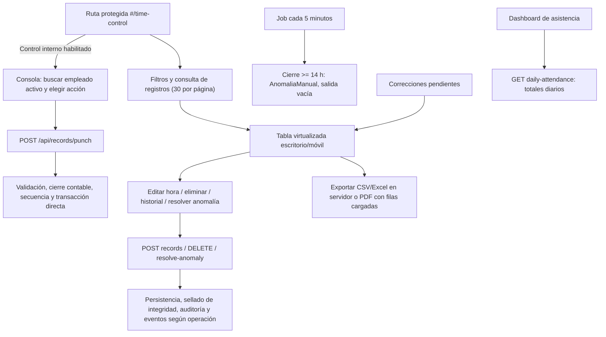

# Flujo: Control horario y asistencia (`control-horario-y-asistencia`)

- **Estado:** `AS_IS_DOCUMENTADO` — inspección estática Fase 1; falta replicación en vivo.
- **Última actualización:** 2026-11-17
- **Módulos / actores:** `time-control`, `records`, `corrections`, planificación y cierre contable. Operadores: `Administrador`, `Supervisor_Elevado`, `Supervisor`, `Reloj_Control` y `Fiscalizador`; el trabajador y el kiosco tienen flujos propios ([portal](portal-trabajador-y-correcciones.md), [kiosco](marcaje-kiosco.md)).
- **Entradas:** UI `/#/time-control`; `GET /api/records`, `GET /api/records/daily-attendance`, `POST /api/records`, `POST /api/records/bulk`, `DELETE /api/records/:id`, `POST /api/records/punch`, `POST /api/records/auto-close`, `POST /api/records/:id/resolve-anomaly`, `GET /api/records/integrity/verify`, `GET /api/records/export`; consultas y resolución de correcciones; tarea `processAutoClosures`.
- **Alcance de evidencia:** código del checkout actual, incluidos cambios locales existentes. No se ejecutaron pruebas ni se observaron respuestas HTTP, navegador o datos reales durante esta fase. Las anomalías son hipótesis comprobables, no bugs confirmados.

## 1. Diagrama AS-IS

## 2. Comportamiento observado en código

### 2.1 Acceso, filtros y consulta

- `frontend/src/App.tsx` protege la ruta para los cinco roles indicados; `Usuario` no figura entre ellos. `TimeControl.view.tsx` muestra reloj de servidor, búsqueda, tabla y, solo si `isControlInternoEnabled`, consola de marcaje. `useTimeControl.ts` deshabilita acciones de interfaz para `Supervisor` y `Fiscalizador`.
- `useTimeRecordFilters.ts` inicia en «Últimas 24 horas» usando ayer y hoy como fechas de negocio de Chile; semana, mes y «todo» cubren respectivamente hoy menos 6, 30 y 60 días. El rango personalizado requiere inicio y fin válidos y aplicar; admite parámetros `startDate`, `endDate`, `show=anomalies` y luego los retira de la URL. `useTimeControl.ts` aplica nombre con debounce de 500 ms, área, tipo de jornada, estado y anomalías; solicita páginas de 30. Seleccionar cualquiera de los dos estados de anomalía activa el modo de anomalías compartido.
- `TimeRecordService.listRecords` (`backend/src/services/TimeRecordService.ts`) excluye eliminados salvo consulta incremental `since`, filtra por fechas y campos y ordena por fecha y creación descendentes para la lista ordinaria. `Usuario` y `Kiosk_Employee` quedan restringidos al empleado asociado; el resto puede filtrar por empleado. Enriquece en lotes con contexto de planificación. En modo anomalías combina filas con anomalías virtuales de turnos sin marcaje y pagina el conjunto. `useTimeRecordsQuery.ts` conserva filas en IndexedDB y puede presentar caché como placeholder o ante fallo de consulta; la tabla usa listas virtualizadas (`TimeRecordTableViewDesktop.tsx`, `TimeRecordTableViewMobile.tsx`).
- Los filtros de áreas y jornadas de `TimeRecordFilters.tsx` se derivan de empleados activos y de una consulta independiente de registros con `pageSize: 50`, sin fechas. Las consultas y la tabla se actualizan mediante invalidación de eventos `timeRecord:created`, `updated`, `deleted` y `batch_created` en `frontend/src/hooks/useSocketEvents.ts`.

### 2.2 Marcaje y acciones sobre jornadas

- `useClockingPanel.ts` busca por nombre normalizado entre opciones activas de `GET /api/employees/clocking-options`, consulta las últimas cinco filas del empleado seleccionado y deriva su estado. Envía entrada, inicio/fin de colación o salida con `source: OPERATOR`; `timeRecordService.ts` normaliza los nombres de acción a camelCase. Un ref impide envíos simultáneos. `ClockingPanel.tsx` muestra «Cargando...» durante consulta, mientras las condiciones de habilitación se basan en selección, estado y rol.
- Fastify autentica `POST /api/records/punch` y rechaza `Fiscalizador`; `createRecordFlows` resuelve identidad propia para `Usuario`/kiosco y requiere empleado para otros roles. `PunchService.ts` aplica reglas de secuencia, empleado activo, licencia, cierre, espera entre marcajes y transacción directa serializada por empleado; las acciones y excepciones se detallan en [marcaje-kiosco](marcaje-kiosco.md). El servidor permanece como autoridad de las reglas aunque la interfaz calcule el estado.
- Doble clic abre acciones rápidas; la edición usa `useTimestampEditor.ts`, interpreta la hora en `America/Santiago`, mantiene fecha base y si la salida es anterior o igual a la entrada la desplaza al día siguiente. Envía el registro completo mediante mutación a `POST /api/records`. `TimeRecordService.saveRecord` valida, usa transacción directa y bloqueo por empleado, reutiliza una fila activa de empleado/día si no hay ID, hace upsert y sella integridad; registra auditoría. El borrado pide confirmación, hace borrado lógico, sella y audita (`TimeRecordService.deleteRecord`).
- `POST /api/records`, lote, borrado, resolución, verificación y cierre manual exigen `Administrador`, `Supervisor_Elevado`, `Supervisor` o `Reloj_Control` en `backend/src/modules/records/http/routes.ts`. El cierre manual llama a `TimeRecordService.processAutoClosures`, distinto de la implementación del job. Los esquemas de rutas están en `backend/src/models/schemas/time-correction.schemas.ts`. El flujo valida el lote completo frente a períodos cerrados y fechas futuras antes de escribir (`backend/src/modules/records/application/flows.ts`).
- El servidor bloquea hasta la fecha contable manual inclusive y fechas anteriores al primer día del mes anterior; falla cerrado si no puede consultar la configuración (`TimeRecordService.isRecordLocked`). La interfaz calcula una fecha efectiva y la pasa a las filas; `useTimeControlModals.ts` también consulta la fecha manual para borrado y novedad.
- El modal de anomalías ofrece `ABSENCE_MARK`, `SHIFT_HOURS_ACK`, `PERMIT_MARK`, `DAY_OFF_MARK`, `VACATION_MARK`; `resolveAnomaly` identifica IDs virtuales `MISSING-...` y rechaza materializarlos si son futuros (`TimeRecordService.ts`). El historial de fila consulta auditoría (`RecordHistoryModal.tsx`); la tabla también construye indicadores con auditoría y solicitudes de corrección (`useTimeRecordTableController.ts`). Las rutas de correcciones autorizan resolver a administrador y ambos supervisores, no a `Reloj_Control` (`backend/src/modules/corrections/http/routes.ts`); detalle y cambios locales están en el documento del portal.

### 2.3 Exportación, agregación y automatismos

- La tabla ofrece CSV y Excel mediante `GET /api/records/export` con autenticación y rango; el flujo de servidor exige fechas, audita `DATA_EXPORT` y restringe `Usuario`/kiosco a su empleado. El PDF se construye en cliente con las filas actualmente cargadas (`useTimeControl.ts`, `useTimeRecordTableController.ts`, `backend/src/modules/records/application/flows.ts`).
- `GET /api/records/daily-attendance` sirve al dashboard analítico, no a la tabla principal (`useAttendanceAnalytics.ts`). `TimeRecordService.dailyAttendance` agrupa por día y empleado distinto: total de empleados con fila, presentes con entrada y estado no ausente, y atrasos mayores a 15 minutos frente al inicio almacenado; rellena días sin filas con cero. Por defecto cubre hoy y 29 días anteriores. Aplica alcance propio a `Usuario`/kiosco.
- `runtimeJobs.ts` programa `autoCloseService.processAutoClosures` cada cinco minutos bajo lock de tarea y lo omite durante seeding fase 2. Para filas abiertas no terminales con entrada de al menos 14 horas, `autoCloseService.ts` deja salida vacía, marca `AnomaliaManual`, guarda justificación, sella con transacción directa y bloqueo por empleado, crea auditoría e intenta notificar por correo. El endpoint manual usa otra implementación (`TimeRecordService.processAutoClosures`) con el mismo umbral; no se infiere equivalencia total de efectos.

## 3. Anomalías y riesgos para replicación

1. **[ANOMALÍA-01] Exportación y filtros.** La UI envía nombre, área y tipo de jornada para CSV/Excel, pero `prepareExport` extrae rango, empleado, área y cargo; no propaga nombre ni tipo de jornada ni estado/anomalías. PDF usa filas cargadas, mientras CSV/Excel consulta servidor. Comparar archivos y totales con filtros y más de 30 filas; revisar el comportamiento de descarga y límites. Fuentes: `useTimeControl.ts`, `useTimeRecordTableController.ts`, `backend/src/modules/records/application/flows.ts`, `backend/src/services/export/ExportService.ts`.
2. **[ANOMALÍA-02] Opciones de filtros incompletas.** Las opciones de área y jornada dependen de la primera página de una consulta independiente de 50 sin rango, sin llamada visible a `fetchNextPage` en `TimeRecordFilters.tsx`. Comprobar con más de 50 filas y empleados cuya área aparezca fuera de esa página y con rangos diferentes.
3. **[ANOMALÍA-03] Estado de consola durante carga o fallo.** El estado inicial es `fuera`; la vista muestra carga, pero no incluye `isLoadingRecords` en las condiciones de los botones. La consulta puede usar caché. Comprobar selección con jornada abierta, respuesta lenta y fallida, sin asumir que el servidor acepte una secuencia incorrecta (`useClockingPanel.ts`, `ClockingPanel.tsx`, `useTimeRecordsQuery.ts`).
4. **[ANOMALÍA-04] Límite del cierre automático en UI.** La tabla compara fecha `<= effectiveLockDate`, mientras `isRecordLocked` usa `<` para el primer día del mes anterior salvo bloqueo manual inclusivo. Contrastar ese día y la respuesta del servidor para edición/borrado, con y sin fecha manual (`useTimeControlData.ts`, `useTimeRecordRowController.ts`, `TimeRecordService.ts`).
5. **[ANOMALÍA-05] Novedad de fila.** `handleAddCommentClick` puede activar `isAddNoveltyModalOpen` tras consultar turno abierto; en `TimeControl.view.tsx` no se observa montaje de ese modal ni uso de `handleSaveNovelty`, cuya implementación registra simulación. Replicar la acción y verificar UI y persistencia (`useTimeControlModals.ts`, `TimeControl.view.tsx`).
6. **[ANOMALÍA-06] Indicadores con páginas parciales.** `useTimeRecordTableController.ts` construye mapa de ediciones desde la primera página de 20 logs y mapa de pendientes desde solicitudes cargadas; buscar un registro cuya edición o pendiente no esté en esa página y comparar indicador con historial y API. La acción de auditoría filtrada es `Time Record Edited`, mientras `saveRecord` registra `TIME_RECORD_EDITED`; comprobar formatos reales y rutas de auditoría antes de concluir.
7. **[ANOMALÍA-07] Dos rutas de cierre.** El job y el endpoint usan implementaciones distintas, y la primera incluye auditoría y notificación en el código inspeccionado. Comparar resultados, concurrencia y efectos posteriores en staging, sin ejecutar sobre datos productivos (`autoCloseService.ts`, `TimeRecordService.ts`, `recordFlows.ts`).

8. **[ANOMALÍA-08] Verificación parcial de integridad.** `verifyChain` filtra fechas y comienza con mapa de hash anterior vacío, aunque la cadena se ordena por creación e ID. Comparar un rango intermedio con la cadena completa y registros insertados fuera de orden, para distinguir un límite de alcance de una rotura real (`backend/src/services/timeRecordIntegrityService.ts`).
9. **[ANOMALÍA-09] Atomicidad del lote.** Antes de escribir se comprueban todas las fechas, pero `createBulkRecords` persiste fragmentos de 50 en transacciones independientes. Inducir un fallo en un fragmento posterior y observar filas, respuesta y auditoría; definir el resultado esperado (`TimeRecordService.ts`, `records/application/flows.ts`).
10. **[ANOMALÍA-10] Cierre y concurrencia.** Ambas implementaciones seleccionan filas abiertas antes de adquirir el bloqueo por empleado y después actualizan por ID. Probar de forma controlada un marcaje de salida concurrente con el cierre, verificando estado, salida e integridad (`autoCloseService.ts`, `TimeRecordService.ts`).

## 4. Dudas para revisión humana

1. **[DUDA-01] PENDIENTE:** ¿CSV, Excel y PDF deben representar exactamente el mismo rango y filtros, incluyendo todas las páginas, y cómo debe indicarse cualquier límite?
2. **[DUDA-02] PENDIENTE:** ¿Qué acciones debe poder realizar `Supervisor` en esta pantalla? La UI deshabilita acciones mientras el guard de escritura de registros admite ese rol.
3. **[DUDA-03] PENDIENTE:** ¿Cuál es el comportamiento esperado de la novedad asociada a una fila y dónde debe guardarse?
4. **[DUDA-04] PENDIENTE:** ¿El primer día del mes anterior debe quedar editable según la regla automática, y cómo debe comunicarse el cierre manual?
5. **[DUDA-05] PENDIENTE:** ¿Deben mostrar los indicadores todas las correcciones pendientes y ediciones históricas por fila, independientemente de la paginación?

## 5. Inventario de pruebas y plan para Fase 2

| Área                             | Evidencia de pruebas existentes (inventario, sin ejecutar)                                                                                                                                                                                                                                                                           | Replicación propuesta                                                                               |
| -------------------------------- | ------------------------------------------------------------------------------------------------------------------------------------------------------------------------------------------------------------------------------------------------------------------------------------------------------------------------------------ | --------------------------------------------------------------------------------------------------- |
| Fastify, permisos y persistencia | `backend/tests/fastify-integration/records.test.ts` cubre creación, alcance, concurrencia, lote de 51 filas, exportación, resolución y borrado; `backend/tests/unit/recordFlows.test.ts`; `backend/tests/integration/attendance.test.ts`; `backend/tests/integration/punch-race.test.ts`                                             | Probar matriz de roles y fechas límite, concurrencia y persistencia con datos aislados.             |
| Agregación e integridad          | `backend/tests/unit/timeRecordDailyAttendance.test.ts`, `backend/tests/timeRecordIntegrityService.test.ts`, `backend/tests/integration/integrity.automated.test.ts`, `backend/tests/integration/time-record-anomaly-filter-flow.test.ts`                                                                                             | Contrastar cálculo diario, anomalías físicas/virtuales, paginación y cadena tras cada mutación.     |
| UI y acciones                    | `frontend/src/tests/features/time-control/useTimeControl.test.ts`, `useTimeControlModals.test.ts`, `useTimeRecordFilters.test.tsx`, `useTimeRecordTableController.test.ts`, `frontend/src/tests/components/time_control/ClockingPanel.spec.tsx`, `TimeRecordTable.spec.tsx`; `frontend/src/tests/hooks/useTimeRecordsQuery.test.tsx` | Reproducir ANOMALÍA-02 a 06 en escritorio y móvil, incluyendo carga/error y caché.                  |
| Exportación y recorrido          | `frontend/e2e/auth-security.spec.ts` prueba bearer en exportación; `frontend/e2e/user-flows.spec.ts` contiene ciclo de asistencia; `frontend/e2e/gap-coverage.spec.ts`                                                                                                                                                               | Comparar contenido CSV/Excel/PDF con filtros y varias páginas, y comprobar errores de descarga.     |
| Correcciones y automatismos      | `backend/tests/fastify-integration/leavesCorrections.test.ts`, `backend/tests/integration/correction-approve-race.test.ts`, `backend/tests/unit/correctionServiceSeal.anti-regression.test.ts`; `backend/src/services/runtimeJobs.ts`                                                                                                | Validar indicadores y eventos; comparar endpoint y job con reloj controlado y limpieza de datos QA. |

## 6. Historial de sincronización

- `2026-11-17`: extracción estática Fase 1; diez anomalías y cinco dudas pendientes. Sin replicación ni pruebas ejecutadas en esta inspección.
