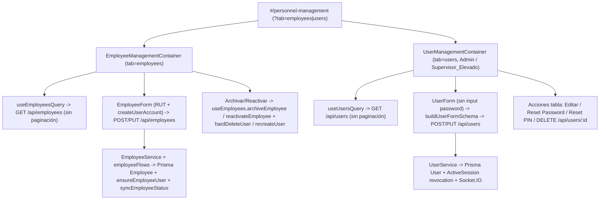

# Flujo: Gestión de personal y usuarios (`gestion-personal-y-usuarios`)

- **Estado:** `SINCRONIZADO_Y_VERIFICADO` — Spec 116 implementada y verificada localmente y en staging (ver sección 7).
- **Última actualización:** 2026-11-18
- **Módulos / actores:** `personnel-management`, `employee-management`, `user-management`, `employees`, `users`, `EmployeeService`, `UserService`, `useEmployeeManagementData`, `useUserManagementData`, `useEmployees`, `useUsers`. En UI, `#/personnel-management` y `#/employee-management` admiten `Administrador`, `Supervisor_Elevado`, `Supervisor` y `Reloj_Control`; `#/user-management` admite `Administrador` y `Supervisor_Elevado` (`App.tsx`). En API, `/api/employees*` varía según endpoint (`kiosk` público, `GET /api/employees` y `clocking-options` autenticados sin `Kiosk_Employee`, escrituras para `Administrador`/`Supervisor_Elevado`/`Supervisor`/`Reloj_Control`, `PUT /api/employees/:id` también para `Kiosk_Employee` sobre sí mismo); `/api/users*` admite `Administrador` y `Supervisor_Elevado` en `GET`, solo `Administrador` en `POST`/`DELETE`, y `Administrador` o propio usuario (solo `password`) en `PUT /api/users/:id`.
- **Entradas:** UI `#/personnel-management` (redirecciones `#/employee-management` -> `?tab=employees` y `#/user-management` -> `?tab=users`); API `GET /api/employees/kiosk`, `GET /api/employees/clocking-options`, `GET/POST /api/employees`, `PUT /api/employees/:id`, `POST /api/employees/bulk`, `GET /api/employees/export`, `GET/POST /api/users`, `PUT/DELETE /api/users/:id`.
- **Alcance de evidencia:** Fase 1 (inspección estática) + Fase 2 (pruebas unitarias e integración Fastify/PostgreSQL 18.4, replicación HTTP en Fastify + PostgreSQL efímero y Playwright headless en staging `http://127.0.0.1:8080`).

## 1. Diagrama AS-IS

## 2. Comportamiento observado en código

### 2.1 Navegación y permisos (`#/personnel-management`)

- `App.tsx` redirige `#/user-management` hacia `#/personnel-management?tab=users` (solo `Administrador` y `Supervisor_Elevado`) y `#/employee-management` hacia `#/personnel-management?tab=employees` (`Administrador`, `Supervisor_Elevado`, `Supervisor`, `Reloj_Control`).
- `PersonnelManagement.container.tsx` habilita `canManageUsers` para `Administrador` y `Supervisor_Elevado`. Si otro rol entra con `?tab=users`, reemplaza la URL a `?tab=employees`.
- `PersonnelManagement.view.tsx` renderiza `TabNav` condicional con las pestañas `"Empleados"` y `"Accesos"` y monta `EmployeeManagementContainer` o `UserManagementContainer` con `isEmbedded={true}`.

### 2.2 Gestión de empleados (`#/personnel-management?tab=employees` y `/api/employees*`)

- **Frontend (`employee-management`):**
  - `useEmployeesQuery` invoca `employeeService.getAll()` (`GET /api/employees` sin `page`/`pageSize`) y filtra `!employee.isDeleted`.
  - `useEmployeeManagementData` filtra en memoria por estado (`Activos` / `Archivados`) y búsqueda (`name`, `rut`, `position`, `area`), con scroll infinito en cliente (`pageSize = 20` móvil, `50` desktop). `requestSort` muestra toast indicando que no está disponible en modo infinito.
  - `EmployeeForm` valida RUT chileno (`isValidChileanRut`), `position`, `area` y `workdayType` obligatorios, e incluye el switch `"Generar Cuenta de Acceso Asociada"` (`createUserAccount`).
  - `EmployeeManagement.view.tsx` muestra `"Nuevo Registro"`, menú `"Utilitarios"` (importación Excel, exportación CSV/Excel/PDF), modales de formulario, historial de turnos y confirmación de archivado (que consulta previamente `checkOpenRecord`).
  - `useEmployees.archiveEmployee` actualiza el estado del empleado a `"Archivado"` y adicionalmente invoca `hardDeleteUser` (`DELETE /api/users/:id`) y cierra asignaciones de turno futuras desde el cliente; `reactivateEmployee` vuelve a `"Activo"` e invoca `recreateUser` (`POST /api/users`).
- **Backend (`backend/src/modules/employees/` y `EmployeeService.ts`):**
  - Todas las rutas de `/api/employees*` están registradas en `protectedApp` y validadas por `routeContracts.ts`.
  - `GET /api/employees/kiosk` es pública y expone `{ id, name, rutHash, isPinBlocked, status, area, workdayType }` solo de empleados activos.
  - `GET /api/employees/clocking-options` requiere autenticación (sin `Kiosk_Employee`), filtra por `area` si el usuario es `Supervisor` y devuelve `[]` si es `Usuario` sin `employeeId`.
  - `GET /api/employees` requiere autenticación (sin `Kiosk_Employee`); si el usuario es `Usuario` y tiene `employeeId`, restringe `where.id = authUser.employeeId`. Soporta `since`, `search`, `status`, `area`, `page`, `pageSize` (sin cota máxima).
  - `POST /api/employees` (`Administrador`, `Supervisor_Elevado`, `Supervisor`, `Reloj_Control`) genera ID secuencial `EMP-N` si no viene `id`, hashea PIN inicial (o `rut.slice(0, 4)` si es numérico de 4 dígitos) con `bcryptjs`, crea empleado en `withDirectTransaction` y opcionalmente llama `ensureEmployeeUser` (`POST` alias único + password `"123456"` + `isForcePasswordChange: true`).
  - `PUT /api/employees/:id` permite `Supervisor_Elevado`/`Administrador`/`Supervisor`/`Reloj_Control`, o `Kiosk_Employee` sobre su propio `id` enviando únicamente `{ pin }`. Prohíbe que un nuevo PIN coincida con `existing.rut.slice(0, 4)`.
  - `EmployeeService.syncEmployeeStatus` al archivar cierra turnos activos (`endDate = yesterday`), soft-delete de turnos futuros, hard-delete de permisos futuros, recorta permisos activos a `today`, cambia el `User` asociado a `role: "Archivado"`, elimina sus `ActiveSession` y emite `force-logout`; al reactivar resetea el PIN a `rut.slice(0, 4)` y restaura al `User` a `role: "Usuario"` con contraseña `"123456"` y `isForcePasswordChange: true`.
  - `POST /api/employees/bulk` (`bodyLimit: 10 MiB`) crea empleados en lote; `GET /api/employees/export` exporta `.xlsx` en streaming.

### 2.3 Gestión de usuarios (`#/personnel-management?tab=users` y `/api/users*`)

- **Frontend (`user-management`):**
  - `useUsersQuery` está habilitada solo para `Administrador` y `Supervisor_Elevado`; invoca `userService.getAll()` (`GET /api/users` sin paginación), deduplica por `username` y filtra `!user.isDeleted`.
  - `useUserManagementData` filtra en memoria por `username` o nombre del empleado vinculado, con scroll infinito en cliente (`30` móvil, `60` desktop). `canManageUser` exige `currentUser.role === "Administrador"`.
  - `UserManagement.view.tsx` renderiza el botón `"Nuevo Usuario"` únicamente cuando `!isEmbedded`. En la tabla desktop ofrece Editar, Resetear contraseña (`"123456"` + `mustChangePassword: true`), Resetear PIN Kiosco y Eliminar (`DELETE /api/users/:id`).
  - `UserForm.view.tsx` muestra tarjeta estática `"Contraseña Temporal: 123456 * Cambio Obligatorio"` en alta (sin input de contraseña), mientras `buildUserFormSchema` exige `values.password.length >= 6` en alta. En edición deshabilita `username` y permite seleccionar `employeeId`.
- **Backend (`backend/src/modules/users/` y `UserService.ts`):**
  - `GET /api/users` permite `Administrador` y `Supervisor_Elevado`; soporta `since`, `search`, `role`, `page`, `pageSize`.
  - `POST /api/users` (`Administrador`) normaliza `username` a minúsculas, hashea `password`, asigna `isForcePasswordChange: true` y registra auditoría `USER_CREATE`.
  - `PUT /api/users/:id` permite `Administrador` o el propio usuario (`isSelf`, restringido estrictamente a `{ password }`). En `withDirectTransaction` con `FOR UPDATE`, revoca sesiones (`EXCEPT_CURRENT` si cambia su propia contraseña voluntariamente, `ALL` si cambia rol, archiva, fuerza cambio o cambia password de otro) y emite `force-logout`.
  - `DELETE /api/users/:id` (`Administrador`) ejecuta hard delete de `User` y registra `USER_DELETE`.

## 3. Anomalías y riesgos para replicación

1. **[ANOMALÍA-01] Botón `"Nuevo Usuario"` ausente en modo embebido y `UserForm` bloqueado por Zod:** `UserManagement.view.tsx` oculta el botón `"Nuevo Usuario"` cuando `isEmbedded === true` (como ocurre siempre desde `#/personnel-management`). Además, `buildUserFormSchema` exige `password.length >= 6` al crear, pero `toFormValues(null)` inicializa `password: ""` y `UserForm.view.tsx` no renderiza input de contraseña.
2. **[ANOMALÍA-02] Archivado/reactivación de empleados desalineado entre frontend y backend:** `useEmployees.archiveEmployee` llama `DELETE /api/users/:id` (hard delete del usuario) tras poner al empleado en `"Archivado"`, chocando con `EmployeeService.syncEmployeeStatus` que preserva al usuario con `role: "Archivado"` y espera restaurarlo al reactivar. Luego `reactivateEmployee` intenta recrear un `POST /api/users` con un nuevo `username`.
3. **[ANOMALÍA-03] Imposibilidad de desvincular `employeeId` en `PUT /api/users/:id` y fallos silenciosos en `useUserManagementData`:** `UserForm` envía `employeeId: undefined` (omitido en JSON) y `UpdateUserSchema` no acepta `null`; `useUsers.addUser`/`updateUser` devuelven `null`/`false` sin toast ni validación antes de cerrar el modal o mostrar éxito en reset de contraseña.
4. **[ANOMALÍA-04] Desalineación de contratos en `EmployeeSchema`, `UserQuerySchema` y respuestas de `/api/employees`:** `EmployeeSchema` omite `area` y `workdayType` (obligatorios en Prisma/`EmployeeService`), `UserQuerySchema` usa `numericString` en `page`/`pageSize` (permite `0`/`-1`/`abc` con riesgo `500`), `POST /api/employees` omite `syncStatus`/`lastModified`/`isDeleted`, `UpdateUserSchema` excluye rol `"Archivado"` y `UserManagement` muestra la pestaña `"Accesos"` a `Supervisor_Elevado` pero lo deja en solo lectura.
5. **[ANOMALÍA-05] Seguridad, concurrencia y reglas de dominio en backend:**
   - `GET /api/employees` no restringe lista cuando un usuario con rol `Usuario` tiene `employeeId: null` (fuga de nómina) ni filtra por área para `Supervisor` (a diferencia de `clocking-options`).
   - `EmployeeService` guarda el PIN inicial sin hashear cuando el RUT contiene puntos (`"12.345.678-9".slice(0, 4)` = `"12.3"`), y `resolveEmployeeId` ordena lexicográficamente sin lock (riesgo de colisión `EMP-N` en concurrencia).
   - `EmployeeFlows.update` ejecuta `ensureUser` y `syncEmployeeStatus` fuera de la transacción de `repository.update`; `createBulkEmployees` no es transaccional ni ejecuta `syncEmployeeStatus`.
   - `DELETE /api/users/:id` permite que un `Administrador` se elimine a sí mismo.
   - `EmployeeManagement.view.tsx` pasa `hasLinkedUser={false}` fijo y `existingEmployees={processedEmployees}` (incompleto frente a archivados/paginados).

## 4. Evidencia de replicación (Fase 2)

- **Suites existentes ejecutadas:**
  - Backend unit (`6/6` archivos, `30/30` tests): `user-service.test.ts`, `public-users.test.ts`, `userFlows.test.ts`, `employeeFlows.test.ts`, `employeeServicePin.anti-regression.test.ts`, `employeeServiceList.test.ts`.
  - Backend integración Fastify + PostgreSQL 18.4 (`2/2` archivos, `29/29` tests): `tests/fastify-integration/employees.test.ts` (`16/16`), `tests/fastify-integration/users.test.ts` (`13/13`).
  - Frontend (`9/9` archivos, `44/44` tests): `personnel-management`, `employee-management`, `user-management`, `employeeAndUserForms.test.tsx`, `useEmployeesQueryGating.test.tsx`, `useUsersQuery.test.tsx`.
- **Replicación HTTP / PostgreSQL 18.4 (`createFastifyRuntime`):**
  - `EmployeeSchema.parse(...)` stripea `area` y `workdayType`; `POST /api/employees` sin `position` o sin `area` devuelve `500 INTERNAL_ERROR` (`PrismaClientValidationError`).
  - `GET /api/employees` como `Usuario` con `employeeId: null` devuelve `200` con toda la nómina (`3/3`), y como `Supervisor` devuelve `200` sin filtrar por área (`3/3`).
  - `GET /api/users?page=0&pageSize=1` y `GET /api/users?page=abc&pageSize=1` devuelven `500 INTERNAL_ERROR`.
  - `POST /api/employees` con RUT `"12.345.678-9"` sin `pin` responde `201` y almacena `"12.3"` en texto plano en `employees.pin` (`isBcryptHash: false`).
  - Dos `POST /api/employees` concurrentes sin `id` (`Promise.all`) colisionan en `resolveEmployeeId`: uno responde `201` (`EMP-1001`) y el otro `409 CONFLICT`.
  - `PUT /api/users/:id` con `{ employeeId: null }` devuelve `400 VALIDATION_ERROR`; con `{ employeeId: "" }` desvincula a `null`. Con `{ role: "Archivado" }` devuelve `400 VALIDATION_ERROR`.
  - `DELETE /api/users/:id` con el propio ID del `Administrador` autenticado responde `204` y elimina su propia cuenta en BD.
  - `POST /api/employees` (`201`) omite `syncStatus`, `lastModified` e `isDeleted` de la respuesta.
  - `GET /api/employees/export` responde `200` (`6890` bytes `.xlsx`) con auth y `401` sin auth; `GET /api/employees/kiosk` responde `200` sin auth exponiendo `rutHash`.
- **Replicación UI headless en staging (`http://127.0.0.1:8080`):**
  - Redirecciones `#/user-management` y `#/employee-management` funcionan hacia `#/personnel-management?tab=users` y `?tab=employees`.
  - En `?tab=users` como `Administrador`, `hasNuevoUsuario: false` (no existe botón `"Nuevo Usuario"` en modo embebido).
  - `Supervisor_Elevado` con contraseña activa entra a `?tab=users`, ve `4/4` filas en `"Solo Lectura"` y sin botón de creación.
  - Al editar `EMP-1001` (con usuario vinculado), aparece el switch `"Generar Cuenta de Acceso Asociada"`.
  - Crear empleado con RUT duplicado de empleado archivado (`28604551-0`) no valida en cliente y falla en servidor con `409 CONFLICT`.
  - Archivar `EMP-1001` dispara `PUT /api/employees/EMP-1001` (`200`) + `DELETE /api/users/...` (`204`); reactivar `EMP-1002` dispara `PUT /api/employees/EMP-1002` (`200`) + `POST /api/users` (`201`).
  - Al editar usuario y elegir `"-- SIN ASIGNAR --"`, `PUT /api/users/:id` omite `employeeId` del body y la vinculación previa persiste tras recargar.
  - Con fallo `500` simulado en `**/api/users/**`, resetear contraseña cierra el modal y muestra toast falso positivo `ÉXITO`, y guardar usuario cierra el modal sin toast de error.

## 5. Bugs confirmados (resueltos en Spec 116)

- **[BUG-01]** Pestaña `"Accesos"` sin botón `"Nuevo Usuario"` en modo embebido (`UserManagement.view.tsx`) y `UserForm` bloqueado por validación Zod (`password` vacío vs mínimo 6 caracteres sin input en pantalla).
- **[BUG-02]** `EmployeeManagement.view.tsx` fija `hasLinkedUser={false}` en edición y valida RUT duplicado solo contra `processedEmployees` en lugar de todos los empleados (`active + archived`).
- **[BUG-03]** Imposibilidad de desvincular `employeeId` en `PUT /api/users/:id` (`undefined` omitido en JSON y `UpdateUserSchema` no acepta `null`) + fallos silenciosos / falsos positivos en `useUsers` y `useUserManagementData` al fallar mutaciones.
- **[BUG-04]** `EmployeeSchema` omite `area` y `workdayType` (causando `500` en `POST /api/employees` cuando faltan), `POST /api/employees` omite campos de sincronización (`syncStatus`, `lastModified`, `isDeleted`) y `UpdateUserSchema` excluye `"Archivado"`.
- **[BUG-05]** `UserQuerySchema` acepta `page=0` / `page=abc` causando `500 INTERNAL_ERROR`, y no existe cota máxima de `pageSize` en `/api/employees` ni `/api/users`.
- **[BUG-06]** `EmployeeService` guarda PIN inicial en texto plano si el RUT tiene puntos, `resolveEmployeeId` colisiona en `POST /api/employees` concurrentes, `EmployeeFlows.update` ejecuta `ensureUser`/`syncEmployeeStatus` fuera de transacción y `createBulkEmployees` no es transaccional.
- **[BUG-07]** `DELETE /api/users/:id` permite que un `Administrador` se elimine a sí mismo.

## 6. Dudas de negocio resueltas

- **[DUDA-01] (`1.A`):** El ciclo de vida del `User` al archivar/reactivar un empleado se delega al backend (`PUT /api/employees/:id`), conservando el usuario con `role: "Archivado"` y restaurándolo a `"Usuario"` al reactivar, sin `DELETE`/`POST` redundantes desde el frontend.
- **[DUDA-02] (`2.B`):** `Supervisor_Elevado` queda habilitado en UI y `/api/users*` para crear, editar y eliminar usuarios no-`Administrador`, con bloqueo estricto en backend y UI sobre cuentas o asignación de rol `"Administrador"`.
- **[DUDA-03] (`3.A`):** `GET /api/employees` queda alineado con `clocking-options` (`[]` para `Usuario` sin `employeeId` y filtrado por `area` para `Supervisor`).

## 7. Verificación de correcciones (Spec 116)

- **Backend:** `npm run check`, `npm run lint`, `npm run check:sdk` (`✅ SDK is fully synchronized.`), `npm run test:schemas-refactor` (`3/3`, `12/12`), unitarios (`tests/unit/employeeFlows.test.ts`, `employeeServicePin.anti-regression.test.ts`, `employeeServiceList.test.ts`, `userFlows.test.ts`) e integración PostgreSQL 18.4 (`run-fastify-isolated.cjs tests/fastify-integration/employees.test.ts tests/fastify-integration/users.test.ts`) en verde.
- **Frontend:** `npm run check`, `npm run lint`, `10/10` archivos y `52/52` tests (`personnel-management`, `employee-management`, `user-management`, `employeeAndUserForms.test.tsx`, `useEmployeesQueryGating.test.tsx`, `useUsersQuery.test.tsx`) en verde.
- **Staging vivo (`http://127.0.0.1:8080`, Playwright headless):**
  - `Administrador` en `?tab=users`: botón `"Nuevo Usuario"` visible, alta con `"123456"` -> `201`, desvinculación de `employeeId` envía `null` y persiste tras recargar, fallo `500` simulado mantiene modal abierto y muestra toast de error.
  - `Supervisor_Elevado` en `?tab=users`: botón `"Nuevo Usuario"` visible, acciones habilitadas en no-`Administrador`, fila `Administrador` protegida sin edición/borrado, y API devuelve `403` ante mutación o escalación de `"Administrador"`.
  - `"Empleados"`: `hasLinkedUser` oculta `"Generar Cuenta de Acceso Asociada"` cuando ya hay usuario vinculado, RUT duplicado de archivado bloqueado en cliente, archivar/reactivar dispara solo `PUT /api/employees/:id`.
  - API: `GET /api/users?page=0&pageSize=1` y `?page=abc&pageSize=1` -> `400`, auto-eliminación `DELETE /api/users/<self>` -> `400 VALIDATION_ERROR`.
