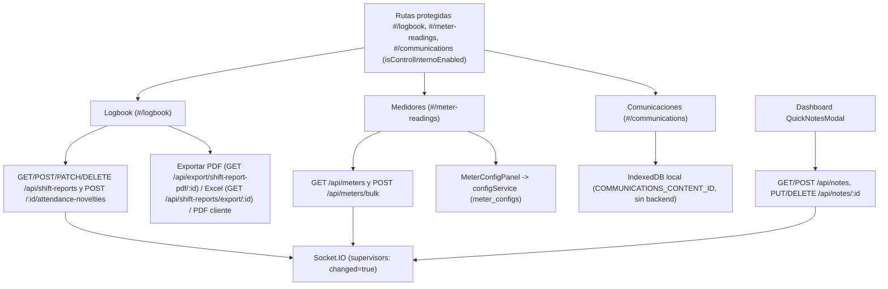

# Flujo: Libro de novedades, medidores y comunicaciones (`libro-novedades-medidores-y-comunicaciones`)

- **Estado:** `AS_IS_DOCUMENTADO` — Fase 1 completada sobre el checkout actual; pendiente de replicación en PostgreSQL 18.4 / staging (Fase 2).
- **Última actualización:** 2026-11-18
- **Módulos / actores:** `logbook`, `meters`, `communications`, `shiftReports`, `notes`, `importExport`, `realtime`. Operadores previstos en UI/API: `Administrador`, `Supervisor_Elevado`, `Supervisor`, `Reloj_Control` y `Fiscalizador` (con divergencias detalladas en sección 3).
- **Entradas:** UI `#/logbook`, `#/meter-readings`, `#/communications`, `QuickNotesModal` (en `#/dashboard`); API `/api/shift-reports*`, `GET /api/export/shift-report-pdf/:id`, `GET /api/shift-reports/export/:id`, `/api/meters*`, `/api/notes*`; Realtime Socket.IO (`shiftReport:*`, `meter:updated`, `quickNote:*`).
- **Alcance de evidencia:** código del checkout actual (`backend` y `frontend`). En Fase 1 no se ejecutaron pruebas ni se observaron respuestas HTTP o navegador; las anomalías registradas deben replicarse y confirmarse en Fase 2.

## 1. Diagrama AS-IS

## 2. Comportamiento observado en código

### 2.1 Acceso, navegación, roles y tiempo real

- **Frontend (`frontend/src/App.tsx`, `frontend/src/hooks/layout/sidebarMenu.ts`):**
  - Las rutas `/logbook`, `/meter-readings` y `/communications` solo se montan cuando `isControlInternoEnabled` (`useControlInternoEnabledQuery()`) es verdadero.
  - `#/logbook` y `#/meter-readings` exigen `ProtectedRoute` con `Administrador`, `Supervisor_Elevado` o `Reloj_Control` (excluyen `Supervisor` y `Fiscalizador`).
  - `#/communications` exige `Reloj_Control`, `Administrador`, `Supervisor_Elevado`, `Supervisor` o `Fiscalizador`. Sin embargo, `buildSidebarMenuByRole` muestra `"Comunicados"` a `Fiscalizador` sin verificar `isControlInternoEnabled`.
- **Backend (`backend/src/modules/*/http/routes.ts` y `realtime/application/eventPolicy.ts`):**
  - `/api/shift-reports*`, `/api/meters*`, `/api/notes*` y `GET /api/export/shift-report-pdf/:id` usan el guard `supervisor` (`Administrador`, `Supervisor_Elevado`, `Supervisor`, `Reloj_Control`), excepto `POST /api/shift-reports/:id/attendance-novelties`, que sobrescribe `onRequest` y excluye a `Supervisor`.
  - Los eventos Socket.IO (`shiftReport:created/updated/deleted`, `meter:updated`, `quickNote:created/updated/deleted`) se proyectan a `{ changed: true }` (o `{ changed: true, created: true }`) exclusivamente para la sala `supervisors`.

### 2.2 Libro de Novedades (`#/logbook` y `shiftReports`)

- `LogbookContainer` -> `useLogbookData` -> `LogbookView` gestionan el turno activo (`status: "open"`) mediante `useReportsQuery` (`GET /api/shift-reports?status=open`), `LogEntriesCard`, `SupplierEntriesCard`, `ClosedReportsModal` y `ShiftReportModal`.
- `ShiftReportService` (`backend/src/services/ShiftReportService.ts`) usa `withDirectTransaction` con lock `pg_advisory_xact_lock(17017, 1)` para garantizar un único turno `"open"` (`409 Conflict` si ya existe otro), proteger novedades vinculadas a asistencia (`recordId`) salvo inclusión en `removedLogEntryIds`, y generar `folio` correlativo numérico con `getNextFolio`.
- `addAttendanceNovelty` adquiere locks sobre `accounting_lock_date` (`17018`), `shiftReports` (`17017, 1`) y `punch:<employeeId>`, validando que el turno esté abierto y la jornada no esté cerrada contablemente.
- La exportación cuenta con dos caminos en PDF (`ClosedReportsModal` descarga `GET /api/export/shift-report-pdf/:id` generado con `pdfkit` en `ExportService.generateShiftReportIndividualPDF`, mientras `ShiftReportModal` genera PDF en cliente con `exportShiftReportToPDF`) y exportación Excel por streaming (`GET /api/shift-reports/export/:id` vía `StreamExportService.streamShiftReportToExcel`).

### 2.3 Lecturas de Medidores (`#/meter-readings` y `meters`)

- `MeterReadingsContainer` -> `useMeterReadingsData` -> `MeterReadingsView` y `MeterHistoryContainer` muestran tarjetas por medidor configurado (hasta `MAX_METERS = 12` almacenado en `configService` bajo `"meter_configs"`), formulario lateral (`MeterForm`), modal rápido (`SingleMeterInputModal`) e historial paginado infinito (`useMeterReadingsInfinite`, `pageSize = 50`).
- `MeterService.list` (`backend/src/services/MeterService.ts`) convierte `startDate`, `endDate` y `month` a límites UTC según `America/Santiago` (`parseBusinessDateCL` / `formatBusinessDateCL`), y `bulkCreate` inserta el lote y sus `AuditLog` (`METERREADING_CREATE`) dentro de `withDirectTransaction` forzando `authorUsername` del usuario autenticado.

### 2.4 Comunicaciones (`#/communications`) y Notas Rápidas (`/api/notes`)

- `#/communications` (`useCommunicationsData` / `CommunicationsView`) lee y guarda HTML sanitizado con `DOMPurify` exclusivamente en **IndexedDB local** (`COUNTER_IDS.COMMUNICATIONS_CONTENT_ID`), sin endpoints backend ni sincronización multiusuario; solo `Administrador` puede editar.
- `QuickNotesModal` (usado en `#/dashboard` vía `useQuickNotes` / `noteService`) sí consume `/api/notes` (`GET`, `POST`, `PUT /:id` para archivar y `DELETE /:id` para borrado físico), con auditoría `QUICKNOTE_*` dentro de `withDirectTransaction` en `NoteService`.

## 3. Discrepancias y riesgos detectados en código (a confirmar en Fase 2)

1. **Contrato roto en `POST /api/meters/bulk`:** `useMeterReadings.ts` envía `timestamp: Date.now()` (`number`) enmascarado con `readings as unknown as SDKMeterReading[]` en `meterService.ts`, pero `MeterReadingSchema` exige `timestamp: z.string().optional()` (probable `400 Bad Request`).
2. **Validación y contratos HTTP en `shiftReports`:**
   - `GET /api/shift-reports` usa `validateRequest("query", z.unknown())`; `parseInt` en `ShiftReportService.list` no valida `NaN`, negativos ni cota máxima de `pageSize`.
   - `operations.ts` declara `ShiftReportListResponse` (`{ success, data }`) sin query params, mientras el endpoint devuelve `{ data, total, page, totalPages }`; `POST /api/shift-reports` exige `folio` en body aunque `create` lo ignora y `update` lo sobrescribe.
3. **Exportación PDF/Excel de reportes eliminados y `404`/`Content-Disposition`:**
   - `ExportService.generateShiftReportIndividualPDF` y `StreamExportService.streamShiftReportToExcel` usan `findUnique({ where: { id } })` sin filtrar `isDeleted: false`.
   - Si no existe el reporte, el PDF lanza `Error` genérico (`500`) en vez de `NotFoundError` (`404`), e interpola `req.params.id` sin sanitizar en `Content-Disposition`.
4. **Soft-delete, auditoría y zona horaria en `ShiftReportService`:**
   - `delete()` marca `isDeleted: true` sin setear `deletedAt` y registra `auditService.log` fuera de `withDirectTransaction`.
   - `normalizeShiftReportEntries` usa `d.getHours()`/`d.getMinutes()` (hora local del servidor) como fallback si falta `time`.
5. **Permisos y aislamiento de Comunicaciones / Notas:**
   - `sidebarMenu.ts` muestra `"Comunicados"` a `Fiscalizador` sin verificar `isControlInternoEnabled` (lleva a 404 si está deshabilitado).
   - `Supervisor` puede acceder a `/api/shift-reports*` (excepto `attendance-novelties`) y `/api/meters*` en backend, pero está bloqueado en `#/logbook` y `#/meter-readings` en frontend.
   - `#/communications` es local a IndexedDB (no sincroniza entre usuarios) y solo editable por `Administrador` (excluye `Supervisor_Elevado`).
6. **Bugs de UI/UX en `Logbook`, `Meters` y `Communications`:**
   - `useLogbookData.ts`: deep-link `?id=` consulta `pageSize: 1` sin `.catch()`, fallando si el reporte no es el primero.
   - `LogEntriesCard` y `SupplierEntriesCard`: muestran toast `"success"` y cierran el modal aunque falle `handleUpdateShift` (error tragado en `useLogbookData.ts`); `executeCloseShift` no invalida `shiftReportsList` de `ClosedReportsModal`.
   - `Logbook.view.tsx`: mojibake en `ConfirmationModal` (`"¿Está seguro..."`, `"Sí, Cerrar Turno"`) y typo `"Cerrar Guardía"`.
   - `ClosedReportsModal.tsx`: dispara `useShiftReportsInfinite` aun cerrada, filtra `searchTerm`/`dateFilter` solo sobre páginas ya cargadas, muestra `startTime`/`endTime` ISO crudos y botones sin `aria-label`.
   - `MeterConfigPanel.tsx`: `updateMeterConfigs` sin `await` ni manejo de error y botones sin `aria-label`; `MeterHistory.view.tsx` oculta lecturas de medidores eliminados; `useMeterReadingsFormController` ignora envíos vacíos sin feedback.
   - `Communications.view.tsx`: botón `"Descartar"` no revierte `content` al valor guardado y falta `isSaving`.
   - Casts inseguros (`as unknown as never`, `as unknown as ...`) en `noteService.ts`, `useQuickNotes.ts`, `meterService.ts` y `shiftReportService.ts`.
