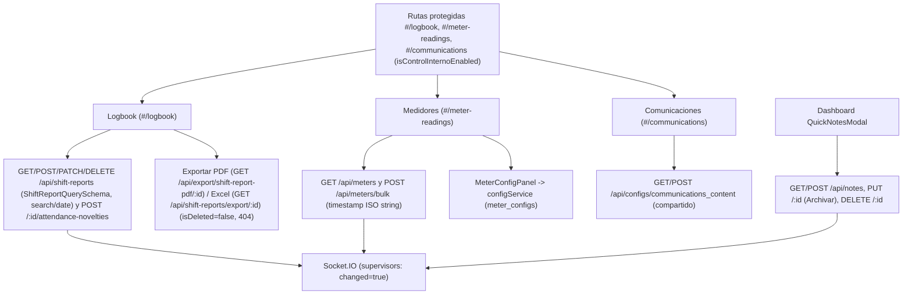

# Flujo: Libro de novedades, medidores y comunicaciones (`libro-novedades-medidores-y-comunicaciones`)

- **Estado:** `SINCRONIZADO_Y_VERIFICADO` — Spec 118 implementada, contratos OpenAPI/SDK sincronizados y verificada en staging (`http://127.0.0.1:8080`) con `0` bugs abiertos y `0` dudas.
- **Última actualización:** 2026-11-18
- **Módulos / actores:** `logbook`, `meters`, `communications`, `shiftReports`, `notes`, `importExport`, `configs`, `realtime`. Operadores previstos:
  - `#/logbook`, `#/meter-readings`, `/api/shift-reports*`, `/api/meters*`, `/api/export/shift-report-pdf/:id`: `Administrador`, `Supervisor_Elevado`, `Reloj_Control`.
  - `#/communications`: `Administrador`, `Supervisor_Elevado`, `Supervisor`, `Reloj_Control`, `Fiscalizador` (condicionado a `isControlInternoEnabled`; edición exclusiva de `Administrador` vía `/api/configs/communications_content`).
  - `QuickNotesModal` (`/api/notes*`): `Administrador`, `Supervisor_Elevado`, `Supervisor`, `Reloj_Control`.
- **Entradas:** UI `#/logbook`, `#/meter-readings`, `#/communications`, `QuickNotesModal` (en `#/dashboard`); API `/api/shift-reports*`, `GET /api/export/shift-report-pdf/:id`, `GET /api/shift-reports/export/:id`, `/api/meters*`, `/api/notes*`, `GET/POST /api/configs/communications_content`; Realtime Socket.IO (`shiftReport:*`, `meter:updated`, `quickNote:*`).
- **Alcance de evidencia:** Código del checkout actual (`backend` y `frontend`), pruebas unitarias e integración Fastify sobre PostgreSQL 18.4, verificación OpenAPI/SDK y auditoría E2E en staging (`http://127.0.0.1:8080`).

## 1. Diagrama AS-IS / TO-BE Implementado

## 2. Resumen de cambios implementados (Spec 118)

1. **Backend (`shiftReports`, `meters`, `importExport`, `configs`):**
   - `ShiftReportQuerySchema` en `report.schemas.ts` con validación estricta (`page >= 1`, `pageSize 1..100`, `since`, `status`, `search`, `date`), `folio` opcional en creación e inmutable en actualización, y `ShiftReportPaginatedResponseSchema` (`{ data, total, page, totalPages }`) sincronizado en `operations.ts`, `swagger.json` y `api-schema.ts`.
   - Roles alineados en `shiftReports/http/routes.ts` y `meters/http/routes.ts` (`Administrador`, `Supervisor_Elevado`, `Reloj_Control`; `Supervisor` recibe `403`).
   - `ShiftReportService`: filtros `search`/`date` server-side en `list()`, `deletedAt: new Date()` + `auditService.log` dentro de `withDirectTransaction` en `delete()`, y `America/Santiago` en `normalizeEntries.ts`.
   - `ExportService.generateShiftReportIndividualPDF` y `StreamExportService.streamShiftReportToExcel` filtran `isDeleted: false`; PDF lanza `NotFoundError` (`404`) cuando no existe o está eliminado y sanitiza `Content-Disposition`.
   - `configs` permite lectura de `communications_content` a roles autenticados (incluyendo `Fiscalizador`) y escritura exclusiva a `Administrador`.
   - Reparados `tests/unit/shiftReportService.test.ts` y `tests/unit/importExportFlows.test.ts`, y ampliada cobertura en `tests/fastify-integration/shiftReports.test.ts`, `importExport.test.ts` y `dataConfigs.test.ts`.
2. **Frontend (`logbook`, `meters`, `communications`, `QuickNotesModal`, `sidebarMenu`):**
   - `sidebarMenu.ts`: condiciona `"Comunicados"` para `Fiscalizador` a `isControlInternoEnabled`.
   - Medidores: `useMeterReadings.ts` envía `timestamp` ISO string (`201` en `POST /api/meters/bulk`), feedback en envío vacío (`useMeterReadingsFormController.ts`), `await` + toast y `id`/`aria-label` en `MeterConfigPanel.tsx`, fallback `"Medidor eliminado"` en `MeterHistory.view.tsx`, y limpieza de casts en `meterService.ts`.
   - Libro de Novedades: corregidos `"Cerrar Guardia"` y mojibake en `Logbook.view.tsx`, propagación de errores en `useLogbookData.ts` (evita toast de éxito falso y cierre de modal en `LogEntriesCard`/`SupplierEntriesCard`), invalidación de `queryKeys.shiftReports()`, deep-link `?id=` corregido, y `ClosedReportsModal.tsx` con `enabled: isOpen`, filtros server-side (`search`, `date`), fechas formateadas y `aria-label`.
   - Comunicaciones y Notas: `useCommunicationsData.ts` y `Communications.view.tsx` migrados a `/api/configs/communications_content` con `isSaving` y restauración en `"Descartar"`; `QuickNotesModal` incorpora botón `Archivar` (`PUT /api/notes/:id`) y limpieza de casts en `noteService.ts` / `useQuickNotes.ts`.
