# Flujo: Marcaje en Kiosco (`marcaje-kiosco`)

- **Estado:** `SINCRONIZADO_Y_VERIFICADO`
- **Última Actualización:** 2026-11-16
- **Módulo / Actores:** `kiosk` / `records` / `employees` / `auth` — Actores: empleado en terminal Kiosco (`Kiosk_Employee`), empleado inactivo o archivado (`Archivado`), cliente SPA (`Kiosk.container`, `useKioskData`, `KioskView`, `authTokenStore`, `SAPHRPortalQueryCache`, `SAPHRPortalDB`) y consumidor externo de `clocking-options` (módulo Control de Asistencia `#/time-control` con roles `Administrador`, `Supervisor_Elevado`, `Supervisor`, `Reloj_Control`, `Fiscalizador`, `Usuario`).
- **Puntos de Entrada:**
  - **UI:** `#/kiosk` (`ROUTES.KIOSK` en `frontend/src/App.tsx`, enlace público en `frontend/src/features/auth/pages/LoginPage.tsx`); pasos internos `KioskStep` (`rut_input`, `employee_list`, `pin_input`, `change_pin`, `actions`, `success`; paso muerto `set_new_pin` retirado).
  - **API:** `GET /api/employees/kiosk`, `POST /api/auth/kiosk-login`, `POST /api/records/punch`, `GET /api/records`, `PUT /api/employees/:id`, `POST /api/auth/logout` (invocado por `kioskLogout()` desde `kiosk-exit-button`).
  - **Nota sobre `GET /api/employees/clocking-options`:** Aunque aparece listado en `_index.md` dentro de los puntos de entrada de `marcaje-kiosco`, en el código verificado **no lo usa `#/kiosk`** y devuelve **`403`** para `Kiosk_Employee`; es consumido exclusivamente por Control de Asistencia (`ROUTES.TIME_CONTROL`) mediante `useClockingEmployeeOptionsQuery` (`frontend/src/hooks/queries/useEmployeesQuery.ts`).
  - **Tiempo real / Jobs / Almacenamiento:** Socket.IO (`io.use`, `authorizeSocketTokens` cada `30000ms` y en `deliver()`, eventos `timeRecord:created` y `employee:updated`), job `autoCloseService.processAutoClosures` cada `5` min (`backend/src/services/runtimeJobs.ts`), `MaintenanceService.rotateAuditLogs` (limpieza de `kiosk-jti:` expirados en `verification`), IndexedDB (`SAPHRPortalQueryCache` con raíz aislada `"employeesKiosk"` y `SAPHRPortalDB` `STORES.DAILY_TIME_RECORDS`) y `sessionStorage` (`kioskToken`).

---

## 1. Diagrama del Flujo (Estado Verificado)

```mermaid
flowchart TD
  Start["Entrada UI #/kiosk (LoginPage o URL directa)"] --> FetchEmp["useEmployees(true) -> GET /api/employees/kiosk (publico, skipAuthHeader, EmployeeQuerySchema, rutHash + workdayType)"]
  FetchEmp -->|"Cache 5m/24h SAPHRPortalQueryCache (employeesKiosk) / Offline PWA"| RutStep["KioskStep: rut_input (NumericKeypad onClick/Space + teclado fisico; Enter confirma RUT)"]
  FetchEmp -->|"Error sin cache (isError=true)"| EmptyUI["EmptyState con boton Reintentar (refetchKioskEmployees)"]

  RutStep -->|"Boton Seleccionar de la lista"| ListStep["KioskStep: employee_list (busqueda nombre debounce 300ms, muestra emp.workdayType)"]
  RutStep -->|"Confirmar RUT: mod 11 + sha256Hex contra rutHash"| SelectGuard{"Empleado encontrado y !isPinBlocked?"}
  ListStep -->|"Clic en empleado"| SelectGuard

  SelectGuard -->|"No (bloqueado o no encontrado)"| RutToast["Toast error y permanece en paso actual"]
  SelectGuard -->|"Si"| PinStep["KioskStep: pin_input (pre-lee IDB SAPHRPortalDB filtrado por fecha hoy Chile y !isDeleted)"]

  PinStep -->|"4 digitos 0-9 (isVerifyingPinRef + AbortController)"| KioskLogin["POST /api/auth/kiosk-login (KioskLoginSchema /^\d{4}$/ -> throttle ip:employeeId)"]
  KioskLogin -->|"404 / 403 Archivado o isPinBlocked (5to fallo -> 403)"| PinErrOrReset["403 bloqueado -> toast 7s + invalida employeesKiosk + resetState; otro -> kiosk-pin-error 2.5s"]
  KioskLogin -->|"401 PIN invalido"| PinErrOrReset
  KioskLogin -->|"200 JWT Kiosk_Employee 5m (kiosk-jti en tx.verification, sin fallback plaintext)"| SaveToken["Guarda sessionStorage kioskToken (aislado de authToken)"]

  SaveToken --> MustChange{"mustChangePin?"}
  MustChange -->|"Si"| ChangePinStep["KioskStep: change_pin (PUT /api/employees/:selfId FOR UPDATE, prohibe rut.slice(0,4), bcryptjs)"]
  MustChange -->|"No"| FetchState["GET /api/records?pageSize=1&employeeId=... (authScope kiosk)"]
  ChangePinStep -->|"PIN actualizado"| FetchState
  FetchState --> ActionsStep["KioskStep: actions (armado 800ms, boton kiosk-change-pin-button, sin set_new_pin)"]

  ActionsStep -->|"Salir / Atras / unmount"| Cleanup["kioskLogout() -> POST /api/auth/logout (revoca kiosk-jti) + clearAllTimers + resetState"]
  ActionsStep -->|"Click accion: isSubmitting visual + GPS (hasta 5s)"| PunchPost["POST /api/records/punch (source=KIOSK, forcedType camelCase directo, authScope=kiosk)"]

  PunchPost --> AuthMW["createAuthenticate: status=Activo + !isPinBlocked + kiosk-jti activo + KIOSK_ALLOWED_PATHS (rechaza clocking-options 403)"]
  AuthMW -->|"401 token expirado/revocado"| Redirect401["Limpia kioskToken, resetState y redirige a rut_input con aviso"]
  AuthMW -->|"Autorizado"| RbacPunch{"Fiscalizador o empleado != Activo?"}
  RbacPunch -->|"Si -> 403 ForbiddenError"| PunchErrUI["useKioskData: muestra mensaje especifico del backend (429 toast unico sin rate_limited)"]
  RbacPunch -->|"No"| TxStart["PunchService.handlePunch: withDirectTransaction + pg_advisory_xact_lock punch:employeeId"]

  TxStart --> LockAndCooldown["isRecordLocked (fail-closed) + cooldown 15s atomico sobre timestamps reales de marcaje"]
  LockAndCooldown -->|"403 cerrado / 429 cooldown"| PunchErrUI
  LockAndCooldown -->|"Pasa guards"| LeaveChk{"LeaveRecord vigente hoy?"}
  LeaveChk -->|"Si -> throw ON_LEAVE (400)"| PunchErrUI
  LeaveChk -->|"No"| OpenRec["Busca TimeRecord abierto (ignora AnomaliaManual y SinMarcajeTurnoAsignado de date < serverDate)"]
  OpenRec -->|"date > serverDate o licencia pasada sin marcajes"| NullRec["record = null (abre fila hoy)"]
  OpenRec -->|"date <= serverDate"| AutoCloseChk{"shouldAutoClose >= 14h?"}
  AutoCloseChk -->|"Si"| Close14h["Cierra como AnomaliaManual + justification + sealAfterMutation -> record=null"]
  AutoCloseChk -->|"No"| BreakChk{"Colacion incompleta y forcedType=salida?"}

  NullRec --> SeqGuard["Valida entrada previa para colacion/salida y rechaza 2da jornada post-Completado (400)"]
  Close14h --> SeqGuard
  BreakChk -->|"Si <= 60m -> BREAK_INCOMPLETE_TOO_EARLY"| PunchErrUI
  BreakChk -->|"Si > 60m -> SALIDA BREAK_INCOMPLETE_TIMEOUT"| PersistPunch["Crea/Actualiza TimeRecord (GPS ?? null) + sealAfterMutation SHA256 orden (createdAt, id)"]
  BreakChk -->|"No"| SeqGuard
  SeqGuard --> PersistPunch

  PersistPunch --> PostTx["Post-tx: auditService + notifyLateness (America/Santiago) + SocketService.emit timeRecord:created"]
  PostTx -->|"eventPolicy: record?.employeeId ?? employeeId"| SocketOk["Kiosk_Employee y Usuario reciben timeRecord:created"]
  PostTx -->|"HTTP 200"| SuccessStep["KioskStep: success (toast guardado + scheduleTimer 2500ms cancelable -> resetState)"]
```

---

## 2. Comportamiento Documentado en Código (Estado Verificado)

### 2.1 Ruta pública `#/kiosk`, entrada, salida y convivencia con sesión portal

1. **Montaje público en SPA:**
   - `ROUTES.KIOSK` equivale a `"/kiosk"` (`frontend/src/constants.ts`) bajo `HashRouter` (`frontend/src/contexts/AppProviders.tsx`), accesible vía `/#/kiosk`.
   - `frontend/src/App.tsx` carga `Kiosk.container.tsx` de forma diferida (`lazy`) dentro de `<Suspense fallback={<LoadingSpinner fullScreen />} />` y `<RenderProfiler id="kiosk">`. Es una ruta pública **fuera** de `<ProtectedRoute>` y `<PersistentLayout />` (sin `app-shell`, `app-header`, `app-sidebar` ni `main-content`).
   - En `frontend/src/features/auth/pages/LoginPage.tsx` existe el acceso `<Link to={ROUTES.KIOSK} data-testid="login-kiosk-link">` ("Acceder como Kiosko"). Si ya hay sesión portal activa (`isAuthenticated && currentUser && !currentUser.mustChangePassword`), `LoginPage.tsx` redirige inmediatamente con `navigate(getDefaultRouteForRole(...), { replace: true })` y retorna `null`; por ello un usuario autenticado en el portal solo ingresa al Kiosco mediante navegación directa al hash `/#/kiosk`.
2. **Aislamiento de tokens y convivencia con `App.tsx`:**
   - `frontend/src/services/authToken.ts` separa ambos tokens en `sessionStorage`: `TOKEN_KEY = "authToken"` y `KIOSK_TOKEN_KEY = "kioskToken"`. `getAuthHeaderForScope(scope)` resuelve `Bearer <kioskToken>` para `scope === "kiosk"` y `Bearer <authToken>` para `scope === "portal"`.
   - `frontend/src/services/authService.ts` implementa `isAuthenticated()` leyendo únicamente `authToken` y rechazando explícitamente `payload.role === "Kiosk_Employee"`.
   - En `frontend/src/services/apiClient.ts`, ante HTTP `401` con `authScope === "kiosk"`, ejecuta `authTokenStore.removeKioskToken()` y retorna sin disparar el evento global `"unauthorized"` ni alterar `authToken`. Adicionalmente, `skipAuthEvents` evita disparar el evento global `"rate_limited"` cuando `authScope === "kiosk"`.
   - `employeeService.getKioskEmployees()` (`frontend/src/services/employeeService.ts`) llama `apiClient.get("/api/employees/kiosk", { skipAuthHeader: true })`, por lo que **no** adjunta `Authorization: Bearer <authToken>` aunque exista sesión portal activa en segundo plano.
3. **Retorno, `resetState`, `clearAllTimers`, Atrás y `unmount`:**
   - `kiosk-exit-button` (`frontend/src/features/kiosk/views/Kiosk.view.tsx`) es visible en `step === "rut_input" || step === "employee_list"` e invoca `onLogout` (`useKioskData.ts`), que cuando existe `kioskToken` ejecuta `authService.kioskLogout()` (`POST /api/auth/logout` con `authScope: "kiosk"`), limpia `kioskToken` y navega a `ROUTES.LOGIN` (`/`), manteniendo intacto `authToken` del portal.
   - El botón `"Atrás"` (`Kiosk.view.tsx`) se muestra en todo `step !== "rut_input"` y llama a `resetState()` (`useKioskData.ts`): ejecuta `clearAllTimers()` (cancelando todos los `setTimeout` registrados vía `scheduleTimer`), aborta peticiones en vuelo con `AbortController`, revoca `kioskToken` si aplica, vuelve a `"rut_input"`, limpia `selectedEmployee`, `searchTerm`, `pinInput`, `pinError`, `rutInput`, `rutError`, `newPin`, `confirmNewPin`, `clockStatus`, `latestOpenRecord` y `isSubmitting`, y fija `isKioskArmed(false)` (preservando `authToken`).
   - Al desmontar (`useKioskData.ts`), ejecuta `clearAllTimers()`, aborta peticiones en vuelo y limpia `kioskToken`.

### 2.2 Carga de personal, caché offline, `GET /api/employees/kiosk` y nota sobre `clocking-options`

1. **Orquestación de datos en cliente (`useEmployees(true)`):**
   - `frontend/src/features/kiosk/containers/Kiosk.container.tsx` invoca `useKioskData()` y propaga `{...logic}` a `<KioskView {...logic} />`.
   - `useKioskData` llama a `useEmployees(true)` (`frontend/src/hooks/useEmployees.ts`), que mantiene deshabilitados `useUsers({ enabled: false })` y `useEmployeesQuery(false)`, y habilita únicamente `useKioskEmployeesQuery(true)` (`frontend/src/hooks/queries/useEmployeesQuery.ts`).
   - `useKioskEmployeesQuery` usa la clave aislada `queryKeys.employeesKiosk()` (`["employeesKiosk"]`, `frontend/src/lib/queryKeys.ts`), llama `employeeService.getKioskEmployees()`, y configura `staleTime: 300000` (5 min) y `gcTime: 86400000` (24 h).
   - `useEmployees.ts` filtra `kioskEmployees.filter((e) => e.status === "Activo")`, ordena por `a.name.localeCompare(b.name)`, expone `isError` real (`isErrorEmployees`) y `refetchKioskEmployees`. Mientras `kioskQuery.isLoading`, `Kiosk.view.tsx` renderiza el spinner `"Sincronizando Biometría"`. Si `isErrorEmployees` es verdadero sin datos en caché, `Kiosk.view.tsx` renderiza `EmptyState` con botón explícito `"Reintentar"` conectado a `refetchKioskEmployees`.
2. **Offline, PWA e IndexedDB en consulta:**
   - `frontend/vite.config.ts` registra `VitePWA` (`registerType: "autoUpdate"`), `navigateFallbackDenylist: [/^\/api\//, /^\/socket\.io\//]` y estrategia `StaleWhileRevalidate` para scripts/styles.
   - `AppProviders.tsx` y `frontend/src/lib/queryCache.ts` persisten `"employeesKiosk"` en `PERSISTED_QUERY_ROOTS` dentro de IndexedDB `SAPHRPortalQueryCache` (`maxAge: 24h`). `purgePersistedQueryCache` soporta `preserveRoots`, y `authSlice.logout()` (`frontend/src/store/slices/authSlice.ts`) preserva `"employeesKiosk"` tanto en memoria como en IDB al cerrar la sesión del portal. Además, los marcajes (`useTimeRecordsQuery.ts`) ya no invalidan `employeesKiosk` por colisión de prefijo.
   - `apiClient.ts` aplica timeout de `15000ms`, `0` reintentos para `POST`/`PUT` y hasta `2` reintentos (3 intentos) para `GET` ante error de red/`408`/`429`/`5xx`.
3. **Backend `GET /api/employees/kiosk`:**
   - Endpoint público sin `options.authenticate` (`backend/src/modules/employees/http/routes.ts`), con `preHandler: validateRequest("query", EmployeeQuerySchema)` que exige `page >= 1` y `pageSize >= 1` (`400 VALIDATION_ERROR` ante negativos o no numéricos).
   - `employeeFlows.list(request.query)` (`backend/src/modules/employees/application/flows.ts`) detecta `kiosk = !user` y `EmployeeService.listEmployees` fuerza `where.status = "Activo"`.
   - Proyección exacta sin PII: `{ id, name, rutHash, isPinBlocked, status, area, workdayType }`, donde `rutHash` es el hash SHA-256 hex minúsculas de `rut.replace(/\./g, "").toUpperCase()`. Omite `rut` en claro, `pin`, `email`, `position`, `pinFailedAttempts`, `createdAt`, `updatedAt`. Orden fijo `{ name: "asc" }`.
   - Tipado completo en OpenAPI (`backend/src/platform/openapi/operations.ts` / `swagger.json` como `KioskEmployees` y `frontend/src/types/api-schema.ts` generado vía `npm run sdk:generate`).
4. **Aclaración explícita sobre `GET /api/employees/clocking-options`:**
   - Registrado con `...read` (`onRequest: options.authenticate`, `employees/http/routes.ts`) y validado con `employeeClockingOptionsResponse`: retorna `[{ id, name, position, area, workdayType, status: "Activo" }]`.
   - Para `Kiosk_Employee` responde **`403 ForbiddenError`** porque no forma parte de `KIOSK_ALLOWED_PATHS` (`backend/src/modules/auth/application/authenticate.ts`); también responde `403` si `isForcePasswordChange === true`.
   - Es consumido **exclusivamente** por Control de Asistencia (`ROUTES.TIME_CONTROL`) vía `useClockingEmployeeOptionsQuery`.

### 2.3 Flujo UI paso a paso (`rut_input` → `employee_list` → `pin_input` → [`change_pin` →] `actions` → `success`)

1. **Paso `rut_input` (`Kiosk.view.tsx`, `useKioskData.ts`):**
   - `kiosk-display` renderiza `formattedRutDisplay` (separadores de miles `.` y guion `-`) o placeholder `"00.000.000-0"`.
   - `NumericKeypad` (`frontend/src/components/ui/NumericKeypad.tsx`) vincula `onClick` (soportando activación con `Space` sobre botones enfocados), y `useKioskData.ts` agrega listener de teclado físico (`0-9`, `K`/`k`, `Backspace`, `Enter`). En `rut_input`, `"K"` solo se acepta al final como dígito verificador y se soportan RUTs `>= 100M` (hasta `10` caracteres: `9` dígitos + DV). Nota: `Enter` en `window.keydown` dispara `handleRutConfirm()` (inclusive cuando el foco está en un botón numérico).
   - `handleRutConfirm` exige longitud mínima, valida con `isValidChileanRut` (`frontend/src/utils/validation.ts`, módulo 11), calcula `sha256Hex` sobre `rut.replace(/\./g, "").toUpperCase()` y busca coincidencia contra `emp.rutHash` en `activeEmployees` (manejo null-safe). Los errores en `kiosk-rut-error` (`role="alert"`) se limpian mediante `scheduleTimer(..., 2000)`.
   - El botón `"Seleccionar de la lista"` cambia `step` a `"employee_list"`.
2. **Paso `employee_list` (`Kiosk.view.tsx`, `useKioskData.ts`):**
   - `<input type="search" autoFocus>` actualiza `searchTerm`; `useDebounce(searchTerm, 300)` filtra `filteredEmployees` por `normalizeString(emp.name).toLowerCase()` (`frontend/src/utils/stringUtils.ts`).
   - Cada fila en el contenedor scrollable (`tabIndex={0}`, `role="region"`, `aria-label`) muestra `emp.name`, `emp.area` y `{emp.workdayType}` (presente en el DTO).
   - Al elegir empleado, `handleEmployeeSelect` bloquea el paso a `pin_input` si `employee.isPinBlocked` (toast error `5000ms`), sin requerir `employee.rut` en cliente.
3. **Paso `pin_input` (`Kiosk.view.tsx`, `useKioskData.ts`):**
   - Al fijar `selectedEmployee`, un `useEffect` consulta `idbGetAllBy(STORES.DAILY_TIME_RECORDS, "employeeId", selectedEmployee.id)` de `SAPHRPortalDB`, filtrando estrictamente por fecha de hoy en `America/Santiago` y `!isDeleted`, y pre-calcula `clockStatus` / `latestOpenRecord` vía `getContractClockingStatus` (`frontend/src/utils/mappings.ts`).
   - `NumericKeypad` y teclado físico aceptan exclusivamente dígitos `0-9` (bloqueando `"K"`) con máximo `4` caracteres.
   - `useKioskData.ts` serializa la verificación con `isVerifyingPinRef` + `AbortController` (abortando al pulsar `"Atrás"`, `resetState()` o `unmount`).
   - `handlePinConfirm` llama `authService.kioskVerifyPin(selectedEmployee.id, pinInput, signal)` → `POST /api/auth/kiosk-login` (`skipAuthEvents: true`):
     - **Éxito (`200`):** guarda `data.token` en `sessionStorage["kioskToken"]`, limpia `pinError`. Si `data.mustChangePin === true`, transiciona obligatoriamente a `step = "change_pin"`. En caso contrario, consulta `timeRecordService.getAll({ pageSize: 1, filters: { employeeId: selectedEmployee.id }, authScope: "kiosk" })`, recalcula `clockStatus` y `latestOpenRecord`, pasa a `step = "actions"`, fija `isKioskArmed = false` y tras `scheduleTimer(..., 800)` activa `isKioskArmed = true`. Si `getAll` falla, muestra error accionable sin avanzar silenciosamente con estado stale.
     - **Bloqueo (`403` / `code === "PIN_BLOCKED"` o `isBlocked`):** invalida de inmediato `queryKeys.employeesKiosk()`, muestra toast error `7000ms` y ejecuta `resetState()`.
     - **Otros errores (`401`, `403` archivado, `429`, red):** `setPinError(result.message)` (`kiosk-pin-error`) por `2500ms` vía `scheduleTimer` y limpia `pinInput`.
4. **Paso `actions` (`Kiosk.view.tsx`, `useKioskData.ts`) y `success` (`Kiosk.view.tsx`):**
   - Muestra `CLOCKING_STATUS_CONFIG[clockStatus]`, el botón `kiosk-change-pin-button` ("Cambiar mi PIN") hacia `change_pin`, y `4` botones `Button`:
     - `jornada_inicio` ("Inicio Jornada"): `["fuera", "terminada", "jornada_terminada_anomalia", "por_iniciar", "no_programado", "ausente"].includes(clockStatus)` → `forcedType = "entrada"`.
     - `colacion_inicio` ("Inicio Colación"): `clockStatus === "en_jornada"` → `forcedType = "inicioColacion"`.
     - `colacion_fin` ("Fin Colación"): `clockStatus === "en_colacion"` → `forcedType = "finColacion"`.
     - `jornada_fin` ("Fin Jornada"): `["en_jornada", "en_jornada_post_colacion", "en_colacion"].includes(clockStatus)` → `forcedType = "salida"`.
   - Deshabilitados mientras `!isKioskArmed || !action.enabled || isSubmitting` (`aria-busy={isSubmitting}`, indicador visual durante la espera de GPS hasta `5s` + `POST`).
   - `handleClockingAction` pide geolocalización bajo demanda vía `getCurrentGeolocation()` (`timeout: 5000`, `maximumAge: 60000`) y envía `POST /api/records/punch` con `{ employeeId, source: "KIOSK", forcedType, latitude?, longitude? }`, `authScope: "kiosk"` y `suppressErrorToast: true` (camelCase directo).
   - Al resolver `200`: invalida `queryKeys.timeRecords()` y `queryKeys.dashboard()` (sin invalidar `employeesKiosk`), muestra toast `"Registro guardado."`, pasa a `step = "success"` y programa `scheduleTimer(() => resetState(), 2500)` cancelable en `resetState`/`unmount`.
   - Manejo de errores en `handleClockingAction`: muestra el mensaje específico del backend para todas las denegaciones de negocio (`ON_LEAVE`, `BREAK_INCOMPLETE_TOO_EARLY`, cooldown `15s`, periodo contable cerrado, `403`, y `429` en **un único toast** gracias a `skipAuthEvents: true`). Ante `401` (token expirado o revocado), limpia `kioskToken`, ejecuta `resetState()` y redirige a `rut_input` con aviso.
5. **Toasts, Audio, Design System y A11y:**
   - `Kiosk.view.tsx`, `NumericKeypad.tsx` y `SimpleConnectionIndicator.tsx` utilizan tokens semánticos WCAG AA (`text-token-text-primary`, `text-token-text-onAccent`, `bg-token-*`), `<main role="main">`, `<header>`, `role="alert"` en errores, `aria-label` de progreso en círculos PIN, región scrollable accesible (`tabIndex={0}` + `role="region"`), y layout flex responsive en móvil `375x667` sin `overflow-hidden` ni solapamientos (`0` violaciones critical/serious en `axe-core` Light & Dark).

### 2.4 Autenticación Kiosco (`POST /api/auth/kiosk-login`), throttling, sesión revocable y `KIOSK_ALLOWED_PATHS`

1. **Validación y throttle (`backend/src/modules/auth/http/routes.ts`):**
   - `POST /api/auth/kiosk-login` ejecuta `preHandler: [validateRequest("body", KioskLoginSchema), throttle]`.
   - `KioskLoginSchema` (`backend/src/models/schemas/auth-user.schemas.ts`) valida `employeeId` no vacío y `pin` con `/^\d{4}$/` (`400 VALIDATION_ERROR` antes de `throttle` y antes de consumir intentos).
   - `throttle` llama `inspectLoginFailures(ip, body)` (`backend/src/services/loginFailures.ts`) → `429` + `Retry-After`.
   - `POST /api/auth/kiosk-login` se registra antes del `return` strangler, por lo que sigue activo bajo `BETTER_AUTH_ENABLED=true`.
2. **`AuthService.verifyKioskPin` (`backend/src/services/AuthService.ts`) y `authFlows.kioskLogin` (`backend/src/modules/auth/application/flows.ts`):**
   - Ejecuta `withDirectTransaction` (`DIRECT_URL`) + `SELECT id FROM employees WHERE id = ${employeeId} FOR UPDATE`.
   - `!employee` → `NOT_FOUND` (registra `failures.record` y audita `KIOSK_PIN_FAILED`, `404`).
   - `employee.status !== "Activo"` → `ARCHIVED` (`403` `"Empleado archivado o inactivo."`).
   - `employee.isPinBlocked` → `BLOCKED` (registra `failures.record` y audita `KIOSK_PIN_FAILED`, `403`).
   - Verificación de PIN: **sin fallback en texto plano**. Exige hash `bcryptjs` en `employee.pin` (`bcryptjs.compare`).
   - **Éxito:** resetea `pinFailedAttempts = 0` si era `> 0`; genera un `jti` único persistido en `tx.verification` (`identifier: "kiosk-jti:<jti>"`, TTL `5m`, limpiado al expirar por `MaintenanceService.rotateAuditLogs`); firma JWT (`expiresIn: "5m"`) con `{ id: "kiosk-" + employee.id, username: employee.name, role: "Kiosk_Employee", employeeId: employee.id, jti }`; calcula `mustChangePin` (si sigue con el PIN inicial); limpia `failures.clear`, audita `KIOSK_PIN_SUCCESS` y responde `200` (`kioskResponse` incluye `mustChangePin`).
   - **Fallo:** incrementa `pinFailedAttempts`, fija `isPinBlocked = newAttempts >= 5` dentro de la tx, registra `failures.record`, audita `KIOSK_PIN_FAILED`. En intentos `1..4` responde `401` (`"PIN incorrecto."`); en el **5.º fallo** (`isBlocked = true`) responde **`403`** (`"PIN bloqueado por demasiados intentos."`).
3. **Middleware `createAuthenticate`, `logout` y Socket.IO (`authenticate.ts`, `authentication.ts`, `socketAuthentication.ts`):**
   - Si `user.role === "Kiosk_Employee"`:
     1. Verifica en BD que el empleado exista, tenga `status === "Activo"`, `isPinBlocked === false` y que el registro `kiosk-jti:<jti>` en `verification` siga vigente (no expirado ni revocado). Ante fallo devuelve `401`/`403`.
     2. Exige match exacto en `KIOSK_ALLOWED_PATHS`: `POST /api/records/punch`, `GET /api/records` (propio), `PUT /api/employees/:selfId`, `POST /api/auth/logout`.
   - `POST /api/auth/logout` revoca inmediatamente el `kiosk-jti:<jti>` en `verification` (`revokeSession` / `logout`), invalidando el JWT en el acto.
   - En Socket.IO, `authorizeSocketTokens` verifica `status === "Activo"`, `isPinBlocked === false` y `kiosk-jti` activo al conectar, cada `30000ms` y en `deliver()`.

### 2.5 Consulta de registros desde Kiosco (`GET /api/records`)

1. `GET /api/records` (`backend/src/modules/records/http/routes.ts`) aplica `preHandler: validateRequest("query", TimeRecordQuerySchema)` (`backend/src/models/schemas/time-correction.schemas.ts`), validando `page >= 1`, `pageSize >= 1 || -1` (`400 VALIDATION_ERROR` ante inválidos/negativos) y declarando `showAnomalies`.
2. `TimeRecordService.listRecords` (`backend/src/services/TimeRecordService.ts`) fuerza `where.employeeId = authUser.employeeId` para `Kiosk_Employee` (`403` si falta o intenta consultar otro empleado). Enriquecimiento en batch con `enrichRecord` protegido por `try/catch` + `logger.error` al parsear `justification`.

### 2.6 Procesamiento de marcaje (`POST /api/records/punch`), reglas de dominio, integridad y tiempo real

1. **Contrato HTTP (`backend/src/modules/records/http/routes.ts`, `time-correction.schemas.ts`):**
   - Excluye explícitamente a `Fiscalizador` (`403 ForbiddenError`).
   - `PunchSchema` exige `employeeId`, acepta `source` (incl. `"KIOSK"`), `forcedType?: "entrada" | "salida" | "inicioColacion" | "finColacion"`, y acota `latitude` (`[-90, 90]`) y `longitude` (`[-180, 180]`). `PunchResponseSchema` declara `{ success, action, record?, timestamp, exceptionApplied?, exceptionType?, requiresReview? }`.
2. **Orquestación `recordFlows.punch` y transacción `PunchService.handlePunch`:**
   - Dentro de `withDirectTransaction` (`skipTrigger: true`) con `SELECT pg_advisory_xact_lock(hashtext("punch:" + employeeId))`:
     - Verifica `employee.status === "Activo"` para **todos** los callers (incluido `Administrador`), lanzando `403` si está inactivo/archivado.
     - Evalúa `isRecordLocked` (fail-closed ante error de BD → `403`).
     - Evalúa el **cooldown de `15s` de forma atómica dentro del lock** para **todo** punch (con o sin `forcedType`), midiendo el timestamp real del último marcaje del empleado (`entrada`/`inicioColacion`/`finColacion`/`salida`) y nunca `updatedAt` alterado por autocierres (`429`).
     - Verifica `LeaveRecord` vigente hoy → `400 ON_LEAVE`.
     - Busca `TimeRecord` abierto: ignora filas futuras (`date > serverDate`), licencias pasadas sin marcajes, y **filas de días anteriores (`date < serverDate`) en estado `"AnomaliaManual"` o `"SinMarcajeTurnoAsignado"`**.
     - Auto-cierre inline (`shouldAutoClose >= 14h`): cierra como `AnomaliaManual` escribiendo `justification` coherente y sellando integridad, alineado con `TimeRecordService.processAutoClosures` y `autoCloseService` (`>= 14h`).
     - Secuencia estricta (`backend/src/domain/attendanceRules.ts`, sin normalización snake_case muerta): exige `entrada` previa para `inicioColacion`, `finColacion` y `salida` (`400`), y bloquea iniciar una 2.ª jornada en el mismo día si el registro de hoy ya está `"Completado"` (`400`).
     - Colación incompleta (`forcedType === "salida"` con `inicioColacion && !finColacion`): `<= 60m` → `400 BREAK_INCOMPLETE_TOO_EARLY`; `> 60m` → `SALIDA` (`BREAK_INCOMPLETE_TIMEOUT`). Salida `> 12h` → `ExcesoJornada` preservando `metadata.replacedAbsenceByPunch` si existía.
     - Persiste coordenadas GPS usando `latitude ?? null` / `longitude ?? null` (preservando `0, 0`).
3. **Lock compartido, integridad SHA256 y Socket.IO:**
   - `pg_advisory_xact_lock(hashtext("punch:" + employeeId))` se comparte entre `PunchService`, `TimeRecordService` (`saveRecord`, `bulk`, `resolveAnomaly`, `deleteRecord`, `processAutoClosures`), `autoCloseService` y `LeaveService`.
   - `timeRecordIntegrityService` (`prevHash`, `verifyChain`, `bulkSqlSeal`) ordena de forma inmutable por `(createdAt, id)` y re-sella posteriores en `sealAfterMutation`.
   - Post-tx: `notifyLateness` formatea la hora en timezone `America/Santiago`; `eventPolicy.ts` lee `value.record?.employeeId ?? value.employeeId` entregando `timeRecord:created` a `Kiosk_Employee` y `Usuario`.

### 2.7 Cambio de PIN en Kiosco (`change_pin` y `PUT /api/employees/:id`)

1. **UI (`Kiosk.view.tsx`, `useKioskData.ts`):**
   - `change_pin` es accesible obligatoriamente tras login cuando `mustChangePin === true` y voluntariamente desde el botón `kiosk-change-pin-button` ("Cambiar mi PIN") en `actions`. El paso muerto `set_new_pin` fue eliminado de Kiosco, y el botón no-op `"Cambiar PIN (Simulado)"` fue retirado de `EmployeeListCard.tsx`.
   - `handleSetNewPin` exige `4` dígitos numéricos (`0-9`, bloqueando `"K"`), `newPin === confirmNewPin` y rechaza `newPin === enteredRutPrefix` (`rut.slice(0, 4)`), sin guardar el PIN en claro en el estado del empleado en React.
2. **Backend `PUT /api/employees/:id` (`EmployeeService.ts`, `employees/application/flows.ts`):**
   - Ejecuta dentro de `withDirectTransaction` + `SELECT ... FOR UPDATE`.
   - Prohíbe fijar `pin === employee.rut.slice(0, 4)` (`400 VALIDATION_ERROR`).
   - Hashea con `bcryptjs` (cost 10), resetea `isPinBlocked: false`, `pinFailedAttempts: 0`, limpia el flag de PIN inicial, redacta `pin` (`"[REDACTED]"`) en auditoría (`EMPLEADO_PIN_ACTUALIZADO`), incluye `syncStatus`/`lastModified`/`isDeleted` en `EmployeeFlows.update`, y emite `employee:updated`.
   - En altas, cargas masivas y reactivaciones (`Archivado -> Activo` en `EmployeeService.syncEmployeeStatus`), el PIN inicial `rut.slice(0, 4)` se almacena siempre hasheado con `bcryptjs` (cost 10) y nunca en texto plano.

---

## 3. Reglas de Negocio (`BR-XX`)

| ID      | Regla en Código                                                                                                                                                                                                                                                                                                                                                                                                                                                                 | Fuente (`archivo:línea`)                                                                                                                                                                                                                       | Estado       |
| :------ | :------------------------------------------------------------------------------------------------------------------------------------------------------------------------------------------------------------------------------------------------------------------------------------------------------------------------------------------------------------------------------------------------------------------------------------------------------------------------------ | :--------------------------------------------------------------------------------------------------------------------------------------------------------------------------------------------------------------------------------------------- | :----------- |
| `BR-01` | `GET /api/employees/kiosk` es público, valida `EmployeeQuerySchema` (`page >= 1`, `pageSize >= 1`), fuerza `status = "Activo"`, ordena por `name asc` y retorna `{ id, name, rutHash, isPinBlocked, status, area, workdayType }` sin PII (`rut` en claro eliminado) y con esquema OpenAPI `KioskEmployees`.                                                                                                                                                                     | `backend/src/modules/employees/http/routes.ts`; `backend/src/modules/employees/application/flows.ts`; `backend/src/services/EmployeeService.ts`; `backend/src/platform/openapi/operations.ts`                                                  | `VERIFICADA` |
| `BR-02` | `GET /api/employees/clocking-options` exige auth estándar (`403` para `Kiosk_Employee` e `isForcePasswordChange`), sirve solo a `#/time-control` y retorna `{ id, name, position, area, workdayType, status: "Activo" }` con scoping de área para `Supervisor` y propio para `Usuario`.                                                                                                                                                                                         | `backend/src/modules/employees/http/routes.ts`; `backend/src/modules/employees/http/responseSchemas.ts`; `backend/src/services/EmployeeService.ts`                                                                                             | `VERIFICADA` |
| `BR-03` | `#/kiosk` es ruta pública fuera de `ProtectedRoute`; `useEmployees(true)` carga activos vía `employeesKiosk()` (`["employeesKiosk"]` aislado en IDB/React Query, `skipAuthHeader: true`), ofrece `EmptyState` con reintento ante error, busca por nombre sin acentos (`300ms`), valida RUT módulo 11 + `sha256Hex` contra `rutHash` y bloquea `isPinBlocked`.                                                                                                                   | `frontend/src/App.tsx`; `frontend/src/hooks/useEmployees.ts`; `frontend/src/hooks/queries/useEmployeesQuery.ts`; `frontend/src/lib/queryKeys.ts`; `frontend/src/lib/queryCache.ts`; `frontend/src/features/kiosk/hooks/useKioskData.ts`        | `VERIFICADA` |
| `BR-04` | El JWT `Kiosk_Employee` vive aislado en `sessionStorage["kioskToken"]`, se adjunta vía `authScope: "kiosk"` (ante `401` redirige a `rut_input`; `skipAuthEvents: true` evita doble toast en `429`), y `kioskLogout()` invoca `POST /api/auth/logout` en `kiosk-exit-button`, limpiando timers (`clearAllTimers`) y estado en `Atrás`/`unmount` sin pisar `authToken`.                                                                                                           | `frontend/src/services/authToken.ts`; `frontend/src/services/authService.ts`; `frontend/src/services/apiClient.ts`; `frontend/src/store/slices/authSlice.ts`; `frontend/src/features/kiosk/hooks/useKioskData.ts`                              | `VERIFICADA` |
| `BR-05` | `POST /api/auth/kiosk-login` valida `KioskLoginSchema` (`/^\d{4}$/`) antes de `throttle`, exige `status = "Activo"` (`403`), bloquea al 5.º fallo (`isPinBlocked=true` + HTTP `403`), verifica exclusivamente hash `bcryptjs` (sin fallback texto plano), emite JWT `5m` con `kiosk-jti` revocable en `tx.verification` y `mustChangePin`, y sigue activo bajo `BETTER_AUTH_ENABLED=true`.                                                                                      | `backend/src/modules/auth/http/routes.ts`; `backend/src/models/schemas/auth-user.schemas.ts`; `backend/src/services/loginFailures.ts`; `backend/src/services/AuthService.ts`; `backend/src/modules/auth/application/flows.ts`                  | `VERIFICADA` |
| `BR-06` | `createAuthenticate` y `authorizeSocketTokens` exigen `employee.status === "Activo"`, `!isPinBlocked` y `kiosk-jti` activo en `verification` para `Kiosk_Employee`, restringiendo HTTP a `KIOSK_ALLOWED_PATHS`; `POST /api/auth/logout` revoca el `kiosk-jti` al instante y `MaintenanceService.rotateAuditLogs` purga los expirados.                                                                                                                                           | `backend/src/modules/auth/application/authenticate.ts`; `backend/src/services/authentication.ts`; `backend/src/services/socketAuthentication.ts`; `backend/src/services/MaintenanceService.ts`                                                 | `VERIFICADA` |
| `BR-07` | Al seleccionar empleado se pre-calcula `clockStatus` desde `SAPHRPortalDB` (filtrado por hoy Chile y `!isDeleted`); tras PIN válido (o `change_pin` si `mustChangePin`), consulta `GET /api/records?pageSize=1&employeeId=...` (validado con `TimeRecordQuerySchema`: `page >= 1`, `pageSize >= 1 \|\| -1`, `showAnomalies`), habilitando acciones tras `800ms`.                                                                                                                | `frontend/src/features/kiosk/hooks/useKioskData.ts`; `backend/src/models/schemas/time-correction.schemas.ts`; `backend/src/services/TimeRecordService.ts`; `backend/src/services/kpi/KpiFormattingService.ts`                                  | `VERIFICADA` |
| `BR-08` | En `actions`, `useKioskData` habilita `jornada_inicio` también para `por_iniciar`/`no_programado`/`ausente`, expone `isSubmitting` visual durante GPS + `punch`, envía `source: "KIOSK"` y `forcedType` camelCase directo, muestra mensajes específicos del backend (`429` en toast único), soporta `NumericKeypad` (`onClick`/`Space`) + teclado físico (`Enter` confirma RUT) y auto-resetea `success` tras `2500ms` cancelable.                                              | `frontend/src/features/kiosk/hooks/useKioskData.ts`; `frontend/src/features/kiosk/views/Kiosk.view.tsx`; `frontend/src/components/ui/NumericKeypad.tsx`; `frontend/src/services/timeRecordService.ts`                                          | `VERIFICADA` |
| `BR-09` | `POST /api/records/punch` excluye `Fiscalizador` (`403`), exige `employee.status === "Activo"` (`403`) incluso para `Administrador`, valida coordenadas GPS en `PunchSchema` (`[-90..90]/[-180..180]`), usa `America/Santiago`, bloquea periodos cerrados (`isRecordLocked` fail-closed) y aplica cooldown `15000ms` atómico dentro de lock sobre timestamps reales de marcaje para todo punch.                                                                                 | `backend/src/modules/records/http/routes.ts`; `backend/src/models/schemas/time-correction.schemas.ts`; `backend/src/modules/records/application/flows.ts`; `backend/src/services/PunchService.ts`; `backend/src/services/TimeRecordService.ts` | `VERIFICADA` |
| `BR-10` | `PunchService.handlePunch` serializa con `pg_advisory_xact_lock("punch:" + employeeId)` (compartido con `TimeRecordService`, `autoCloseService` y `LeaveService`), bloquea `ON_LEAVE` (`400`), ignora filas futuras, licencias pasadas sin marcajes y `AnomaliaManual`/`SinMarcajeTurnoAsignado` de `date < serverDate`, auto-cierra `>= 14h` con `justification` (alineado con `processAutoClosures`), exige `entrada` previa y bloquea 2.ª jornada post-`Completado` (`400`). | `backend/src/services/PunchService.ts`; `backend/src/domain/attendanceRules.ts`; `backend/src/services/TimeRecordService.ts`; `backend/src/services/autoCloseService.ts`; `backend/src/services/LeaveService.ts`                               | `VERIFICADA` |
| `BR-11` | Salida con colación incompleta (`forcedType === "salida"`, `inicioColacion && !finColacion`) exige `> 60` minutos (`400 BREAK_INCOMPLETE_TOO_EARLY`); si supera `60` min marca `SALIDA` (`BREAK_INCOMPLETE_TIMEOUT`, expuesto en `PunchResponseSchema`). Salida `> 12h` fuerza `AnomaliaManual` (`ExcesoJornada`) preservando `replacedAbsenceByPunch`, y GPS usa `?? null` preservando `0, 0`.                                                                                 | `backend/src/services/PunchService.ts`; `backend/src/domain/attendanceRules.ts`; `backend/src/models/schemas/time-correction.schemas.ts`                                                                                                       | `VERIFICADA` |
| `BR-12` | Toda mutación sella `integrityHash`/`integrityPrevHash` (`SHA256`) en orden inmutable `(createdAt, id)` re-sellando posteriores en `sealAfterMutation`, audita post-tx, notifica atrasos `> 15` min en `America/Santiago` y emite `timeRecord:created` entregándolo también a `Kiosk_Employee` y `Usuario` vía `eventPolicy.ts` (`value.record?.employeeId ?? value.employeeId`).                                                                                               | `backend/src/services/PunchService.ts`; `backend/src/services/timeRecordIntegrityService.ts`; `backend/src/modules/realtime/application/eventPolicy.ts`                                                                                        | `VERIFICADA` |
| `BR-13` | `PUT /api/employees/:id` para `Kiosk_Employee` ejecuta bajo `withDirectTransaction` + `FOR UPDATE`, admite solo `{ pin }` (`/^\d{4}$/`), prohíbe `pin === rut.slice(0, 4)` (`400`), hashea con `bcryptjs` (cost 10, al igual que altas/reactivaciones), resetea `pinFailedAttempts`/`isPinBlocked`/`mustChangePin`, redacta `pin` en auditoría y expone `change_pin` vía `kiosk-change-pin-button` o `mustChangePin` (sin `set_new_pin` ni no-op en `EmployeeListCard`).        | `backend/src/modules/employees/http/routes.ts`; `backend/src/services/EmployeeService.ts`; `backend/src/modules/employees/application/flows.ts`; `frontend/src/features/kiosk/views/Kiosk.view.tsx`                                            | `VERIFICADA` |

---

## 4. Anomalías y Dudas para Revisión Humana

### Tabla Resumen de Anomalías Técnicas (`[ANOMALÍA-XX]`)

| ID              | Severidad  | Estado Actual | Origen   | Resumen Técnico                                                                                                                                                                   |
| :-------------- | :--------- | :------------ | :------- | :-------------------------------------------------------------------------------------------------------------------------------------------------------------------------------- |
| `[ANOMALÍA-01]` | Crítica    | **RESUELTA**  | Backend  | Exposición pública de `rut` completo en `/api/employees/kiosk`, PIN fallback `rut.slice(0, 4)` y texto plano al reactivar.                                                        |
| `[ANOMALÍA-02]` | Alta       | **RESUELTA**  | BE + FE  | Sesión Kiosco stateless no revocable tras `/logout` o bloqueo, y botón `Salir` no invoca `POST /api/auth/logout`.                                                                 |
| `[ANOMALÍA-03]` | Alta       | **RESUELTA**  | Backend  | Registro previo `AnomaliaManual` (`salida: null`) o `SinMarcajeTurnoAsignado` bloquea o secuestra el marcaje de hoy.                                                              |
| `[ANOMALÍA-04]` | Alta       | **RESUELTA**  | Backend  | Cadena `integrityHash` SHA256 vulnerable por `updatedAt`, falta de `pg_advisory_xact_lock` en otros módulos y audit fuera de tx.                                                  |
| `[ANOMALÍA-05]` | Alta       | **RESUELTA**  | Backend  | `forcedType` `inicioColacion`/`salida` crea fila huérfana/duplicada sin `entrada` (y guarda GPS en `entradaLatitude`).                                                            |
| `[ANOMALÍA-06]` | Alta       | **RESUELTA**  | FE + BE  | Doble envío/carrera en `pin_input`, `KioskLoginSchema.pin` sin validar 4 dígitos y 5.º fallo devuelve `401` bloqueando BD.                                                        |
| `[ANOMALÍA-07]` | Alta       | **RESUELTA**  | Frontend | Timers `setTimeout` huérfanos en `useKioskData` sin refs ni `clearTimeout` en `resetState`/`unmount`.                                                                             |
| `[ANOMALÍA-08]` | Alta       | **RESUELTA**  | Frontend | Ocultamiento de errores accionables de negocio (`15s`, `BREAK_INCOMPLETE_TOO_EARLY`, cerrado) y `401` silencioso en `actions`.                                                    |
| `[ANOMALÍA-09]` | Alta       | **RESUELTA**  | Frontend | `NumericKeypad` inoperante con teclado `Enter`/`Space` (`onPointerDown` exclusivo) y sin soporte de teclado físico.                                                               |
| `[ANOMALÍA-10]` | Media/Alta | **RESUELTA**  | Backend  | Huecos del cooldown `15s` (solo con `forcedType`, fuera del lock, usa `updatedAt`) y `updateEmployee` sin `FOR UPDATE`.                                                           |
| `[ANOMALÍA-11]` | Media      | **RESUELTA**  | Backend  | Evento Socket.IO siempre `"timeRecord:created"` e inalcanzable para `Kiosk_Employee`/`Usuario` por `eventPolicy.ts`.                                                              |
| `[ANOMALÍA-12]` | Media      | **RESUELTA**  | Backend  | GPS `0` perdido (`\|\| null`), `PunchSchema`/`TimeRecordQuerySchema`/`PunchResponseSchema` laxos, `isRecordLocked` fail-open, `Fiscalizador` en `/punch` y `enrichRecord` frágil. |
| `[ANOMALÍA-13]` | Media      | **RESUELTA**  | Frontend | `TypeError` potencial por `e.rut` opcional en `useKioskData`, `"K"` en cualquier posición y límite de `9` caracteres en RUT.                                                      |
| `[ANOMALÍA-14]` | Media      | **RESUELTA**  | Frontend | `clockStatus`/`latestOpenRecord` stale desde `SAPHRPortalDB`, fallo silencioso de `getAll` y limpieza incompleta en `resetState`.                                                 |
| `[ANOMALÍA-15]` | Media      | **RESUELTA**  | Frontend | Pasos `change_pin`/`set_new_pin` inalcanzables, no-op en `EmployeeListCard`, `pin` plano en estado React y sin validar dígitos.                                                   |
| `[ANOMALÍA-16]` | Media      | **RESUELTA**  | FE + BE  | Mismatch de contrato en `/api/employees/kiosk` (`workdayType`, `validateRequest`, paginación, OpenAPI), `source: "SELF_SERVICE"` y aliases snake_case.                            |
| `[ANOMALÍA-17]` | Media      | **RESUELTA**  | Frontend | Sin feedback visual `isSubmitting` durante espera GPS (hasta `5s`) + `punch` y `isError: false` fijo al fallar carga inicial.                                                     |
| `[ANOMALÍA-18]` | Media      | **RESUELTA**  | Frontend | Colisión de prefijo `queryKeys.employees()`, purga de lista offline al cerrar portal y caché `isPinBlocked` sin invalidar.                                                        |
| `[ANOMALÍA-19]` | Media      | **RESUELTA**  | Frontend | Detección frágil de bloqueo por `includes("bloqueado")` y exclusión de estados `por_iniciar`/`no_programado`/`ausente`.                                                           |
| `[ANOMALÍA-20]` | Media/Baja | **RESUELTA**  | Frontend | Desviaciones de Design System (contraste blanco en Light Mode, tokens hardcoded, HTML crudo) y fallas de A11y / recorte.                                                          |
| `[ANOMALÍA-21]` | Baja       | **RESUELTA**  | Backend  | Autocierre dual con riesgo nocturno, `toLocaleTimeString()` en TZ del host y omisión de campos sync en `EmployeeFlows.update`.                                                    |

### Detalle de Anomalías Técnicas (`[ANOMALÍA-XX]`)

- **`[ANOMALÍA-01]` _(Crítica / RESUELTA)_ Exposición pública de `rut` completo y PIN fallback `rut.slice(0, 4)`:**
  - **Verificado en Fase 4:** `GET /api/employees/kiosk` retorna `rutHash` (SHA-256 hex) sin `rut` en claro; `AuthService.verifyKioskPin` exige hash `bcryptjs` sin fallback en texto plano; altas, cargas masivas y reactivaciones (`EmployeeService.syncEmployeeStatus`) hashean `rut.slice(0, 4)` con `bcryptjs` (cost 10); y `PUT /api/employees/:id` rechaza `pin === rut.slice(0, 4)` con `400`.

- **`[ANOMALÍA-02]` _(Alta / RESUELTA)_ Sesión Kiosco stateless no revocable ni cerrada al salir:**
  - **Verificado en Fase 4:** `kiosk-login` registra `kiosk-jti:<jti>` en `tx.verification` (`TTL 5m`, limpiado por `MaintenanceService.rotateAuditLogs`); `POST /api/auth/logout` lo revoca al instante; `createAuthenticate` y `authorizeSocketTokens` exigen `status === "Activo"`, `!isPinBlocked` y `kiosk-jti` vigente; y `kiosk-exit-button` invoca `kioskLogout()` (`POST /api/auth/logout`) antes de limpiar `kioskToken`.

- **`[ANOMALÍA-03]` _(Alta / RESUELTA)_ Bloqueo de marcaje tras día anterior con `AnomaliaManual` o `SinMarcajeTurnoAsignado`:**
  - **Verificado en Fase 4:** `PunchService.handlePunch` ignora registros de días anteriores (`date < serverDate`) en estado `"AnomaliaManual"` o `"SinMarcajeTurnoAsignado"`, permitiendo iniciar la jornada de hoy en `serverDate`.

- **`[ANOMALÍA-04]` _(Alta / RESUELTA)_ Cadena `integrityHash` SHA256 vulnerable y falta de lock entre módulos:**
  - **Verificado en Fase 4:** `timeRecordIntegrityService` (`prevHash`, `verifyChain`, `bulkSqlSeal`) ordena de forma inmutable por `(createdAt, id)` y re-sella posteriores en `sealAfterMutation`; el lock `pg_advisory_xact_lock("punch:" + employeeId)` se comparte en `PunchService`, `TimeRecordService` (`saveRecord`, `bulk`, `resolveAnomaly`, `deleteRecord`, `processAutoClosures`), `autoCloseService` y `LeaveService`.

- **`[ANOMALÍA-05]` _(Alta / RESUELTA)_ Creación de fila huérfana/duplicada sin `entrada` vía `forcedType`:**
  - **Verificado en Fase 4:** `attendanceRules.ts` y `PunchService` exigen `entrada` previa para `inicioColacion`/`finColacion`/`salida` y rechazan (`400`) abrir una 2.ª jornada tras `"Completado"` en el mismo día.

- **`[ANOMALÍA-06]` _(Alta / RESUELTA)_ Carrera y doble envío en `pin_input`, schema de PIN laxo y estado `401` en el 5.º fallo:**
  - **Verificado en Fase 4:** `useKioskData.ts` serializa con `isVerifyingPinRef` + `AbortController` (abortando en `Atrás`/`resetState`/`unmount`), bloquea `"K"` y limita a `4` dígitos; `KioskLoginSchema.pin` exige `/^\d{4}$/` (`400` antes de `throttle`); y el 5.º fallo responde **`403`** bloqueando al empleado.

- **`[ANOMALÍA-07]` _(Alta / RESUELTA)_ Timers huérfanos tras `resetState` o `unmount`:**
  - **Verificado en Fase 4:** Todos los `setTimeout` (`2500ms` de `success`, `800ms` de armado, `pinError`, `rutError`) se registran con `scheduleTimer` y se cancelan con `clearAllTimers()` en `resetState()` y `unmount`.

- **`[ANOMALÍA-08]` _(Alta / RESUELTA)_ Ocultamiento de errores accionables y expiración `401` silenciosa en `actions`:**
  - **Verificado en Fase 4:** `actions` muestra los mensajes específicos del backend (`ON_LEAVE`, `BREAK_INCOMPLETE_TOO_EARLY`, cooldown `15s`, periodo cerrado, `403`, y `429` en un único toast gracias a `skipAuthEvents: data.authScope === "kiosk"`); ante `401`, limpia `kioskToken`, ejecuta `resetState()` y redirige a `rut_input`.

- **`[ANOMALÍA-09]` _(Alta / RESUELTA)_ `NumericKeypad` inoperante por teclado `Enter`/`Space` y sin teclado físico:**
  - **Verificado en Fase 4:** `NumericKeypad` vincula `onClick` (activo con `Space` sobre botón enfocado) y `useKioskData.ts` escucha teclado físico (`0-9`, `K`/`k`, `Backspace`, `Enter`). Nota verificada (`#106`): `Enter` confirma el RUT vía el listener global `window.keydown` (`handleRutConfirm()`).

- **`[ANOMALÍA-10]` _(Media/Alta / RESUELTA)_ Huecos de cooldown `15s`, `loginFailures` sin auditoría y falta de lock en `updateEmployee`:**
  - **Verificado en Fase 4:** El cooldown de `15s` se evalúa atómicamente dentro de `withDirectTransaction` + `pg_advisory_xact_lock` para todo punch (con o sin `forcedType`) sobre timestamps reales de marcaje; `auth/application/flows.ts` audita `KIOSK_PIN_FAILED` en `NOT_FOUND` y `BLOCKED`; y `EmployeeService.updateEmployee` ejecuta en `withDirectTransaction` + `FOR UPDATE`.

- **`[ANOMALÍA-11]` _(Media / RESUELTA)_ Evento Socket.IO `timeRecord:created` inalcanzable para no-staff:**
  - **Verificado en Fase 4:** `eventPolicy.ts` evalúa `value.record?.employeeId ?? value.employeeId`, entregando `timeRecord:created` a `Kiosk_Employee` y `Usuario`.

- **`[ANOMALÍA-12]` _(Media / RESUELTA)_ Validaciones de entrada, GPS `0`, `TimeRecordQuerySchema`, `isRecordLocked`, `enrichRecord` y RBAC de `/punch`:**
  - **Verificado en Fase 4:** `PunchService` usa `latitude ?? null` / `longitude ?? null` (preservando `0, 0`), escribe `justification` en autocierre inline y preserva `replacedAbsenceByPunch` ante `ExcesoJornada`; `PunchSchema` acota rangos GPS y `attendanceRules.ts` retira snake_case muerto; `PunchResponseSchema` incluye `exceptionApplied`, `exceptionType` y `requiresReview`; `TimeRecordQuerySchema` valida `page >= 1` / `pageSize >= 1 || -1` y declara `showAnomalies`; `isRecordLocked` falla cerrado; `enrichRecord` usa `try/catch` + `logger.error`; y `/punch` excluye `Fiscalizador` (`403`) y empleados inactivos (`403`).

- **`[ANOMALÍA-13]` _(Media / RESUELTA)_ `TypeError` potencial por `e.rut` opcional, `"K"` intermedia y límite `9` en `rut_input`:**
  - **Verificado en Fase 4:** `useKioskData.ts` compara vía `sha256Hex` contra `emp.rutHash` de forma null-safe, restringe `"K"` al dígito verificador y soporta RUTs `>= 100M`.

- **`[ANOMALÍA-14]` _(Media / RESUELTA)_ Estado `clockStatus`/`latestOpenRecord` stale desde `SAPHRPortalDB` y fallo silencioso post-PIN:**
  - **Verificado en Fase 4:** La pre-lectura IDB filtra por fecha hoy Chile y `!isDeleted`; si falla `getAll` post-PIN no avanza silenciosamente con estado stale; y `resetState()` limpia `clockStatus`, `latestOpenRecord` e `isSubmitting`.

- **`[ANOMALÍA-15]` _(Media / RESUELTA)_ Pasos `change_pin`/`set_new_pin` inalcanzables y manejo inseguro de PIN en memoria:**
  - **Verificado en Fase 4:** `change_pin` se dispara por `mustChangePin` y por `kiosk-change-pin-button` en `actions`; `set_new_pin` y `"Cambiar PIN (Simulado)"` en `EmployeeListCard.tsx` fueron retirados; `useKioskData` valida `4` dígitos numéricos distintos al prefijo del RUT sin guardar el PIN en claro en el estado del empleado.

- **`[ANOMALÍA-16]` _(Media / RESUELTA)_ Desalineación de contratos DTO/OpenAPI en `/api/employees/kiosk`, `source` y `forcedType` legacy:**
  - **Verificado en Fase 4:** `/api/employees/kiosk` valida `EmployeeQuerySchema`, incluye `workdayType` y está tipado en `operations.ts`/`swagger.json`/`api-schema.ts` como `KioskEmployees`; `useKioskData.ts` envía `source: "KIOSK"` y `forcedType` camelCase directo.

- **`[ANOMALÍA-17]` _(Media / RESUELTA)_ Sin feedback `isSubmitting` durante GPS (hasta `5s`) + `punch` y sin error UI al fallar carga inicial:**
  - **Verificado en Fase 4:** `useKioskData` expone estado reactivo `isSubmitting` (`disabled`, `aria-busy` e indicador visual en botones de `actions`), y `useEmployees(true)` expone `isError` real renderizando `EmptyState` con botón `"Reintentar"`.

- **`[ANOMALÍA-18]` _(Media / RESUELTA)_ Colisión de prefijo `queryKeys.employees()`, purga portal y caché `isPinBlocked` stale:**
  - **Verificado en Fase 4:** `queryKeys.employeesKiosk()` usa raíz propia `["employeesKiosk"]`, `authSlice.logout()` preserva `"employeesKiosk"` en memoria e IDB (`preserveRoots`), y el bloqueo `403` invalida `employeesKiosk` de inmediato.

- **`[ANOMALÍA-19]` _(Media / RESUELTA)_ Detección frágil de bloqueo por substring y lista cerrada de `clockingStatus`:**
  - **Verificado en Fase 4:** `useKioskData.ts` detecta bloqueo por status `403` / código estructurado y habilita `jornada_inicio` también para `"por_iniciar"`, `"no_programado"` y `"ausente"`.

- **`[ANOMALÍA-20]` _(Media/Baja / RESUELTA)_ Desviaciones de Design System Governance, contraste Light Mode, A11y y recorte de viewport:**
  - **Verificado en Fase 4:** Contraste WCAG AA con tokens semánticos en `Kiosk.view.tsx`, `NumericKeypad.tsx` y `SimpleConnectionIndicator.tsx`, `<main role="main">`, `<header>`, `role="alert"`, `aria-label` en círculos PIN, `tabIndex={0}`/`role="region"` en lista, layout flex móvil `375x667` sin `overflow-hidden` ni solapamientos, y `0` violaciones critical/serious en `axe-core` Light & Dark.

- **`[ANOMALÍA-21]` _(Baja / RESUELTA)_ Autocierre dual con riesgo nocturno, timezone de notificación y omisión en `EmployeeFlows.update`:**
  - **Verificado en Fase 4:** `TimeRecordService.processAutoClosures` quedó alineado a `>= 14h` reales como `autoCloseService`; `PunchService.notifyLateness` formatea la hora en `America/Santiago`; y `EmployeeFlows.update` incluye `syncStatus`/`lastModified`/`isDeleted`.

### Dudas de Negocio y Arquitectura (`[DUDA-XX]`)

- **`[DUDA-01]` _(DECIDIDO — Opción A)_ Exposición pública de `rut`, PIN fallback `rut.slice(0, 4)` y campo `workdayType` en `GET /api/employees/kiosk`:** Se elimina el `rut` en claro de `GET /api/employees/kiosk` (reemplazándolo por lookup sin PII / hash determinístico de RUT normalizado) y se incluye `workdayType` en el DTO público; adicionalmente se elimina el fallback de PIN `rut.slice(0, 4)` en texto plano al reactivar un empleado, almacenando hash `bcryptjs` y exigiendo cambio obligatorio del PIN inicial.
- **`[DUDA-02]` _(DECIDIDO — Opción A)_ Visibilidad de `change_pin` / `set_new_pin` en Kiosco:** Se habilita el botón `"Cambiar mi PIN"` en el paso `actions` y se fuerza la transición al paso `change_pin` cuando el empleado inicia sesión con PIN inicial; se retira el paso muerto `set_new_pin` en Kiosco y el botón no-op `"Cambiar PIN (Simulado)"` en `frontend/src/features/employee-management/components/EmployeeListCard.tsx:268`.
- **`[DUDA-03]` _(DECIDIDO — Opción A)_ Política de formato y fortaleza del PIN en API:** `KioskLoginSchema.pin` exige `/^\d{4}$/` (respondiendo `400 VALIDATION_ERROR` antes de `throttle` y antes de consumir intentos fallidos), `PUT /api/employees/:id` prohíbe definir `pin === rut.slice(0, 4)` y `POST /api/auth/kiosk-login` devuelve HTTP `403` en el 5.º intento fallido que activa el bloqueo.
- **`[DUDA-04]` _(DECIDIDO — Opción A)_ Manejo de registros previos `AnomaliaManual` (`salida: null`) o `SinMarcajeTurnoAsignado`:** `PunchService` ignora las filas de días anteriores (`date < serverDate`) en estado `"AnomaliaManual"` o `"SinMarcajeTurnoAsignado"` al abrir la jornada de hoy, permitiendo iniciar un `TimeRecord` limpio en `serverDate`.
- **`[DUDA-05]` _(DECIDIDO — Opción A)_ Secuencia obligatoria con `entrada` previa y dobles turnos intradía:** Se rechaza explícitamente (`400 VALIDATION_ERROR`) cualquier marcaje con `forcedType` `"inicioColacion"`, `"finColacion"` o `"salida"` sin una `entrada` previa abierta, y se bloquea iniciar una 2.ª jornada en el mismo día una vez que la jornada del día ya quedó en estado `"Completado"`.
- **`[DUDA-06]` _(DECIDIDO — Opción A)_ Cooldown `15s` sin `forcedType` y restricciones de `/punch` para `Fiscalizador` / `Archivado`:** El cooldown de `15s` se ejecuta dentro de la transacción con `pg_advisory_xact_lock` para todo punch (con o sin `forcedType`) midiendo el timestamp del marcaje real del empleado (sin verse afectado por `autoClose`); se excluye al rol `Fiscalizador` (`403`) de `POST /api/records/punch` y se rechaza (`403`) marcar sobre empleados con `status !== "Activo"` incluso para `Administrador`.
- **`[DUDA-07]` _(DECIDIDO — Opción A)_ Extensión de `pg_advisory_xact_lock("punch:" + employeeId)` a otros escritores:** Se comparte `pg_advisory_xact_lock("punch:" + employeeId)` entre todos los escritores de `TimeRecord` y `LeaveService`, y se ancla la cadena `integrityHash` / `integrityPrevHash` en orden inmutable `(createdAt, id)` en lugar de `updatedAt`.
- **`[DUDA-08]` _(DECIDIDO — Opción A)_ Regla oficial para turnos nocturnos que cruzan medianoche:** Se alinea `POST /api/records/auto-close` manual con la regla de `>= 14h` reales transcurridas desde `entrada` (compatible con turnos nocturnos que cruzan medianoche, igual que el cron `autoCloseService`), manteniendo el aviso de `ExcesoJornada` (`> 12h`) en salida.
- **`[DUDA-09]` _(DECIDIDO — Opción A)_ Mensajes accionables y expiración de `kioskToken` en `actions`:** En `actions` se muestran los mensajes específicos del backend para todas las denegaciones de negocio (con un único toast en `429`, sin duplicar con el evento global `"rate_limited"`); ante `401` por expiración o revocación se limpia `kioskToken` y se redirige a `rut_input`; y la sesión `Kiosk_Employee` pasa a ser revocable (`POST /api/auth/logout` al salir cuando exista `kioskToken`, bloqueando `isPinBlocked = true` y tokens revocados dentro de `createAuthenticate`).
- **`[DUDA-10]` _(DECIDIDO — Opción A)_ Teclado físico, accesibilidad en `NumericKeypad` y estado `isSubmitting`:** `NumericKeypad` soporta `onClick`, activación por teclado `Enter`/`Space` y teclado físico; `actions` expone feedback visual `isSubmitting` durante GPS + punch y la carga inicial fallida ofrece botón de reintento; `pin_input` bloquea doble envío concurrente, usa `AbortController` e invalida `employeesKiosk` al bloquear; se cancelan todos los `setTimeout` huérfanos y se resetean `clockStatus`/`latestOpenRecord`; manejo null-safe de `rut`, `"K"` solo como dígito verificador, soporte de RUTs `>= 100M` y bloqueo de `"K"` en PIN; contraste WCAG AA en Light/Dark Mode, `0` violaciones `axe-core` y layout responsive móvil `375x667` sin solapamientos.
- **`[DUDA-11]` _(DECIDIDO — Opción A)_ Valor `source` enviado por Kiosco (`"SELF_SERVICE"` vs `"KIOSK"`):** `useKioskData.ts` envía directamente `source: "KIOSK"` y `forcedType` en camelCase (`"entrada"`, `"inicioColacion"`, `"finColacion"`, `"salida"`), asegurando compatibilidad de esquemas y filtros en backend.
- **`[DUDA-12]` _(DECIDIDO — Opción A)_ Convivencia o aislamiento de sesión portal al abrir `/#/kiosk`:** Se mantiene viva la sesión portal en segundo plano (`authToken` intacto), `GET /api/employees/kiosk` se envía sin cabecera `Authorization` (`skipAuthHeader`/público) y se aísla la caché `employeesKiosk()` para que no sea purgada por el `logout()` del portal ni por invalidaciones genéricas de `employees`.

---

## 5. Hallazgos de Replicación en Vivo y Pruebas Externas

### 5.1 Resumen de Ejecución en Staging (Fase 2 y Cierre Fase 4 — `2026-11-16`)

- **Estado de replicación y cierre:** **`SINCRONIZADO_Y_VERIFICADO`** (`21` `[BUG-01]`..`[BUG-21]` reproducidos en Fase 2 y verificados como **`RESUELTO`** en Fase 4 tras rebuild de staging `#106` y suite E2E funcional completa `91/91 PASS` `#110`).
- **Entorno y herramientas:** Stack `compose.staging.yaml` sobre `http://127.0.0.1:8080` (`db`, `pgbouncer`, `backend`, `frontend` `healthy`) y base `pweb3_staging` en fecha Chile `2026-11-16` (línea base inicial read-only: `36` empleados `Activo`, `0` con `is_pin_blocked = true`, `0` con `pin IS NULL`, `0` `Archivado`, `0` `time_records`/`leave_records`/`assigned_shifts`, `0` `holidays` hoy, `0` `accounting_lock_date`, `2` `users`).
  - **UI / Accesibilidad (`#76`, `#106`, `#110`):** Playwright Chromium sobre `http://127.0.0.1:8080/#/kiosk` + `@axe-core/playwright` en Light Mode y Dark Mode, viewports `1280x720` y `375x667`; suite permanente `frontend/e2e/kiosk-hardening.spec.ts` (`6/6 PASS`), `frontend/e2e/a11y.spec.ts` (`12/12 PASS`) y suite E2E funcional completa (`91/91 PASS`, `#110`).
  - **API / BD / Tiempo real (`#77`, `#96`, `#106`):** Batería HTTP directa sobre `http://127.0.0.1:8080/api/*`, verificación directa en PostgreSQL `pweb3_staging`, clientes Socket.IO concurrentes (`Administrador`, `Kiosk_Employee`, `Usuario`), y suite backend `backend/tests/fastify-integration/kioskHardening.test.ts` (`423/423` integración, `558/558` unitarios, `#96`).
- **Aislamiento y limpieza:** Scripts temporales eliminados (`frontend/qa-k2-ui-probe.mjs`, `qa-k2-api-probe*.mjs`, `qa-k4-api-probe.mjs`); `0` filas QA residuales (`QA-K2-*`, `QA-K4-*`, `E2ET-*`) en `employees`, `users`, `active_sessions`, `time_records`, `leave_records` y `audit_logs`; contenedores `healthy` y `GET http://127.0.0.1:8080/api/health` y `/api/health/ready` → `200` (`status: "healthy"`).

### 5.2 Comportamiento Confirmado OK en Vivo (`#76`, `#77`)

- **Licencia vigente (`ON_LEAVE`) y licencia pasada:** Con `LeaveRecord` vigente hoy + fila `Vacaciones` (`SYSTEM_LEAVE`) pre-materializada, `POST /api/records/punch` devolvió `400 VALIDATION_ERROR` (`"El empleado tiene licencia, vacaciones o permiso aprobado para hoy. Elimine la licencia con un supervisor para poder marcar."`) con `0` mutaciones en `time_records` (`#77`), y la UI de `#/kiosk` mostró íntegro el mensaje del backend en `1` toast (`#76`). Con licencia pasada + fila `Vacaciones` pasada sin marcajes, `POST /api/records/punch` respondió `200 ENTRADA` creando fila en fecha `2026-11-16` (`#77`).
- **Ciclo completo camelCase y umbral de colación incompleta (`60m`):** Respetando el cooldown de `15s`, `Inicio Jornada` (`entrada`) → `Inicio Colación` (`inicioColacion`) → `Fin Colación` (`finColacion`) → `Fin Jornada` (`salida`) retornaron `200` (`ENTRADA/Laborando/en_jornada` → `INICIO_COLACION/Colacion/en_colacion` → `FIN_COLACION/Laborando/en_jornada_post_colacion` → `SALIDA/Completado/terminada`; en BD `Completado|SELF_SERVICE` vía UI), y `forcedType: "inicio_colacion"` fue rechazado con `400 VALIDATION_ERROR` (`#76`, `#77`). La salida anticipada en colación a `30m` y `59m45s` devolvió `400` (`"...debe superar 60 minutos."`), mientras a `60m02s` y `61m` permitió `200 SALIDA` (`exceptionApplied: true`, `exceptionType: "BREAK_INCOMPLETE_TIMEOUT"`, `AnomaliaManual` con `requiresReview: true` sin turno y `Completado` con `requiresReview: false` con snapshot horario) (`#77`).
- **Armed delay `800ms`, doble clic en `actions` y geolocalización:** Durante los primeros `800ms` tras entrar a `actions`, los botones permanecieron `disabled: true` (`title="Preparando..."`), pasando luego a `disabled: false`; doble clic durante espera GPS disparó solo `1` `POST /api/records/punch` (`isSubmittingRef`); geolocalización concedida (`-33.4489, -70.6693`) guardó coordenadas en `entrada`/`salida` y geolocalización denegada permitió punch `200` sin coordenadas (`NULL|NULL`) (`#76`).
- **Validaciones base de RUT, bloqueo previo y `PUT /api/employees/:id`:** En `rut_input`, `"1"` mostró `kiosk-rut-error: "RUT DEMASIADO CORTO."` (limpiado a `2200ms`), RUT válido inexistente mostró `"EMPLEADO NO ENCONTRADO."`, RUT válido con DV `"K"` avanzó a `pin_input`, empleado con `isPinBlocked: true` bloqueó el avance con toast, y empleado con `rut: ""` mostró `"Este empleado no tiene RUT configurado para verificación."` (`#76`). En API, empleado pre-bloqueado (`QA-K2-API-PREBLOCK`) y bloqueado tras ventana de `60s` devolvieron `403` (`"PIN bloqueado. Contacte a un administrador."`) (`#77`). `PUT /api/employees/:id` como `Kiosk_Employee` rechazó `pin: "abcd"` (`400`), `{ pin: null }` (`403`) y otro `:id` (`403`), actualizó un PIN válido (`200` + `kiosk-login` `200` + evento Socket.IO `employee:updated`) y auditó `EMPLEADO_PIN_ACTUALIZADO` (`CRITICAL`, `isReset: false`) y `EMPLEADO_ACTUALIZADO` (`changes: { pin: "[REDACTED]" }`) (`#77`).
- **Aislamiento de tokens (`kioskToken` vs `authToken`) y `GET /api/records`:** En convivencia con sesión portal (`qa_k2_ui_user`), `kioskToken` permaneció aislado de `authToken`; al pulsar `kiosk-exit-button`, se borró `kioskToken`, se preservó `authToken` y el usuario regresó a `#/worker-portal` con `0` respuestas `4xx` (`#76`). En API, `GET /api/records` como `Kiosk_Employee` sin `?employeeId=` devolvió `200` (`1` propio) y con `?employeeId=<otro>` devolvió `403` (`#77`).
- **`GET /api/employees/clocking-options` (RBAC y scoping):** Anónimo → `401`; `Kiosk_Employee` → `403 FORBIDDEN` (`"Token de kiosco no autorizado para este recurso"`); `Reloj_Control` → `200` (`62` activos, claves `["id","name","position","area","workdayType","status"]`, `0` archivados); `Administrador` → `200` (`62`); `Supervisor` con `employeeId` en `QA-K2-API-AREA-A` → `200` (`25` solo de su área, `seesAreaB: false`); `Usuario` → `200` (`1` propio) (`#77`).
- **Controles UI/A11y puntuales OK:** `employee_list` (`.max-h-64.overflow-auto`) pasó `scrollable-region-focusable` en `axe-core` por contener `<button>` hijos enfocables; el título `"Portal Empleado"` en Dark Mode alcanzó contraste `19.57:1` (`#76`).

### 5.3 Defectos Reproducidos y Resueltos (`[BUG-01]`..`[BUG-21]`)

- **[BUG-01]** (Crítica — **RESUELTO**) **Exposición pública de `rut`, PIN fallback `rut.slice(0, 4)`, PIN en texto plano al reactivar y permiso para fijar `pin === rut.slice(0, 4)`** (`#77`; `[ANOMALÍA-01]`, `[ANOMALÍA-15]`):
  - **Pasos:** (1) Consultar `GET /api/employees/kiosk` sin autenticación. (2) Autenticar un empleado con `pin = NULL` mediante `POST /api/auth/kiosk-login` usando `rut.slice(0, 4)` (`[REDACTED]`). (3) Reactivar un empleado `Archivado -> Activo` vía `PUT /api/employees/:id` como `Administrador`, inspeccionar `employees.pin` en PostgreSQL e intentar `kiosk-login` con `rut.slice(0, 4)`. (4) Como `Kiosk_Employee`, invocar `PUT /api/employees/:id` fijando `pin === rut.slice(0, 4)`.
  - **Esperado:** El endpoint público no debe exponer el `rut` completo de toda la dotación; no debe existir fallback de PIN derivable de un campo público (`rut.slice(0, 4)`); toda reactivación debe persistir hash seguro o exigir provisión explícita; y `PUT /api/employees/:id` debe rechazar `pin === rut.slice(0, 4)`.
  - **Observado (Fase 2):** `GET /api/employees/kiosk` (`200`) expuso `rut` completo; `kiosk-login` aceptó fallback `rut.slice(0, 4)`; reactivación guardó `rut.slice(0, 4)` en texto plano; y `PUT /api/employees/:id` aceptó `pin === rut.slice(0, 4)`.
  - **Resolución y Evidencia Fase 4 (`#93`, `#106`, `#110`):** Corregido en `employees/application/flows.ts` (`rutHash` + `workdayType` sin `rut`), `EmployeeService.ts` (alta/bulk/reactivación con `bcryptjs` cost 10; `updateEmployee` con `FOR UPDATE` rechaza `pin === rut.slice(0, 4)`), y `AuthService.ts` (sin fallback texto plano). Verificado en `backend/tests/fastify-integration/kioskHardening.test.ts`, `frontend/e2e/kiosk-hardening.spec.ts` y staging (`#106`: sin `rut`, `mustChangePin: true`, bcrypt `$2...` len `60` en reactivación, `PUT` `pin === rut.slice(0,4)` → `400`; suite E2E `91/91 PASS` `#110`).

- **[BUG-02]** (Alta — **RESUELTO**) **Sesión `Kiosk_Employee` stateless no revocable tras `POST /api/auth/logout` o `is_pin_blocked = true`, y botón `Salir` sin llamada a `/logout`** (`#76`, `#77`; `[ANOMALÍA-02]`):
  - **Pasos:** (1) Obtener JWT `Kiosk_Employee` y verificar `GET /api/records` (`200`). (2) Ejecutar `POST /api/auth/logout` (`200`) y reutilizar el mismo JWT en `GET /api/records`. (3) Fijar `is_pin_blocked = true` en BD y volver a consultar `GET /api/records` con el mismo JWT. (4) En UI `#/kiosk`, pulsar `kiosk-exit-button`.
  - **Esperado:** `POST /api/auth/logout` y el bloqueo `is_pin_blocked = true` deben invalidar inmediatamente el JWT `Kiosk_Employee`, y `kiosk-exit-button` debe invocar `POST /api/auth/logout` antes de limpiar `kioskToken`.
  - **Observado (Fase 2):** El mismo JWT siguió respondiendo `200` tras `POST /api/auth/logout` y tras `is_pin_blocked = true`; `kiosk-exit-button` no invocó `/api/auth/logout`.
  - **Resolución y Evidencia Fase 4 (`#93`, `#100`, `#106`, `#110`):** Corregido con `kiosk-jti:<jti>` en `tx.verification` (`TTL 5m`), revocación en `logout`/`revokeSession`, validación de `status`, `!isPinBlocked` y `kiosk-jti` en `createAuthenticate`/`socketAuthentication`, y `kioskLogout()` en `useKioskData.ts` / `authService.ts`. Verificado en `kioskHardening.test.ts`, `kiosk-hardening.spec.ts` y staging (`#106`: post-logout → `401`, `is_pin_blocked=true` → `403`, `kiosk-exit-button` → `POST /api/auth/logout` `200`; `91/91 PASS` `#110`).

- **[BUG-03]** (Alta — **RESUELTO**) **`KioskLoginSchema` laxo (acepta letras o espacios consumiendo intentos) y 5.º fallo bloqueante devuelve `401`** (`#76`, `#77`; `[ANOMALÍA-06]`):
  - **Pasos:** (1) Enviar `POST /api/auth/kiosk-login` con `pin: "abcd"` y `pin: "    "`, seguido de intentos erróneos adicionales (`[REDACTED]`). (2) Repetir `5` fallos consecutivos desde UI `#/kiosk`.
  - **Esperado:** `KioskLoginSchema` debe rechazar PINs no numéricos o de longitud != `4` con `400 VALIDATION_ERROR` antes de consumir intentos, y el 5.º fallo que activa el bloqueo debe responder `403`.
  - **Observado (Fase 2):** `"abcd"` y `"    "` consumieron intentos (`401`), y el 5.º fallo respondió `401`.
  - **Resolución y Evidencia Fase 4 (`#93`, `#106`, `#110`):** Corregido en `auth-user.schemas.ts` (`KioskLoginSchema.pin` `/^\d{4}$/`) y `auth/application/flows.ts` (5.º fallo responde `403`). Verificado en `kioskHardening.test.ts`, `kiosk-hardening.spec.ts` y staging (`#106`: `"abcd"`/`"    "` → `400`, 5.º fallo → `403`; `91/91 PASS` `#110`).

- **[BUG-04]** (Alta — **RESUELTO**) **Doble envío concurrente de `POST /api/auth/kiosk-login`, botón `"Atrás"` en vuelo abre `"actions"` con `kioskToken`, y caché `employeesKiosk` stale tras bloqueo en UI** (`#76`; `[ANOMALÍA-06]`, `[ANOMALÍA-18]`):
  - **Pasos:** (1) En `pin_input` con latencia simulada, ingresar 4.º dígito y confirmar. (2) Con `/kiosk-login` en vuelo, pulsar `"Atrás"`. (3) Tras bloquear el PIN al 5.º fallo, volver a seleccionar al mismo empleado sin recargar.
  - **Esperado:** Impedir envíos duplicados concurrentes; pulsar `"Atrás"` debe abortar la petición y descartar `kioskToken`; e invalidar `employeesKiosk` al bloquearse.
  - **Observado (Fase 2):** Se enviaron `2` `POST /api/auth/kiosk-login`; `"Atrás"` saltó a `actions` con `kioskToken: true`; y la caché `employeesKiosk` quedó stale.
  - **Resolución y Evidencia Fase 4 (`#100`, `#106`, `#110`):** Corregido en `useKioskData.ts` (`isVerifyingPinRef` + `AbortController`, aborto en `resetState`/`unmount`, invalidación inmediata de `employeesKiosk` en bloqueo `403`). Verificado en `useKioskData.regression.test.tsx`, `kiosk-hardening.spec.ts` y staging (`#106`: sin doble `POST`, `"Atrás"` aborta en vuelo, caché invalidada tras `403`; `91/91 PASS` `#110`).

- **[BUG-05]** (Alta — **RESUELTO**) **Día anterior `AnomaliaManual` (`salida: null`) bloquea `entrada` de hoy o muta ayer, y `SinMarcajeTurnoAsignado` absorbe el punch de hoy** (`#77`; `[ANOMALÍA-03]`):
  - **Pasos:** Sembrar para `2026-11-15` un `TimeRecord` `AnomaliaManual` (`salida: null`) o `SinMarcajeTurnoAsignado` y ejecutar `POST /api/records/punch` hoy (`2026-11-16`).
  - **Esperado:** Registros históricos de días anteriores en `AnomaliaManual` o `SinMarcajeTurnoAsignado` no deben bloquear el inicio de jornada de hoy ni absorber los marcajes de hoy.
  - **Observado (Fase 2):** `AnomaliaManual` bloqueó `entrada` (`400`) o mutó `2026-11-15`; `SinMarcajeTurnoAsignado` mutó la fila de `2026-11-15`.
  - **Resolución y Evidencia Fase 4 (`#93`, `#106`, `#110`):** Corregido en `PunchService.ts` ignorando `AnomaliaManual`/`SinMarcajeTurnoAsignado` con `date < serverDate`. Verificado en `kioskHardening.test.ts` y staging (`#106`: `AnomaliaManual` y `SinMarcajeTurnoAsignado` de ayer ignorados, `ENTRADA` `200` hoy; `91/91 PASS` `#110`).

- **[BUG-06]** (Alta — **RESUELTO**) **Fila huérfana/duplicada con `forcedType: "salida"` sin `entrada` previa o tras `"Completado"`, contaminando `entrada_latitude`/`entrada_longitude`** (`#77`; `[ANOMALÍA-05]`):
  - **Pasos:** (1) Sin `entrada` previa, enviar `POST /api/records/punch` con `forcedType: "salida"`. (2) Tras finalizar una jornada (`Completado`), enviar un segundo `POST` con `forcedType: "salida"`.
  - **Esperado:** Rechazar (`400`) `salida`/`colación` sin `entrada` previa y bloquear 2.ª jornada tras `Completado`.
  - **Observado (Fase 2):** Ambos envíos devolvieron `200 SALIDA` creando filas con `entrada: null` y guardando coordenadas en `entrada_latitude`/`entrada_longitude`.
  - **Resolución y Evidencia Fase 4 (`#93`, `#106`, `#110`):** Corregido en `attendanceRules.ts` y `PunchService.ts`. Verificado en `kioskHardening.test.ts` y staging (`#106`: `forcedType: "salida"` sin `entrada` y post-`Completado` → `400`; `91/91 PASS` `#110`).

- **[BUG-07]** (Alta — **RESUELTO**) **Cadena de integridad SHA256 rota (`PREV_HASH_MISMATCH`, `brokenCount: 1`) al intercalar otro `TimeRecord` entre `entrada` y `salida`** (`#77`; `[ANOMALÍA-04]`):
  - **Pasos:** Registrar `R1` `entrada` (`200`), insertar `R2` (`2026-11-15`) vía `POST /api/records` (`200`), registrar `R1` `salida` (`200`) y consultar `GET /api/records/integrity/verify`.
  - **Esperado:** El encadenamiento SHA256 debe permanecer válido ante inserciones o mutaciones intercaladas.
  - **Observado (Fase 2):** `GET /api/records/integrity/verify` detectó `brokenCount: 1` (`PREV_HASH_MISMATCH`).
  - **Resolución y Evidencia Fase 4 (`#93`, `#96`, `#106`, `#110`):** Corregido en `timeRecordIntegrityService.ts` (orden inmutable `(createdAt, id)` + re-sellado de posteriores en `sealAfterMutation`) y lock compartido `pg_advisory_xact_lock("punch:" + employeeId)`. Verificado en `kioskHardening.test.ts` y staging (`#106`: `verify` con `R1`+`R2` intercalado → `checkedCount: 2, brokenCount: 0`; `91/91 PASS` `#110`).

- **[BUG-08]** (Alta — **RESUELTO**) **Huecos de cooldown `15s`: doble punch simultáneo/consecutivo sin `forcedType` pasa `200` y `autoCloseService` previo provoca `429` ajeno** (`#77`; `[ANOMALÍA-10]`):
  - **Pasos:** Enviar `2` `POST /api/records/punch` simultáneos sin `forcedType`, y probar punch `< 15s` tras `autoCloseService`.
  - **Esperado:** Cooldown `15s` atómico dentro del lock para todo punch (con o sin `forcedType`), midiendo timestamps reales de marcaje.
  - **Observado (Fase 2):** Los `2` simultáneos sin `forcedType` pasaron `[200, 200]`, y `autoCloseService` previo provocó `429`.
  - **Resolución y Evidencia Fase 4 (`#93`, `#106`, `#110`):** Corregido en `PunchService.ts` (cooldown `15s` atómico dentro de `withDirectTransaction` + `pg_advisory_xact_lock` sobre timestamps reales de marcaje). Verificado en `kioskHardening.test.ts` y staging (`#106`: `2` simultáneos sin `forcedType` → `[200, 429]`; post-autoClose → `200`; `91/91 PASS` `#110`).

- **[BUG-09]** (Alta — **RESUELTO**) **En `actions`, ocultamiento de errores accionables (`BREAK_INCOMPLETE_TOO_EARLY`, cooldown con doble toast `429`) y `401` por token expirado atrapa en `"actions"`** (`#76`; `[ANOMALÍA-08]`):
  - **Pasos:** (1) Pulsar `Inicio Colación` `< 15s`. (2) Pulsar `Fin Jornada` con colación `< 60m`. (3) Con `kioskToken` expirado/revocado en `actions`, pulsar una acción.
  - **Esperado:** Mostrar motivo específico (`BREAK_INCOMPLETE_TOO_EARLY`, `429` en un único toast) y ante `401` redirigir a `rut_input`.
  - **Observado (Fase 2):** `429` generó `2` toasts; `BREAK_INCOMPLETE_TOO_EARLY` quedó oculto bajo toast genérico; `401` dejó en `actions`.
  - **Resolución y Evidencia Fase 4 (`#100`, `#106`, `#110`):** Corregido en `useKioskData.ts` y `useTimeRecordsQuery.ts` (`skipAuthEvents: data.authScope === "kiosk"`, mensajes específicos del backend, redirección a `rut_input` en `401`). Verificado en `useKioskData.regression.test.tsx`, `kiosk-hardening.spec.ts` y staging (`#106`: `BREAK_INCOMPLETE_TOO_EARLY` `400`, `429` toast único, `401` redirige a `rut_input`; `91/91 PASS` `#110`).

- **[BUG-10]** (Alta — **RESUELTO**) **Timer huérfano de `2500ms` en `success` resetea la sesión del usuario siguiente** (`#76`; `[ANOMALÍA-07]`):
  - **Pasos:** Completar marcaje hasta `success`, pulsar `"Atrás"` antes de `2500ms`, avanzar con el siguiente empleado y esperar `2800ms`.
  - **Esperado:** Cancelar el `setTimeout` de `2500ms` en `resetState()` y `unmount`.
  - **Observado (Fase 2):** El timer huérfano reseteó al segundo empleado a `rut_input`.
  - **Resolución y Evidencia Fase 4 (`#100`, `#106`, `#110`):** Corregido en `useKioskData.ts` (`scheduleTimer`/`clearAllTimers` en `resetState` y `unmount`). Verificado en `useKioskData.regression.test.tsx`, `kiosk-hardening.spec.ts` y staging (`#106`: timer `2500ms` cancelado al pulsar `"Atrás"`; `91/91 PASS` `#110`).

- **[BUG-11]** (Alta — **RESUELTO**) **`NumericKeypad` inoperante por teclado físico y mediante `Enter`/`Space`** (`#76`; `[ANOMALÍA-09]`):
  - **Pasos:** En `rut_input`, enfocar `kiosk-key-1` y presionar `Space`/`Enter`; luego escribir dígitos con teclado físico.
  - **Esperado:** Permitir ingreso por teclado físico y activación por teclado (`Space` en botón enfocado / `Enter`).
  - **Observado (Fase 2):** Ni `Enter`/`Space` ni teclado físico modificaron `kiosk-display`.
  - **Resolución y Evidencia Fase 4 (`#100`, `#106`, `#110`):** Corregido en `NumericKeypad.tsx` (`onClick` activo con `Space`) y `useKioskData.ts` (listener de teclado físico). Nota verificada (`#106`): teclado físico y `Space` activos; `Enter` confirma el RUT mediante el listener global `window.keydown` (`handleRutConfirm()`). Verificado en `NumericKeypad.browser.spec.tsx`, `kiosk-hardening.spec.ts` y staging (`91/91 PASS` `#110`).

- **[BUG-12]** (Media — **RESUELTO**) **`GET /api/employees/kiosk` y `GET /api/records` con parámetros negativos/inválidos devuelven `500 INTERNAL_ERROR`, `?showAnomalies=true` filtra sin estar en Zod y `/kiosk` omite `workdayType` renderizando vacío en `employee_list`** (`#76`, `#77`; `[ANOMALÍA-12]`, `[ANOMALÍA-16]`):
  - **Pasos:** Consultar `/api/employees/kiosk` y `/api/records` con `page`/`pageSize` inválidos o negativos, `?showAnomalies=true`, e inspeccionar `workdayType` en `employee_list`.
  - **Esperado:** Rechazar con `400 VALIDATION_ERROR` parámetros inválidos/negativos, declarar `showAnomalies` en `TimeRecordQuerySchema` e incluir `workdayType` en `/api/employees/kiosk`.
  - **Observado (Fase 2):** Parámetros inválidos/negativos devolvieron `500`, `showAnomalies` faltaba en Zod y `workdayType` faltaba en el DTO.
  - **Resolución y Evidencia Fase 4 (`#93`, `#106`, `#110`):** Corregido en `employees/http/routes.ts` (`validateRequest("query", EmployeeQuerySchema)`), `employees/application/flows.ts` (incluye `workdayType`), y `time-correction.schemas.ts` (`TimeRecordQuerySchema`: `page >= 1`, `pageSize >= 1 || -1`, `showAnomalies`). Verificado en `kioskHardening.test.ts` y staging (`#106`: `/kiosk` y `/records` negativos/inválidos → `400`, `workdayType: "Ordinaria"`; `91/91 PASS` `#110`).

- **[BUG-13]** (Media — **RESUELTO**) **`PunchResponseSchema` omite `exceptionApplied`, `exceptionType` y `requiresReview` emitidos por `POST /api/records/punch`** (`#77`; `[ANOMALÍA-12]`):
  - **Pasos:** Ejecutar `POST /api/records/punch` (`200`, incluyendo `BREAK_INCOMPLETE_TIMEOUT`) e inspeccionar `PunchResponseSchema`.
  - **Esperado:** Declarar `exceptionApplied`, `exceptionType` y `requiresReview` en `PunchResponseSchema` / OpenAPI.
  - **Observado (Fase 2):** Las `3` propiedades faltaban en `PunchResponseSchema`.
  - **Resolución y Evidencia Fase 4 (`#93`, `#106`, `#110`):** Corregido en `time-correction.schemas.ts` (`PunchResponseSchema`) y OpenAPI/SDK. Verificado en `kioskHardening.test.ts` y staging (`#106`: `PunchResponseSchema` incluye `exceptionApplied`, `exceptionType`, `requiresReview`; `91/91 PASS` `#110`).

- **[BUG-14]** (Media — **RESUELTO**) **Coordenadas GPS `0, 0` se persisten como `NULL|NULL` en PostgreSQL** (`#77`; `[ANOMALÍA-12]`):
  - **Pasos:** Enviar `POST /api/records/punch` con `latitude: 0` y `longitude: 0`.
  - **Esperado:** Preservar `0` sin convertirlo en `NULL`.
  - **Observado (Fase 2):** Se persistieron `NULL|NULL` por uso de `|| null`.
  - **Resolución y Evidencia Fase 4 (`#93`, `#106`, `#110`):** Corregido en `PunchService.ts` (`?? null`) y `PunchSchema` (rangos `[-90..90]/[-180..180]`). Verificado en `kioskHardening.test.ts` y staging (`#106`: `latitude: 0, longitude: 0` persistidos como `0, 0` en PG; `91/91 PASS` `#110`).

- **[BUG-15]** (Media — **RESUELTO**) **RBAC de `POST /api/records/punch` permite marcar a `Fiscalizador` y a `Administrador` sobre empleado `Archivado`** (`#77`; `[ANOMALÍA-12]`):
  - **Pasos:** Invocar `POST /api/records/punch` como `Fiscalizador` y como `Administrador` sobre un empleado `Archivado`.
  - **Esperado:** Responder `403` en ambos casos.
  - **Observado (Fase 2):** Ambos casos respondieron `200`.
  - **Resolución y Evidencia Fase 4 (`#93`, `#106`, `#110`):** Corregido en `records/http/routes.ts` (`Fiscalizador` → `403`) y `PunchService.ts` (`employee.status !== "Activo"` → `403`). Verificado en `kioskHardening.test.ts` y staging (`#106`: `Fiscalizador` → `403`, `Administrador` sobre `Archivado` → `403`; `91/91 PASS` `#110`).

- **[BUG-16]** (Media — **RESUELTO**) **`eventPolicy.ts` bloquea el evento Socket.IO `timeRecord:created` para `Kiosk_Employee` y `Usuario`** (`#77`; `[ANOMALÍA-11]`):
  - **Pasos:** Conectar sockets `Kiosk_Employee` y `Usuario` y ejecutar `POST /api/records/punch`.
  - **Esperado:** Ambos roles deben recibir `timeRecord:created` para su propio `employeeId`.
  - **Observado (Fase 2):** Recibieron `0` eventos `timeRecord:created`.
  - **Resolución y Evidencia Fase 4 (`#93`, `#106`, `#110`):** Corregido en `eventPolicy.ts` (`value.record?.employeeId ?? value.employeeId`). Verificado en `kioskHardening.test.ts` y staging (`#106`: `timeRecord:created` recibido por `Kiosk_Employee`: `1` y `Usuario`: `1`; `91/91 PASS` `#110`).

- **[BUG-17]** (Media — **RESUELTO**) **Paso `actions` sin indicador visual de envío durante geolocalización y error inicial de `GET /api/employees/kiosk` (`500`) sin botón de reintento** (`#76`; `[ANOMALÍA-17]`):
  - **Pasos:** (1) Simular `500` sin caché en `GET /api/employees/kiosk`. (2) Simular espera de geolocalización en `actions`.
  - **Esperado:** Mostrar `EmptyState` con botón de reintento en error inicial, y reflejar `isSubmitting` (`disabled`/`aria-busy`/spinner) durante GPS + `punch`.
  - **Observado (Fase 2):** `retryButtonCount: 0` y botones sin `disabled`/`aria-busy` durante GPS.
  - **Resolución y Evidencia Fase 4 (`#100`, `#106`, `#110`):** Corregido en `useEmployees.ts` (`isError` real + `refetchKioskEmployees`), `useKioskData.ts` (`isSubmitting`) y `Kiosk.view.tsx` (`EmptyState` + `aria-busy`). Verificado en `KioskView.test.tsx`, `kiosk-hardening.spec.ts` y staging (`#106`: `Reintentar` en `500` inicial e `isSubmitting` visual en GPS; `91/91 PASS` `#110`).

- **[BUG-18]** (Media — **RESUELTO**) **Pasos `change_pin` y `set_new_pin` inalcanzables desde la UI** (`#76`; `[ANOMALÍA-15]`):
  - **Pasos:** Inspeccionar el DOM de `#/kiosk` buscando disparadores hacia `change_pin` / `set_new_pin`.
  - **Esperado:** Exponer disparador accesible para `change_pin` y retirar pasos muertos.
  - **Observado (Fase 2):** `0` disparadores en el DOM.
  - **Resolución y Evidencia Fase 4 (`#100`, `#106`, `#110`):** Corregido en `useKioskData.ts` y `Kiosk.view.tsx` (`mustChangePin -> change_pin` y botón `kiosk-change-pin-button` en `actions`; retirado `set_new_pin` y el no-op en `EmployeeListCard.tsx`). Verificado en `KioskView.test.tsx`, `kiosk-hardening.spec.ts` y staging (`#106`: `change_pin` forzado y `kiosk-change-pin-button` en `actions`; `91/91 PASS` `#110`).

- **[BUG-19]** (Media — **RESUELTO**) **`TypeError` uncaught si `rut: null`, aceptación de `"K"` en PIN e intermedia en RUT y truncamiento a `9` caracteres en `rut_input`** (`#76`; `[ANOMALÍA-13]`):
  - **Pasos:** Ingresar `"1K2"` y RUT `>= 100M` en `rut_input`, probar `rut: null` en respuesta, e ingresar `"K"` en `pin_input`.
  - **Esperado:** `"K"` solo en DV final de RUT, soporte `>= 100M`, manejo null-safe y bloqueo de `"K"` en `pin_input`.
  - **Observado (Fase 2):** `"1K2"` aceptado, `10` dígitos truncados a `9`, `TypeError` con `rut: null`, y `"K"` aceptado en PIN.
  - **Resolución y Evidencia Fase 4 (`#100`, `#106`, `#110`):** Corregido en `useKioskData.ts` y `Kiosk.view.tsx` (`sha256Hex` null-safe sobre `rutHash`, `"K"` solo DV final, hasta `10` chars en RUT, solo dígitos `0-9` en PIN). Verificado en `useKioskData.regression.test.tsx`, `kiosk-hardening.spec.ts` y staging (`#106`: `pin_input` bloquea `"K"`, `rut_input` `"K"` solo DV final; `91/91 PASS` `#110`).

- **[BUG-20]** (Media — **RESUELTO**) **Contraste Light Mode (`1.17:1` en `"Portal Empleado"`), violaciones `axe-core` y solapamiento móvil en `375x667`** (`#76`; `[ANOMALÍA-20]`):
  - **Pasos:** Auditar `#/kiosk` en Light/Dark con `@axe-core/playwright` (`1280x720`) y geometría en `375x667`.
  - **Esperado:** Contraste WCAG AA, `0` violaciones critical/serious en `axe-core` y `0` solapamientos en `375x667`.
  - **Observado (Fase 2):** Contraste `1.17:1` en `h1`, violaciones `color-contrast`/`landmark-one-main`/`region`, y solapamiento en `375x667`.
  - **Resolución y Evidencia Fase 4 (`#100`, `#106`, `#110`):** Corregido en `Kiosk.view.tsx`, `NumericKeypad.tsx` y `SimpleConnectionIndicator.tsx` (tokens WCAG AA, `<main role="main">`, `<header>`, `role="alert"`, layout flex móvil sin `overflow-hidden`). Verificado en `frontend/e2e/a11y.spec.ts`, `kiosk-hardening.spec.ts` y staging (`#106`: `a11y` `kiosk` Light/Dark `0` critical/serious; `375x667` `0` solapamientos; `91/91 PASS` `#110`).

- **[BUG-21]** (Baja — **RESUELTO**) **Convivencia con sesión portal: `GET /api/employees/kiosk` adjunta `Authorization: Bearer [REDACTED]` innecesario si hay `authToken`** (`#76`):
  - **Pasos:** Iniciar sesión portal y navegar directamente a `/#/kiosk` inspeccionando cabeceras de `GET /api/employees/kiosk`.
  - **Esperado:** No enviar `authToken` del portal en `Authorization` hacia el endpoint público del Kiosco.
  - **Observado (Fase 2):** `GET /api/employees/kiosk` adjuntó `Authorization: Bearer [REDACTED]`.
  - **Resolución y Evidencia Fase 4 (`#100`, `#106`, `#110`):** Corregido en `apiClient.ts` y `employeeService.ts` (`skipAuthHeader: true`). Verificado en `kiosk-hardening.spec.ts` y staging (`#106`: `GET /api/employees/kiosk` sin header `Authorization` con sesión portal activa; `91/91 PASS` `#110`).

---

## 6. Comportamiento Esperado Aprobado (`TO-BE`)

> **Estado de Fase 4:** Contrato técnico `TO-BE` implementado y verificado en código, pruebas unitarias/integración (`#96`, `#102`) y staging E2E (`#106`, `#110`, `91/91 PASS`), cerrando las decisiones `[DUDA-01]`..`[DUDA-12]` (Opción `A`), los defectos `[BUG-01]`..`[BUG-21]` y las anomalías `[ANOMALÍA-01]`..`[ANOMALÍA-21]`.

### 6.1 Contrato `TO-BE` por Capacidad (Decisiones `[DUDA-01]`..`[DUDA-12]` + Cierre de `[BUG-01]`..`[BUG-21]`)

1. **Directorio Público Kiosco (`GET /api/employees/kiosk`), Sin PII y Reactivación Segura (`[DUDA-01]`, `[DUDA-12]`, `[BUG-01]`, `[BUG-12]`, `[BUG-21]`, `[ANOMALÍA-01]`, `[ANOMALÍA-16]`, `[ANOMALÍA-18]`):**
   - `GET /api/employees/kiosk` aplica `validateRequest("query", ...)` (rechazando con `400 VALIDATION_ERROR` parámetros inválidos o negativos de `page`/`pageSize`), fuerza `status = "Activo"` y retorna únicamente campos públicos sin PII: **elimina el `rut` en claro** y lo reemplaza por un identificador/hash determinístico no reversible de RUT normalizado (para que el cliente valide coincidencia en `rut_input` o realice lookup sin exponer el RUT de la dotación), e **incluye `workdayType`** junto con `{ id, name, rutHash, isPinBlocked, status, area, workdayType }`. Su contrato OpenAPI (`operations.ts` + `swagger.json` + `api-schema.ts`) queda completamente tipado (fin de `responses: never`).
   - En frontend, `employeeService.getKioskEmployees()` utiliza `skipAuthHeader: true` (sin adjuntar `Authorization: Bearer <authToken>` aunque exista sesión portal activa en segundo plano), manteniendo intacta la sesión portal (`authToken` y WebSocket en background).
   - Se aísla `queryKeys.employeesKiosk()` (clave raíz propia distinta de `["employees"]` y protegida frente a la purga de `authSlice.logout()`) para que los marcajes o el cierre de sesión del portal no invaliden ni borren la caché offline del Kiosco en `SAPHRPortalQueryCache`.
   - En backend, al reactivar un empleado (`Archivado -> Activo` en `EmployeeService.syncEmployeeStatus`) y en altas/reseteos: se **elimina** la asignación o fallback de `rut.slice(0, 4)` en texto plano; todo PIN inicial se almacena hasheado con `bcryptjs` (cost 10) marcando el estado de PIN inicial pendiente de cambio (`mustChangePin` / equivalente sin exponer PIN en claro), y `AuthService.verifyKioskPin` elimina la rama de fallback/texto plano contra `rut.slice(0, 4)`.

2. **Autenticación Kiosco (`POST /api/auth/kiosk-login`), Bloqueo `403`, Revocación Real y `change_pin` (`[DUDA-02]`, `[DUDA-03]`, `[DUDA-09]`, `[BUG-01]`, `[BUG-02]`, `[BUG-03]`, `[BUG-04]`, `[BUG-18]`, `[ANOMALÍA-02]`, `[ANOMALÍA-06]`, `[ANOMALÍA-10]`, `[ANOMALÍA-15]`, `[ANOMALÍA-19]`):**
   - `KioskLoginSchema.pin` exige estrictamente `/^\d{4}$/` (`400 VALIDATION_ERROR` antes de `throttle` y antes de incrementar `pinFailedAttempts`).
   - `AuthService.verifyKioskPin` / `authFlows.kioskLogin` ejecuta en `withDirectTransaction` (`FOR UPDATE`), audita también intentos fallidos relevantes en `NOT_FOUND` / `BLOCKED` y, al alcanzar el **5.º fallo** (`isPinBlocked = true`), responde **`403`** (`"PIN bloqueado por demasiados intentos."` con código estructurado) en lugar de `401`.
   - Si el empleado inicia sesión utilizando su PIN inicial, la respuesta/estado instruye al frontend a **forzar la transición al paso `change_pin`** antes de permitir acciones de marcaje; además, en `actions` se habilita el botón visible **"Cambiar mi PIN"** hacia `change_pin`. Se elimina el paso muerto `set_new_pin` en Kiosco y se retira el botón no-op `"Cambiar PIN (Simulado)"` en [EmployeeListCard.tsx](../../frontend/src/features/employee-management/components/EmployeeListCard.tsx#L268).
   - `PUT /api/employees/:id` (bajo `withDirectTransaction` + `FOR UPDATE`) prohíbe definir `pin === rut.slice(0, 4)` (`400 VALIDATION_ERROR`), limpia el flag de PIN inicial pendiente de cambio, hashea con `bcryptjs`, resetea `isPinBlocked = false` / `pinFailedAttempts = 0` y en frontend `useKioskData` valida 4 dígitos numéricos (`0-9`) distintos al prefijo del RUT **sin** almacenar el PIN en claro en el estado React.
   - **Sesión `Kiosk_Employee` revocable:** `kiosk-login` registra identidad/sesión revocable (p. ej. `jti` / `ActiveSession` de kiosco) y `POST /api/auth/logout` (con autenticación / extracción de token activa y disponible en Kiosco) revoca la sesión inmediatamente. `createAuthenticate` y `authorizeSocketTokens` rechazan con `401`/`403` tokens `Kiosk_Employee` cuya sesión fue revocada o cuyo empleado tenga `isPinBlocked === true` o `status !== "Activo"`. En UI, `kiosk-exit-button` (y el flujo de salida cuando exista `kioskToken`) invoca `POST /api/auth/logout` (`authScope: "kiosk"`) antes de limpiar `kioskToken`, manteniendo intacto `authToken` del portal.

3. **Reglas de Marcaje (`POST /api/records/punch`), Concurrencia, Integridad SHA256 y Tiempo Real (`[DUDA-04]`, `[DUDA-05]`, `[DUDA-06]`, `[DUDA-07]`, `[DUDA-08]`, `[DUDA-11]`, `[BUG-05]`, `[BUG-06]`, `[BUG-07]`, `[BUG-08]`, `[BUG-12]`, `[BUG-13]`, `[BUG-14]`, `[BUG-15]`, `[BUG-16]`, `[BUG-21]`, `[ANOMALÍA-03]`..`[ANOMALÍA-05]`, `[ANOMALÍA-10]`..`[ANOMALÍA-12]`, `[ANOMALÍA-21]`):**
   - **RBAC y Estado Activo:** `POST /api/records/punch` excluye explícitamente al rol `Fiscalizador` (`403 ForbiddenError`) y valida dentro de `PunchService` que `employee.status === "Activo"` (`403` si está inactivo/archivado) para **todos** los callers, incluido `Administrador`.
   - **Cooldown `15s` atómico y real:** El cooldown de `15000ms` se evalúa dentro de `withDirectTransaction` bajo `pg_advisory_xact_lock("punch:" + employeeId)` para **todo** punch (con o sin `forcedType`), midiendo el timestamp del último marcaje real del empleado (`entrada`/`inicioColacion`/`finColacion`/`salida`) y nunca `updatedAt` alterado por `autoCloseService` o ediciones administrativas.
   - **Aislamiento de días previos y secuencia estricta de jornada:**
     - `PunchService.handlePunch` ignora registros de días anteriores (`record.date < serverDate`) en estado `"AnomaliaManual"` o `"SinMarcajeTurnoAsignado"` al abrir la jornada de hoy (`record = null`, creando fila nueva en `serverDate`).
     - Se rechaza con `400 VALIDATION_ERROR` cualquier `forcedType` `"inicioColacion"`, `"finColacion"` o `"salida"` cuando no exista una jornada abierta con `entrada` previa.
     - Una vez que el `TimeRecord` de `serverDate` alcanza `"Completado"`, se bloquea (`400`) abrir una 2.ª jornada en el mismo día (sin crear filas huérfanas ni contaminar `entradaLatitude`/`entradaLongitude`).
   - **Turnos nocturnos y autocierre:** Tanto el cron `autoCloseService` como el endpoint manual `POST /api/records/auto-close` (`TimeRecordService.processAutoClosures`) utilizan la misma regla de `>= 14h` reales transcurridas desde `entrada` (preservando turnos nocturnos que cruzan medianoche y escribiendo `justification` coherente en autocierre inline, además de preservar `metadata.replacedAbsenceByPunch` si aplica `ExcesoJornada > 12h`). La notificación de atraso (`> 15m`) formatea la hora en timezone `America/Santiago`.
   - **Lock compartido e integridad SHA256 inmutable:** Todos los escritores de `TimeRecord` (`PunchService`, `TimeRecordService` en `saveRecord`/`bulk`/`resolveAnomaly`/`delete`, `autoCloseService`) y `LeaveService` comparten `pg_advisory_xact_lock("punch:" + employeeId)` en `withDirectTransaction`. `timeRecordIntegrityService.sealAfterMutation` encadena `integrityHash`/`integrityPrevHash` en orden inmutable `(createdAt, id)` en lugar de `updatedAt`, garantizando verificación intacta ante inserciones/ediciones intercaladas.
   - **Esquemas HTTP, GPS `0,0`, `source: "KIOSK"` y Socket.IO:**
     - `PunchSchema` acota coordenadas (`latitude` `[-90, 90]`, `longitude` `[-180, 180]`) y acepta `source: "KIOSK"` + `forcedType` camelCase directo (retirando normalización snake_case muerta en `attendanceRules.ts`); `PunchService` usa `latitude ?? null` y `longitude ?? null` para preservar `0, 0`.
     - `PunchResponseSchema` declara explícitamente `exceptionApplied`, `exceptionType` y `requiresReview` junto con `success`, `action`, `record` y `timestamp`.
     - `TimeRecordQuerySchema` (`GET /api/records`) valida `page >= 1` y `pageSize >= 1` (o sentinel explícito si aplica, respondiendo `400 VALIDATION_ERROR` ante inválidos/negativos) y declara `showAnomalies` explícitamente en Zod. `TimeRecordService.isRecordLocked` falla cerrado ante error de BD y `enrichRecord` parsea `justification` con `try/catch` + `logger.error`.
     - `backend/src/modules/realtime/application/eventPolicy.ts` lee `value.record?.employeeId ?? value.employeeId` para entregar `timeRecord:created` también a sockets `Usuario` y `Kiosk_Employee`.

4. **UX Resiliente, Manejo de Errores, Accesibilidad (`axe-core`) y Responsive Móvil en `#/kiosk` (`[DUDA-09]`, `[DUDA-10]`, `[DUDA-11]`, `[BUG-04]`, `[BUG-09]`, `[BUG-10]`, `[BUG-11]`, `[BUG-17]`, `[BUG-19]`, `[BUG-20]`, `[ANOMALÍA-06]`..`[ANOMALÍA-09]`, `[ANOMALÍA-13]`, `[ANOMALÍA-14]`, `[ANOMALÍA-17]`, `[ANOMALÍA-19]`, `[ANOMALÍA-20]`):**
   - **Carga inicial, `pin_input` y `actions`:**
     - Si falla `GET /api/employees/kiosk` sin caché offline, `useEmployees(true)` expone `isError: true` real y `Kiosk.view.tsx` muestra pantalla de error con botón explícito de reintento (`refetch`).
     - En `rut_input`: manejo null-safe de `rut`, aceptación de `"K"`/`"k"` exclusivamente como dígito verificador y soporte completo de RUTs `>= 100M` (hasta `9` dígitos + DV); en `pin_input` y `change_pin`: bloqueo de `"K"` (solo dígitos `0-9`, máximo `4` caracteres).
     - `pin_input` serializa envíos con ref de bloqueo + `AbortController` (abortando en `Atrás`/`resetState`/`unmount`), detecta bloqueo por código/status estructurado (`403`) e invalida de inmediato `queryKeys.employeesKiosk()` al bloquearse.
     - Si falla `GET /api/records` post-PIN, no avanza silenciosamente con caché `SAPHRPortalDB` stale (filtra IDB por fecha de hoy + `!isDeleted` o informa error con reintento). `useKioskData` habilita `jornada_inicio` también para estados `"por_iniciar"`, `"no_programado"` y `"ausente"`, envía `source: "KIOSK"` y `forcedType` camelCase directo (sin depender de traducción snake_case), y expone estado reactivo `isSubmitting` (`disabled`, `aria-busy`, indicador de carga) durante la espera de GPS (`5000ms`) + `POST /api/records/punch`.
     - Todos los `setTimeout` (`2500ms` de `success`, `800ms` de armado, limpieza de `pinError`/`rutError`) se almacenan en refs y se cancelan vía `clearTimeout` en `resetState()` y `unmount`; `resetState()` reinicia además `clockStatus` y `latestOpenRecord`.
     - En `actions`, toda denegación de negocio muestra el mensaje específico del backend (`15s` cooldown, `BREAK_INCOMPLETE_TOO_EARLY`, periodo cerrado, `403`, `ON_LEAVE`) en **un único toast** en `429` (suprimiendo duplicidad con `"rate_limited"`); ante `401` expirado/revocado, limpia `kioskToken`, reinicia el flujo y redirige a `rut_input` con aviso.
   - **Teclado, Design System y WCAG AA (`375x667` y `1280x720`):**
     - `NumericKeypad` soporta `onClick`, activación por teclado `Enter`/`Space` y soporte completo de teclado físico (`0-9`, `K` solo en DV de RUT, `Backspace`, `Enter`).
     - La vista `#/kiosk` usa tokens semánticos del Design System y primitivas reutilizables: contraste WCAG AA (`>= 4.5:1`) en Light Mode y Dark Mode (corrigiendo `"Portal Empleado"`, `kiosk-exit-button`, `kiosk-key-confirm` y `.opacity-20`), landmarks semánticos (`<main>` y regiones), `role="alert"`/`aria-live` en errores, estado accesible en indicadores de PIN, **`0` violaciones `axe-core`**, y layout responsive en `375x667` sin solapamiento entre `kiosk-step`, `kiosk-exit-button` y `SimpleConnectionIndicator` ni recorte por `overflow: hidden`.

---

## 7. Trazabilidad Código ↔ Flujo y Verificación

| Regla / Componente                                                                    | Cobertura Backend (`backend/tests/`)                                                                                                                                                                                                                                                                                                                                                                                                                                                                                                                                        | Cobertura Frontend (`frontend/src/tests/`)                                                                                                                                                                                                                                                                                                                                                                                                                                          | Cobertura E2E (`frontend/e2e/`) y Estado Verificado                                                                                                                                                                                                                                                                                                                                                                                                                                                  |
| :------------------------------------------------------------------------------------ | :-------------------------------------------------------------------------------------------------------------------------------------------------------------------------------------------------------------------------------------------------------------------------------------------------------------------------------------------------------------------------------------------------------------------------------------------------------------------------------------------------------------------------------------------------------------------------- | :---------------------------------------------------------------------------------------------------------------------------------------------------------------------------------------------------------------------------------------------------------------------------------------------------------------------------------------------------------------------------------------------------------------------------------------------------------------------------------- | :--------------------------------------------------------------------------------------------------------------------------------------------------------------------------------------------------------------------------------------------------------------------------------------------------------------------------------------------------------------------------------------------------------------------------------------------------------------------------------------------------- |
| Auth Kiosco, `KIOSK_ALLOWED_PATHS`, PIN y Throttle (`BR-04`, `BR-05`, `BR-06`)        | `backend/tests/fastify-integration/kioskHardening.test.ts`; `backend/tests/unit/kioskGuard.test.ts`; `backend/tests/unit/authentication.test.ts`; `backend/tests/unit/authFlows.test.ts`; `backend/tests/unit/authHttp.test.ts`; `backend/tests/unit/loginFailures.test.ts`; `backend/tests/fastify-integration/auth.test.ts`; `backend/tests/unit/socketAuthentication.test.ts`; `backend/tests/unit/socketSecurity.test.ts`; `backend/tests/unit/realtimePolicy.test.ts`                                                                                                  | `frontend/src/tests/services/authService.test.ts` (incl. `kioskLogout()`, `AbortSignal`, `skipAuthEvents`); `frontend/src/tests/features/kiosk/useKioskData.regression.test.tsx` (`isVerifyingPinRef`, `AbortController`, `401`/`403`/`429`)                                                                                                                                                                                                                                        | `frontend/e2e/kiosk-hardening.spec.ts` (`6/6 PASS`); `frontend/e2e/auth-security.spec.ts`. **VERIFICADO FASE 4 (`#96`, `#102`, `#106`, `#110`):** `[BUG-01]`, `[BUG-02]`, `[BUG-03]`, `[BUG-04]`, `[BUG-21]` cerrados; `kiosk-jti` revocable, `403` en 5.º fallo y `91/91 PASS` en suite funcional.                                                                                                                                                                                                  |
| Personal Kiosco, `clocking-options` y Cambio PIN (`BR-01`, `BR-02`, `BR-03`, `BR-13`) | `backend/tests/fastify-integration/kioskHardening.test.ts`; `backend/tests/unit/employeeFlows.test.ts`; `backend/tests/unit/employeeServicePin.anti-regression.test.ts`; `backend/tests/unit/fastifyApp.test.ts`; `backend/tests/fastify-integration/employees.test.ts`                                                                                                                                                                                                                                                                                                     | `frontend/src/tests/hooks/useEmployeesQueryGating.test.tsx` (`employeesKiosk` aislado + `isError`); `frontend/src/tests/hooks/useSchedulingQueryGating.test.tsx`; `frontend/src/tests/hooks/useLoginAutomations.test.tsx`; `frontend/src/tests/features/kiosk/KioskView.test.tsx` (`EmptyState` retry, `kiosk-change-pin-button`, `isSubmitting`); `frontend/src/tests/browser/NumericKeypad.browser.spec.tsx` (`onClick`/`Space`); `frontend/src/tests/uiProtection.Kiosk.spec.ts` | `frontend/e2e/kiosk-hardening.spec.ts` (`6/6 PASS`); `frontend/e2e/a11y.spec.ts` (`/#/kiosk` Light & Dark `0` critical/serious, `12/12 PASS`); `frontend/e2e/offline.spec.ts` (`employeesKiosk` preservado); `frontend/e2e/gap-coverage.spec.ts`; `frontend/e2e/startup-regressions.spec.ts`; `frontend/e2e/visual-regression.spec.ts`. **VERIFICADO FASE 4 (`#106`, `#110`):** `[BUG-01]`, `[BUG-04]`, `[BUG-11]`, `[BUG-12]`, `[BUG-17]`, `[BUG-18]`, `[BUG-19]`, `[BUG-20]`, `[BUG-21]` cerrados. |
| Marcaje, `GET /api/records`, Concurrencia e Integridad (`BR-07`..`BR-12`)             | `backend/tests/fastify-integration/kioskHardening.test.ts`; `backend/tests/unit/domainRules.test.ts`; `backend/tests/unit/recordFlows.test.ts`; `backend/tests/integration/attendance.test.ts`; `backend/tests/integration/punch-race.test.ts`; `backend/tests/integration/shifts.validation.test.ts`; `backend/tests/fastify-integration/records.test.ts`; `backend/tests/fastify-integration/shifts.test.ts`; `backend/tests/timeRecordIntegrityService.test.ts`; `backend/tests/integration/system.security.test.ts`; `backend/tests/unit/fastifyRouteContracts.test.ts` | `frontend/src/tests/features/kiosk/useKioskData.regression.test.tsx` (`source: "KIOSK"`, camelCase, `clearAllTimers`, `isSubmitting`, `429` toast único, `401` a `rut_input`); `frontend/src/tests/hooks/useTimeRecordsQuery.test.tsx` (`skipAuthEvents: data.authScope === "kiosk"`)                                                                                                                                                                                               | `frontend/e2e/kiosk-hardening.spec.ts` (`6/6 PASS`); `frontend/e2e/td004-gaps.spec.ts`. **VERIFICADO FASE 4 (`#96`, `#102`, `#106`, `#110`):** `[BUG-05]`..`[BUG-10]`, `[BUG-12]`..`[BUG-17]` cerrados; `423/423` integración backend, `558/558` unitarios backend, `91/91 PASS` E2E funcional.                                                                                                                                                                                                      |

### Inventario Detallado de Cobertura Verificada (Fase 4)

1. **Cobertura Backend (`backend/tests/` — `558/558` unit, `423/423` integración, `10/10` schemas-refactor, `#96`):**
   - **Hardening Kiosco (`backend/tests/fastify-integration/kioskHardening.test.ts`):** Cubre `GET /api/employees/kiosk` (`rutHash`, `workdayType`, validación `EmployeeQuerySchema` `400`), `POST /api/auth/kiosk-login` (`KioskLoginSchema` `/^\d{4}$/`, `403` en 5.º fallo, `mustChangePin`, revocación `kiosk-jti` en `POST /api/auth/logout` y bloqueo `isPinBlocked`), `PUT /api/employees/:id` (`FOR UPDATE`, rechazo `pin === rut.slice(0, 4)`), `POST /api/records/punch` (`Fiscalizador` `403`, empleado inactivo `403`, cooldown `15s` atómico sin `forcedType`, `ON_LEAVE`, `AnomaliaManual`/`SinMarcajeTurnoAsignado` de ayer ignorados, rechazo `salida`/`colación` sin `entrada` y post-`Completado`, GPS `0, 0` preservado, `PunchResponseSchema`), `GET /api/records/integrity/verify` ante inserciones intercaladas, y `eventPolicy` (`timeRecord:created` para `Kiosk_Employee` y `Usuario`).
   - **Suites existentes actualizadas:** `kioskGuard.test.ts`, `authentication.test.ts`, `authFlows.test.ts`, `authHttp.test.ts`, `loginFailures.test.ts`, `fastify-integration/auth.test.ts`, `socketAuthentication.test.ts`, `socketSecurity.test.ts`, `realtimePolicy.test.ts`, `employeeFlows.test.ts`, `employeeServicePin.anti-regression.test.ts`, `fastifyApp.test.ts`, `fastify-integration/employees.test.ts`, `domainRules.test.ts`, `recordFlows.test.ts`, `integration/attendance.test.ts`, `integration/punch-race.test.ts`, `fastify-integration/records.test.ts`, `shifts.validation.test.ts`, `fastify-integration/shifts.test.ts`, `timeRecordIntegrityService.test.ts`, `system.security.test.ts`, `fastifyRouteContracts.test.ts`.
2. **Cobertura Frontend y E2E (`frontend/src/tests/`, `frontend/e2e/` — `95/95` guardrails, `91/91 PASS` E2E funcional, `#100`, `#102`, `#106`, `#110`):**
   - **Unit/Component actualizados:** `frontend/src/tests/features/kiosk/KioskView.test.tsx`, `frontend/src/tests/features/kiosk/useKioskData.regression.test.tsx`, `frontend/src/tests/browser/NumericKeypad.browser.spec.tsx`, `frontend/src/tests/hooks/useEmployeesQueryGating.test.tsx`, `frontend/src/tests/hooks/useTimeRecordsQuery.test.tsx`, `frontend/src/tests/services/authService.test.ts`, `frontend/src/tests/uiProtection.Kiosk.spec.ts`, `frontend/src/tests/hooks/useSchedulingQueryGating.test.tsx`, `frontend/src/tests/hooks/useLoginAutomations.test.tsx`.
   - **E2E permanentes (`frontend/e2e/`):** `frontend/e2e/kiosk-hardening.spec.ts` (`6/6 PASS`: `rutHash`/`workdayType` sin `rut` ni `Authorization`, retry error inicial, teclado físico + `Space` + `"K"` DV + `375x667`, bloqueo `"K"` en PIN + sin doble `POST` + `"Atrás"` aborta en vuelo + `403` 5.º fallo, `mustChangePin -> change_pin` + `kiosk-change-pin-button`, ciclo 4 pasos `source: "KIOSK"` + `isSubmitting` + `429` toast único + timer `2500ms` cancelado, `ON_LEAVE`/`BREAK_INCOMPLETE_TOO_EARLY`/`401` a `rut_input`/`kiosk-exit-button` `POST /api/auth/logout`), `frontend/e2e/a11y.spec.ts` (ampliado con `/#/kiosk` Light & Dark, `0` violaciones critical/serious, `12/12 PASS`), `frontend/e2e/offline.spec.ts` (`employeesKiosk` preservado tras logout portal), `frontend/e2e/auth-security.spec.ts`, `frontend/e2e/gap-coverage.spec.ts`, `frontend/e2e/td004-gaps.spec.ts`, `frontend/e2e/startup-regressions.spec.ts`, `frontend/e2e/visual-regression.spec.ts`.

---

## 8. Historial de Sincronización

- `2026-11-16`: Extracción inicial `AS-IS` Fase 1 (consolidación de trazado backend `#68`, trazado frontend `#69`, inventario de cobertura y huecos de tests `#67`; `21` `[ANOMALÍA-XX]` en estado `ABIERTA` y `12` `[DUDA-XX]` en estado `PENDIENTE`).
- `2026-11-16`: Replicación en vivo Fase 2 sobre staging (`http://127.0.0.1:8080`, `pweb3_staging`, Chromium + `@axe-core/playwright` `#76` y API/BD/Socket.IO `#77`) → `REPLICADO_CON_FALLAS` → `EN_REVISION_HUMANA` (`21` `[BUG-01]`..`[BUG-21]` abiertos reproducidos en vivo, comportamiento confirmado OK documentado, `12` `[DUDA-XX]` pendientes y staging limpio con `0` filas QA residuales).
- `2026-11-16`: Ronda de revisión humana Fase 3 → resueltas `[DUDA-01]`..`[DUDA-12]` (`DECIDIDO`, Opción A en las `12` dudas) y redactado el contrato `TO-BE` consolidado en Sección 6 cubriendo `[DUDA-01]`..`[DUDA-12]` y el cierre de `[BUG-01]`..`[BUG-21]` (pendiente de aprobación explícita del usuario antes de pasar a Fase 4).
- `2026-11-16`: Aprobación explícita de `TO-BE` por el usuario (`aprobado`) → estado `TO_BE_APROBADO`; inicio Fase 4.
- `2026-11-16`: Cierre Fase 4 → `SINCRONIZADO_Y_VERIFICADO`: implementadas y verificadas las correcciones backend (`#93`, `#96`: `558/558` unit, `423/423` integración incl. `kioskHardening.test.ts`), frontend (`#100`, `#102`: `0/0` lint budget, `0` drift Design System, `95/95` guardrails) y QA staging E2E (`#106`, `#110`: `kiosk-hardening.spec.ts` `6/6 PASS`, `a11y.spec.ts` `/#/kiosk` `0` critical/serious, suite funcional completa `91/91 PASS`); `[ANOMALÍA-01]`..`[ANOMALÍA-21]` marcadas `RESUELTA`, `[BUG-01]`..`[BUG-21]` marcados `RESUELTO` y `docs/flows/_index.md` actualizado (`Bugs Abiertos: 0`, `Dudas Abiertas: 0`).
