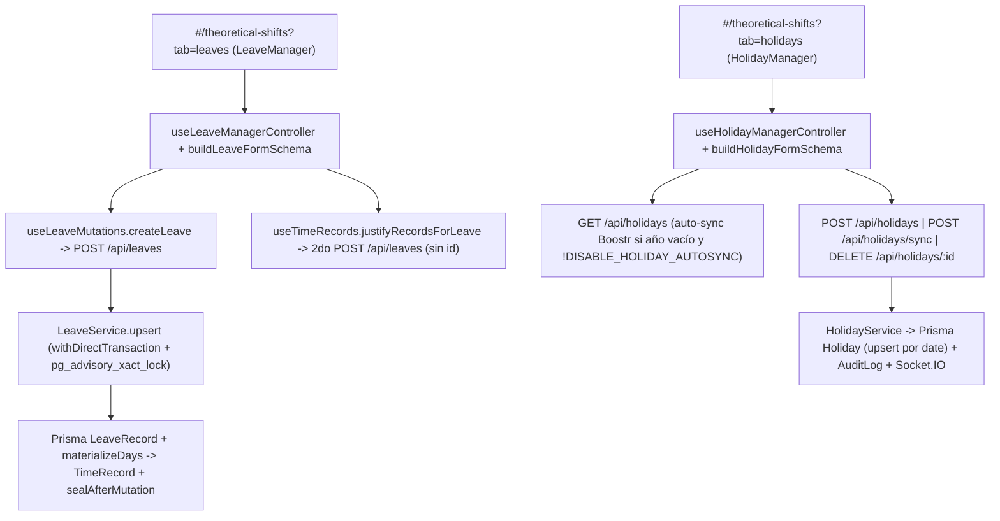

# Flujo: Permisos, ausencias y feriados (`permisos-ausencias-y-feriados`)

- **Estado:** `AS_IS_DOCUMENTADO` — Fase 1 (AS-IS) documentada por inspección estática; pendiente Fase 2 (replicación controlada).
- **Última actualización:** 2026-11-18
- **Módulos / actores:** `theoretical-shifts` (pestañas `leaves` y `holidays`), `leaves`, `holidays`, `LeaveService`, `HolidayService`, `useLeaveManagerController`, `useHolidayManagerController`, `useTimeRecords`, `schedulingService`. En UI, `#/theoretical-shifts` admite `Administrador`, `Supervisor_Elevado` y `Supervisor` (`App.tsx`). En API, `/api/leaves*` (GET/POST/DELETE) y las escrituras de `/api/holidays*` (`POST /api/holidays`, `POST /api/holidays/bulk`, `POST /api/holidays/sync`, `DELETE /api/holidays/:id`) admiten `Administrador`, `Supervisor_Elevado`, `Supervisor` y `Reloj_Control`; `GET /api/holidays` admite cualquier usuario autenticado.
- **Entradas:** UI `#/theoretical-shifts?tab=leaves` (`LeaveManager`), `#/theoretical-shifts?tab=holidays` (`HolidayManager`); API `GET/POST /api/leaves`, `DELETE /api/leaves/:id`, `GET/POST /api/holidays`, `POST /api/holidays/bulk`, `POST /api/holidays/sync`, `DELETE /api/holidays/:id`.
- **Alcance de evidencia:** inspección estática del código del checkout actual (`backend/` y `frontend/`). En Fase 1 no se ejecutaron pruebas ni se observaron respuestas HTTP o navegador.

## 1. Diagrama AS-IS

## 2. Comportamiento observado en código

### 2.1 Ausencias y licencias (`#/theoretical-shifts?tab=leaves` y `/api/leaves*`)

- `TheoreticalShifts.view.tsx` carga de forma diferida `LeaveManager.container.tsx` cuando `activeTab === "leaves"`.
- `useLeaveManagerController.ts` consulta `useLeavesInfiniteQuery({ showArchived, employeeId })` (páginas de 50) y filtra `filterEmployeeName` y `filterType` en cliente sobre las páginas ya descargadas. El formulario usa `useAppForm` con `buildLeaveFormSchema` (`frontend/src/schemas/forms/leave.ts`), que valida en cliente rango `startDate <= endDate`, antigüedad máxima de 7 días hábiles al crear, `endDate >= today` al editar, y solapamiento contra los `leaves` ya cargados.
- En `LeaveManager.view.tsx`, al editar (`editingLeave !== null`) se deshabilitan empleado, tipo y fecha de inicio (`disabled={!!editingLeave}`), permitiendo modificar `endDate` y `notes`.
- Al enviar el formulario, `useLeaveManagerController.onSubmit` ejecuta `createLeave(...)` (`POST /api/leaves`) y, acto seguido, invoca `justifyRecordsForLeave(...)` (`useTimeRecords.ts`), que ejecuta una segunda mutación `POST /api/leaves` sin `id` y con `notes: "Justificación masiva"`.
- En backend (`backend/src/modules/leaves/http/routes.ts`, `flows.ts` y `LeaveService.ts`):
  - `GET /api/leaves` pagina con `LeaveQuerySchema`, oculta `isDeleted: true` cuando no viene `since`, y oculta archivados (`endDate < today`) cuando `!showArchived && !startDate && !endDate`. Aunque `LeaveService.list` contiene una rama `if (user.role === "Usuario" && user.employeeId)`, el hook `supervisor` de la ruta bloquea con `403` a cualquier rol distinto de `Administrador`, `Supervisor_Elevado`, `Supervisor` y `Reloj_Control`.
  - `POST /api/leaves` valida el body con `LeaveRecordSchema` y ejecuta `LeaveService.upsert` dentro de `withDirectTransaction` con bloqueo `pg_advisory_xact_lock(hashtext("punch:" + employeeId))` y `SELECT ... FROM employees WHERE id = ... FOR UPDATE`. Verifica existencia de empleado (`404`), reglas de edición (`CANNOT_EDIT_FINALIZED`, `IMMUTABLE_FIELDS_CHANGED`, `INVALID_END_DATE_PAST`), antigüedad de 7 días hábiles al crear (`LIMIT_7_DAYS_EXCEEDED`), y solapamiento activo (`409 LEAVE_OVERLAP`).
  - Tras guardar `LeaveRecord`, `materializeDays` crea o reactiva `TimeRecord` por cada día del rango (`status: leave.type`, `source: "SYSTEM_LEAVE"`, `scheduledHours: 0`) omitiendo días con marcaje manual (`hasPunch`) o que pertenezcan a otra licencia activa, y sella la cadena criptográfica con `sealAfterMutation` en orden `id ASC`. Al acortar una licencia existente, `archiveDays` archiva los `TimeRecord` sobrantes generados por esa licencia. Emite `leave:updated` y `timeRecord:updated`.
  - `DELETE /api/leaves/:id` ejecuta `LeaveService.delete` bajo transacción y lock: exige `startDate >= today - 7 días hábiles`, bloquea borrado de archivadas salvo que hayan sido creadas en las últimas 24 h (`ARCHIVE_PROTECTION_VIOLATED`), archiva los `TimeRecord` futuros (`date >= today`) generados por la licencia y marca `LeaveRecord` con `isDeleted: true`, `deletedAt: new Date()` y `endDate: yesterday`.

### 2.2 Feriados (`#/theoretical-shifts?tab=holidays` y `/api/holidays*`)

- `TheoreticalShifts.view.tsx` carga `HolidayManager.container.tsx` cuando `activeTab === "holidays"`.
- `useHolidayManagerController.ts` consulta `useHolidaysInfiniteQuery({ pageSize: 50, showArchived })`, ordena descendente por `date` y filtra en cliente `date >= today` cuando `!showArchived`. El formulario usa `buildHolidayFormSchema` (`frontend/src/schemas/forms/holiday.ts`), que valida `date`, `name` (mínimo 2 caracteres), `type` (`Nacional`, `Regional`, `Específico`) y que `date` no esté en `existingDates`.
- `HolidayManager.view.tsx` permite crear, editar, eliminar y ejecutar «Cargar Feriados» (`syncHolidays()`, que llama `POST /api/holidays/sync` sin parámetro explícito de año, usando por defecto `new Date().getFullYear()`).
- En backend (`backend/src/modules/holidays/` y `HolidayService.ts`):
  - `GET /api/holidays` admite cualquier usuario autenticado. Soporta `since`, `page`, `pageSize`, `search` y `showArchived`. Si no viene `since`, `DISABLE_HOLIDAY_AUTOSYNC !== "true"` y `countYear(currentYear) === 0`, dispara `syncExternalHolidays(currentYear)` contra `https://api.boostr.cl/holidays/${year}.json` (con timeout de 5 s, ignorando errores si Boostr falla). Devuelve `HolidayRecord[]` si no hay paginación o `{ data, meta }` si vienen `page` y `pageSize`.
  - `POST /api/holidays` y `POST /api/holidays/bulk` persisten mediante `prisma.holiday.upsert({ where: { date }, update: { name, type }, create: { id, date, name, type } })`, registran auditoría (`HOLIDAY_UPSERT` / `HOLIDAY_BULK_UPSERT`) y emiten `holiday:updated`.
  - `POST /api/holidays/sync` consulta Boostr, ejecuta upserts en paralelo (`Promise.all`), registra `HOLIDAY_SYNC`, emite `holiday:updated` y responde `{ success: true, total, year }`.
  - `DELETE /api/holidays/:id` busca resumen previo (`findSummary`), ejecuta `prisma.holiday.delete({ where: { id } })`, registra `HOLIDAY_DELETE` (`WARNING`) y responde `204`.

### 2.3 Integración transversal

- `schedulingService.ts` consulta `leaveRecord` (`isDeleted: false`) y `holiday` para resolver el calendario y turnos teóricos con prioridad **Licencia > Feriado > Patrón de turno > Sin asignación**.
- `PunchService.ts` consulta `leaveRecord` activo al momento de marcar; `ShiftValidator.ts` y `shiftService.ts` consultan `leaveRecord` para reglas de conflictos/descanso; `EmployeeService.ts` limpia o cierra `leaveRecord` al archivar/eliminar empleados.

## 3. Anomalías y riesgos para replicación

1. **[ANOMALÍA-01] `useLeaveManagerController.onSubmit` duplica `POST /api/leaves` y provoca `409 LEAVE_OVERLAP`.** Después de `createLeave` (`POST /api/leaves`), `onSubmit` llama a `justifyRecordsForLeave` (`useTimeRecords.ts`), que envía un segundo `POST /api/leaves` sin `id` para las mismas fechas, chocando con la ausencia recién creada y dejando abierto el formulario con toast de error.
2. **[ANOMALÍA-02] `POST /api/holidays/sync` vs `useHolidayMutations`: toast muestra `undefined feriados nuevos cargados.`.** Backend responde `{ success, total, year }`, mientras `holidayService.ts` / `useHolidayMutations.ts` leen `data.added` (inexistente).
3. **[ANOMALÍA-03] Edición de feriado por `date` en vez de `id`, y campo fantasma `isRenounceable`.** `prismaHolidayCommands.upsert` usa `where: { date }`, por lo que editar la fecha de un feriado existente crea una fila nueva en lugar de mover el registro original; además, crear un feriado en una fecha archivada (oculta cuando `!showArchived`) la sobreescribe silenciosamente en vez de advertir duplicado. `HolidaySchema` y `holidayFormSchema` declaran `isRenounceable`, pero `model Holiday` en Prisma no tiene esa columna.
4. **[ANOMALÍA-04] Manejo de errores en `DELETE /api/holidays/:id` y filtros/paginación en ausencias.** `DELETE /api/holidays/:id` con `id` inexistente ejecuta `prisma.holiday.delete` sin verificar existencia previa ni mapear `P2025` en el servicio/flujo (riesgo de `500` en vez de `404`). En `LeaveManager`, la búsqueda por nombre y filtro por tipo operan en cliente solo sobre páginas cargadas de 50 registros.
5. **[ANOMALÍA-05] `LeaveService.delete` sobrescribe `endDate` al día anterior.** Al eliminar una licencia (`DELETE /api/leaves/:id`), además de `isDeleted: true` y `deletedAt`, muta `endDate` a `yesterday` en horario de Chile, alterando el rango histórico original.
6. **[ANOMALÍA-06] Desalineación de roles en `Reloj_Control`, `Usuario` y `Fiscalizador`.** `Reloj_Control` tiene acceso completo de escritura en `/api/leaves*` y `/api/holidays*` en API, pero `App.tsx` bloquea `#/theoretical-shifts` para ese rol. En `GET /api/leaves`, existe una rama para `Usuario` en `LeaveService.list` que nunca se alcanza porque `leavesPlugin` exige rol supervisor antes.
7. **[ANOMALÍA-07] `GET /api/holidays` ejecuta auto-sync externo durante un `GET` y retorna contrato dual.** Si `countYear(year) === 0` y no está deshabilitado por env, `GET /api/holidays` llama a `api.boostr.cl` síncronamente (hasta 5 s de latencia); además retorna arreglo plano o `{ data, meta }` según `page`/`pageSize`.

## 4. Dudas para revisión humana

*(Pendiente de Fase 2 para consolidar preguntas de producto/negocio junto con la evidencia de replicación.)*

## 5. Inventario de pruebas y plan para Fase 2

| Área | Evidencia de pruebas existentes (inventario, sin ejecutar) | Replicación propuesta |
| :--- | :--- | :--- |
| Backend `leaves` (API, reglas, materialización) | `backend/tests/fastify-integration/leavesCorrections.test.ts`, `backend/tests/unit/leaveCorrectionFlows.test.ts` | Probar en PostgreSQL efímero + Fastify inject: `POST /api/leaves` crear/editar/acortar, `409 LEAVE_OVERLAP`, `LIMIT_7_DAYS_EXCEEDED`, `DELETE /api/leaves/:id` (regla 7d, 24h archivado y mutación de `endDate`), permisos por rol (`Reloj_Control`, `Usuario`, `Fiscalizador`). |
| Backend `holidays` (API, sync, Prisma) | `backend/tests/fastify-integration/holidays.test.ts`, `backend/tests/holidays-architecture.test.ts`, `backend/tests/unit/holidays/getHolidays.test.ts`, `holidayService.test.ts`, `holidayService.sync.test.ts` | Probar `GET /api/holidays` (paginado vs plano, `search`, `showArchived`, `DISABLE_HOLIDAY_AUTOSYNC`), `POST /api/holidays` al cambiar fecha de un feriado existente, `POST /api/holidays/sync` (shape de respuesta), y `DELETE /api/holidays/:id` con ID inexistente. |
| Frontend UI (`#/theoretical-shifts?tab=leaves` y `holidays`) | `frontend/src/tests/services/holidayAndConfigService.test.ts` | Replicar en Playwright contra staging local: registrar/editar/eliminar ausencia en `LeaveManager` (verificar doble POST / toast 409), crear/editar fecha/sincronizar feriados en `HolidayManager` (verificar toast `undefined` y duplicación al editar fecha). |
