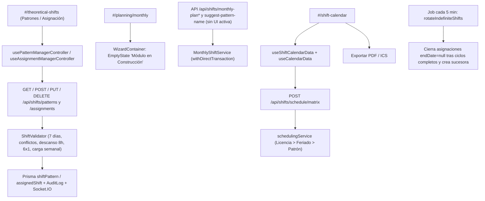

# Flujo: Planificación mensual y turnos (`planificacion-mensual-y-turnos`)

- **Estado:** `REPLICACION_PARCIAL` — Fase 2 ejecutada sobre PostgreSQL 18.4 desechable, Fastify inject y Playwright headless; pendiente decisión sobre dudas abiertas para Fase 3/4.
- **Última actualización:** 2026-11-18
- **Módulos / actores:** `theoretical-shifts`, `planning`, `shift-calendar`, `shifts`, `schedulingService`, `MonthlyShiftService`, `shiftRotationService`. UI `#/theoretical-shifts` y `#/planning/monthly` admiten `Administrador`, `Supervisor_Elevado` y `Supervisor`; `#/shift-calendar` admite además `Usuario` y `Reloj_Control` (no `Fiscalizador`). En API, los endpoints de escritura de `/api/shifts/*` admiten `Administrador`, `Supervisor_Elevado`, `Supervisor` y `Reloj_Control`; los de lectura admiten cualquier usuario autenticado (con alcance propio para `Usuario` y `Kiosk_Employee`).
- **Entradas:** UI `#/theoretical-shifts` (pestañas `patterns`, `assignments`, `leaves`, `holidays`), `#/planning/monthly`, `#/shift-calendar`; API `GET/POST/PUT/DELETE /api/shifts/patterns*`, `POST /api/shifts/patterns/bulk`, `GET/POST/PUT/DELETE /api/shifts/assignments*`, `POST /api/shifts/assignments/bulk`, `GET /api/shifts/schedule/employee/:id`, `GET /api/shifts/schedule/employees-on-date`, `GET /api/shifts/schedule/employee/:id/month`, `POST /api/shifts/schedule/matrix`, `GET/POST /api/shifts/monthly-plan*`, `GET /api/shifts/suggest-pattern-name`, `POST /api/shifts/validate-conflicts`; Job `rotateIndefiniteShifts`.
- **Alcance de evidencia:** inspección estática del código del checkout actual (`backend/` y `frontend/`). En Fase 1 no se ejecutaron pruebas ni se observaron respuestas HTTP o navegador.

## 1. Diagrama AS-IS

## 2. Comportamiento observado en código

### 2.1 Patrones teóricos y asignaciones (`#/theoretical-shifts`)

- `TheoreticalShifts.view.tsx` presenta cuatro pestañas (`patterns`, `assignments`, `leaves`, `holidays`) sincronizadas con `?tab=` mediante `useTheoreticalShiftsData.ts`. Las pestañas de permisos y feriados pertenecen al flujo `permisos-ausencias-y-feriados`.
- `usePatternManagerController.ts` consulta `useShiftPatternsInfiniteQuery({ pageSize: 50, search, showArchived: false })` y `useAssignedShiftsQuery()` para contar empleados afectados al eliminar un patrón. `useShiftPatternForm.ts` crea arreglos `dailySchedules` con `dayIndex` desde `0` hasta `cycleLengthDays - 1` y valida con `buildShiftPatternSchema`.
- `ShiftService.deletePattern` ejecuta una transacción Prisma que: (1) termina asignaciones vigentes o indefinidas (`endDate = yesterday` en horario de Chile), (2) marca `isDeleted = true` solo en asignaciones futuras (`startDate > today`), y (3) marca `isDeleted = true` en el patrón; luego emite `shiftPattern:updated` y `assignedShift:updated`.
- `useAssignmentManagerController.ts` consulta `useAssignedShiftsInfiniteQuery({ pageSize: 50, showArchived })` y filtra por `searchTerm` **en cliente** sobre las páginas ya cargadas. `useShiftAssignmentForm.ts` valida con `buildShiftAssignmentSchema` (límite de 7 días hacia atrás) y detecta conflictos localmente con `detectAssignmentConflicts` para abrir un modal de resolución (`SMART_TERMINATE` si el conflicto es indefinido y posterior, u `OVERLAP`).
- En servidor (`ShiftService.assignShift` / `updateAssignment`), se validan sucesivamente: límite temporal de 7 días (`validateTemporalBoundary`), conflictos de fechas (`validateConflicts`), descanso mínimo de 8 h entre jornadas (`validateRestPeriod`), regla de 6 días consecutivos (`validateConsecutiveWorkdays`, omitida para patrones con `NxM`, `cycleLengthDays >= 14` o `"excepcional"`), y carga semanal promedio (`validateWorkload`, omitida para `Artículo 22`). Registra auditoría en `auditService.logShiftChange` y emite `assignedShift:updated`.

### 2.2 Planificación mensual (`#/planning/monthly`) y `MonthlyShiftService`

- `MonthlyPlanning.view.tsx` renderiza `WizardContainer.tsx`, el cual muestra únicamente un `EmptyState` («Módulo en Construcción»). No hay interfaz conectada a los endpoints de planificación mensual.
- En backend, `MonthlyShiftService.createMonthlyPlan` rechaza meses completamente pasados (`monthEndIso < todayIso`), fija `assignmentStartDateIso` a `todayIso` si el mes está en curso, y dentro de `withDirectTransaction` corta (`endDate = cutoffDateIso`) o elimina (`deleteMany` físico) las asignaciones conflictivas del empleado; luego crea un patrón ad-hoc con `cycleLengthDays = daysDuration`, `worksOnHolidays = true`, `maxHoursPattern = 0` y `hasColacion = true` (`60` min) para los días laborales, y crea una asignación hasta `monthEndIso`.
- `GET /api/shifts/suggest-pattern-name` genera nombres versionados (`INIT_APELLIDO_RUT_Mes_AA_Ver_A..Z`) consultando prefijos existentes en `shiftPattern`.

### 2.3 Calendario de turnos (`#/shift-calendar`) y rotación automática

- `useShiftCalendarData.ts` y `useCalendarData.ts` calculan el rango de la vista (`month`, `week`, `day`) y consultan `POST /api/shifts/schedule/matrix` junto con `useShiftPatternsQuery` y `useAssignedShiftsQuery`. Para `Usuario`, fuerza `selectedEmployeeId` al `employeeId` de su sesión; para otros roles permite filtrar por área, cargo y empleado, además de exportar a PDF o ICS.
- `schedulingService.ts` resuelve cada fecha con prioridad **Licencia > Feriado > Patrón de turno > Sin asignación**, usando fechas de negocio de Chile (`getChileDateISO`).
- `runtimeJobs.ts` ejecuta `rotateIndefiniteShifts` cada 5 minutos bajo lock distribuido (`job:rotateIndefiniteShifts`), omitiéndolo si el seeder fase 2 está activo. `shiftRotationService.ts` toma hasta `SHIFT_ROTATION_MAX_PER_RUN` (default 50) asignaciones con `endDate: null`, calcula ciclos completos transcurridos desde `startDate`, cierra la fila con `updateMany({ where: { id, endDate: null } })` y crea la sucesora desde el día siguiente.

## 3. Anomalías y riesgos para replicación

1. **[ANOMALÍA-01] `ShiftQuerySchema` omite `search`, `showArchived` y `since`.** `GET /api/shifts/patterns` y `GET /api/shifts/assignments` validan query con `ShiftQuerySchema` (`backend/src/models/schemas/shift.schemas.ts`), que solo declara `page`, `pageSize`, `employeeId`, `startDate` y `endDate`. Zod elimina claves no declaradas, por lo que `search`, `showArchived` y `since` en `shifts/application/flows.ts` quedarían vacíos en Fastify.
2. **[ANOMALÍA-02] `PatternScheduleSchema` restringe `dayIndex` a `0..6`.** `ShiftPatternSchema` acepta `cycleLengthDays >= 1` y `dailySchedules` como arreglo o cadena, pero `PatternScheduleSchema` impone `dayIndex.max(6)`. `useShiftPatternForm.ts` envía un arreglo con `dayIndex` de `0` a `cycleLengthDays - 1`, por lo que ciclos > 7 días (ej. 7x7 de 14 días) pueden fallar con `400` en `POST/PUT /api/shifts/patterns`.
3. **[ANOMALÍA-03] `getAssignments` sobrescribe `where.OR` con fechas y omite indefinidos.** En `ShiftService.getAssignments`, el filtro de activos (`where.OR = [{ endDate: null }, { endDate: { gte: today } }]`) es sobrescrito por `if (startDate || endDate) { where.OR = [...] }`. Además, la rama de contención (`startDate <= start` y `endDate >= end`) no incluye `{ endDate: null }`, dejando fuera turnos indefinidos que comenzaron antes del rango.
4. **[ANOMALÍA-04] `ShiftValidator` y manejo de errores HTTP/concurrencia.**
   - `isShiftValidationError` (`shifts/application/flows.ts`) solo captura mensajes con `"Conflicto"`, `"excesiva"` o `"Descanso"`; los errores de `validateTemporalBoundary` (`"antigüedad"`) y `validateConsecutiveWorkdays` (`"6x1"`) escapan como `500` en vez de `400`.
   - `validateRestPeriod` (`ShiftValidator.ts`) consulta siempre `dayIndex = 0` en lugar del índice del ciclo correspondiente a `startDate`, y mezcla `new Date(startDateStr + "T12:00:00")` / hora local con `formatDateUTCISO`.
   - `calculateAverageWeeklyHours` evalúa únicamente `relevantAssignments[relevantAssignments.length - 1]` (la última asignación por `startDate`), permitiendo insertar una asignación intermedia o anterior que exceda `max_weekly_hours` si existe una posterior dentro del límite.
   - `assignShift` y `updateAssignment` no ejecutan sus validaciones ni escrituras dentro de `withDirectTransaction` con bloqueo por empleado (`FOR UPDATE`), quedando expuestos a asignaciones solapadas concurrentes.
5. **[ANOMALÍA-05] Rutas masivas (`bulkPatterns` y `bulkAssignments`) omiten validaciones y auditoría.** `bulkCreatePatterns` no ejecuta `validatePatternSchedules`. `bulkAssignShifts` omite `validateTemporalBoundary`, `validateRestPeriod` y `validateConsecutiveWorkdays`, no registra `auditService.logShiftChange` y persiste en bloques de 50 sin una transacción única.
6. **[ANOMALÍA-06] `MonthlyShiftService` borra físicamente, trunca futuro y omite auditoría/sockets.** `createMonthlyPlan` consulta `conflictingAssignments` sin `isDeleted: false`, hace `deleteMany` físico en vez de soft-delete, corta o borra asignaciones indefinidas o multi-mes sin restaurar los meses posteriores a `monthEndIso`, no emite eventos Socket.IO ni registra auditoría, omite `employeeName`/`shiftPatternName`, y fija `hasColacion: true` (`60` min) y `worksOnHolidays: true`.
7. **[ANOMALÍA-07] `#/planning/monthly` muestra «Módulo en Construcción».** `WizardContainer.tsx` presenta un estado vacío mientras la API mantiene expuestos `/api/shifts/monthly-plan*` y `suggest-pattern-name`.
8. **[ANOMALÍA-08] `rotateIndefiniteShifts` rota eliminados, usa UTC y no es atómico.** Consulta `where: { endDate: null }` sin `isDeleted: false`, calcula `todayStr` con `formatDateUTCISO(now)` en lugar de fecha de negocio de Chile, y ejecuta `updateMany` + `create` fuera de transacción (si falla `create`, el empleado queda sin turno vigente).
9. **[ANOMALÍA-09] Desalineación de roles y búsqueda parcial en UI.** `Reloj_Control` puede mutar patrones, asignaciones y planes mensuales en API mientras `App.tsx` bloquea `#/theoretical-shifts` y `#/planning/monthly` para ese rol. `Fiscalizador` puede leer patrones, asignaciones y matriz en API pero no tiene acceso a `#/shift-calendar`. En `#/theoretical-shifts`, `useAssignmentManagerController` busca solo sobre las páginas ya descargadas (de a 50).

## 4. Dudas para revisión humana

1. **[DUDA-01] ABIERTA:** ¿`#/planning/monthly` debe implementarse/conectarse a `/api/shifts/monthly-plan*` o debe retirarse/mantenerse deshabilitado junto con sus endpoints?
2. **[DUDA-02] ABIERTA:** ¿`Reloj_Control` debe tener permisos de escritura en `/api/shifts/*` o debe restringirse a lectura como refleja la UI? ¿`Fiscalizador` debe poder acceder en modo solo lectura a `#/shift-calendar`?
3. **[DUDA-03] ABIERTA:** Al guardar un plan mensual (`MonthlyShiftService`), si el empleado tenía una asignación indefinida o multi-mes previa, ¿debe preservarse/continuarse esa asignación a partir del mes siguiente?

## 5. Inventario de pruebas y plan para Fase 2

| Área | Evidencia de pruebas existentes (inventario, sin ejecutar) | Replicación propuesta |
| :--- | :--- | :--- |
| Fastify, esquemas y permisos | `backend/tests/fastify-integration/shifts.test.ts`, `backend/tests/integration/shifts.test.ts`, `shifts.validation.test.ts`, `shifts.boundary-flow.test.ts`, `backend/tests/unit/shiftFlows.test.ts` | Probar `search`/`showArchived` en query, `cycleLengthDays > 7`, errores 400 vs 500 en regla 7d/6x1, `getAssignments` con rango + indefinidos, y matriz de roles (`Reloj_Control`, `Fiscalizador`, `Usuario`). |
| Validadores y concurrencia | `backend/tests/unit/shiftValidator.test.ts` | Probar carga horaria en asignaciones intermedias, descanso 8 h con `dayIndex != 0`, y dos `POST /api/shifts/assignments` concurrentes en PostgreSQL. |
| Plan mensual y rotación | `backend/tests/unit/monthlySchedule.test.ts`, `monthlyBreakdown.test.ts`, `maintenanceRotation.test.ts`, `schedulerExecution.test.ts` | Probar `createMonthlyPlan` con asignación indefinida previa y `rotateIndefiniteShifts` con asignaciones soft-deleted y fallo parcial. |
| UI y calendario | `frontend/src/tests/features/theoretical-shifts/TheoreticalShiftsView.test.tsx`, `planning/MonthlyPlanningView.test.tsx`, `shift-calendar/ShiftCalendarFeatureView.test.tsx`, `frontend/src/tests/forms/theoreticalShiftsForms.test.tsx` | Verificar en staging búsqueda de patrones/asignaciones con >50 ítems, creación de patrón >7 días, `#/planning/monthly` y vistas/exportación de `#/shift-calendar`. |

## 6. Replicación parcial (Fase 2)

El 2026-11-18 se ejecutó replicación controlada mediante Fastify inject con PostgreSQL 18.4 desechable (20 migraciones aplicadas), servicios aislados y navegador headless Playwright sobre staging local (`http://127.0.0.1:8080`). Todos los contenedores, usuarios, patrones y asignaciones temporales fueron eliminados al finalizar.

- **[ANOMALÍA-01] `ShiftQuerySchema` (matizada en runtime):** aunque `ShiftQuerySchema` omite `search`, `showArchived` y `since`, `validateRequest` (`backend/src/platform/fastify/validation.ts`) no reasigna `request[field]` tras `schema.parseAsync`. En Fastify inject y staging UI, `GET /api/shifts/patterns?search=ALPHA&showArchived=false` respondió `200` y filtró correctamente en servidor; `GET /api/shifts/patterns?since=<futuro>` devolvió `0` ítems. El contrato OpenAPI/Zod sigue incompleto frente al runtime.
- **[BUG-01] Patrones > 7 días rechazados por HTTP (alta; ANOMALÍA-02):** `POST /api/shifts/patterns` con `cycleLengthDays: 14` y arreglo `dailySchedules` (`dayIndex` `0..13`) respondió `400 VALIDATION_ERROR` con 7 errores (`dailySchedules.7.dayIndex`..`13.dayIndex`: `expected number to be <=6`). En staging UI, `PatternForm` sí renderizó las 14 tarjetas de días.
- **[BUG-02] `getAssignments` con rango omite indefinidos (alta; ANOMALÍA-03):** con una asignación indefinida activa (`startDate = hoy - 3d`, `endDate = null`), `GET /api/shifts/assignments` sin rango devolvió `200` con la fila, pero `GET /api/shifts/assignments?startDate=2026-11-18&endDate=2026-11-23` devolvió `200` con `[]`.
- **[BUG-03] Errores 500, descanso 8 h, carga intermedia y carrera concurrente (crítica; ANOMALÍA-04):**
  - `POST /api/shifts/assignments` con `startDate` 8 días atrás y con patrón 7/7 días laborales (regla 6x1) devolvieron ambos `500 INTERNAL_ERROR` en lugar de `400`.
  - Con patrón previo terminando a las `23:30`, asignar un patrón con `dayIndex=0` libre y `dayIndex != 0` iniciando a las `05:00` (5.5 h de descanso) devolvió `201 Created`.
  - Con empleado `Jornada Normal` y asignación futura válida (`40 h`, `+10..+16d`), insertar una asignación intermedia excesiva (`60 h`, `+1..+7d`) devolvió `201 Created`.
  - Dos `POST /api/shifts/assignments` concurrentes para el mismo empleado y fechas produjeron `201 + 201` (dos filas solapadas persistidas en BD) en una corrida y `201 + 500 INTERNAL_ERROR` (`P0001` de trigger) en otra.
- **[BUG-04] Rutas masivas omiten validaciones y auditoría (alta; ANOMALÍA-05):** `POST /api/shifts/patterns/bulk` aceptó (`201`) un horario inválido (`hours: 99`, `20:00-08:00`); `POST /api/shifts/assignments/bulk` aceptó (`201`) una asignación con `startDate = -30d` y patrón de 7 días laborales, sin crear registros de `auditService.logShiftChange`.
- **[BUG-05] `MonthlyShiftService.createMonthlyPlan` trunca futuro, borra físicamente y omite auditoría/sockets (alta; ANOMALÍA-06):** para el mes `2026-12` en PostgreSQL desechable: (1) una asignación indefinida (`2026-10-01..null`) quedó cortada en `2026-11-30` sin sucesora para `2027-01-01+`; (2) una asignación multi-mes (`2026-12-05..2027-02-28`) fue eliminada físicamente con `deleteMany`; (3) filas con `isDeleted: true` fueron mutadas/borradas; (4) la nueva asignación quedó con `employeeName: null`, `shiftPatternName: null`, patrón con `worksOnHolidays: true`, `maxHoursPattern: 0`, `hasColacion: true` (`60`), `0` eventos Socket.IO y `0` logs de auditoría.
- **[BUG-06] `#/planning/monthly` «Módulo en Construcción» (media; ANOMALÍA-07):** en staging Playwright, navegar como administrador a `#/planning/monthly` mostró `EmptyState` («Módulo en Construcción») con `0` peticiones a `/api/shifts/monthly-plan*` o `suggest-pattern-name`.
- **[BUG-07] `rotateIndefiniteShifts` rota eliminados, usa UTC y no es atómico (alta; ANOMALÍA-08):** en PostgreSQL desechable: (1) una asignación con `isDeleted: true` y `endDate: null` fue rotada (`rotatedCount: 1`) creando una sucesora activa (`isDeleted: false`); (2) con reloj `2026-11-19T01:30:00Z` (`2026-11-18 22:30` Chile, `diffDays = 6 < 7`), rotó prematuramente por usar `formatDateUTCISO`; (3) al simular fallo en `create`, la fila original quedó cerrada sin sucesora, dejando al empleado sin turno activo.
- **[BUG-08] Desalineación de roles y búsqueda parcial de asignaciones en UI (media; ANOMALÍA-09):**
  - En API, `Reloj_Control` pudo ejecutar `POST /patterns` (`201`), `POST /assignments` (`201`) y `POST /monthly-plan` (`200`), pero en staging UI fue redirigido con «Acceso denegado» en `#/theoretical-shifts` y `#/planning/monthly` (sí accedió a `#/shift-calendar`). `Fiscalizador` leyó `GET /patterns`, `GET /assignments` y `POST /schedule/matrix` (`200`), pero en UI fue redirigido con «Acceso denegado» en las 3 rutas.
  - Con 55 asignaciones activas en staging (`pageSize=50`), buscar un trabajador de la página 2 en `#/theoretical-shifts?tab=assignments` mostró `0` resultados hasta cargar más páginas.
  - En `#/shift-calendar`, el cambio de vistas `Mes`/`Semana`/`Día` y la descarga de PDF (`GET /api/export/calendar-pdf` -> `200`) funcionaron; el botón `ICS` habilitado tras seleccionar empleado no disparó evento de descarga en Playwright (sin toast de error).
