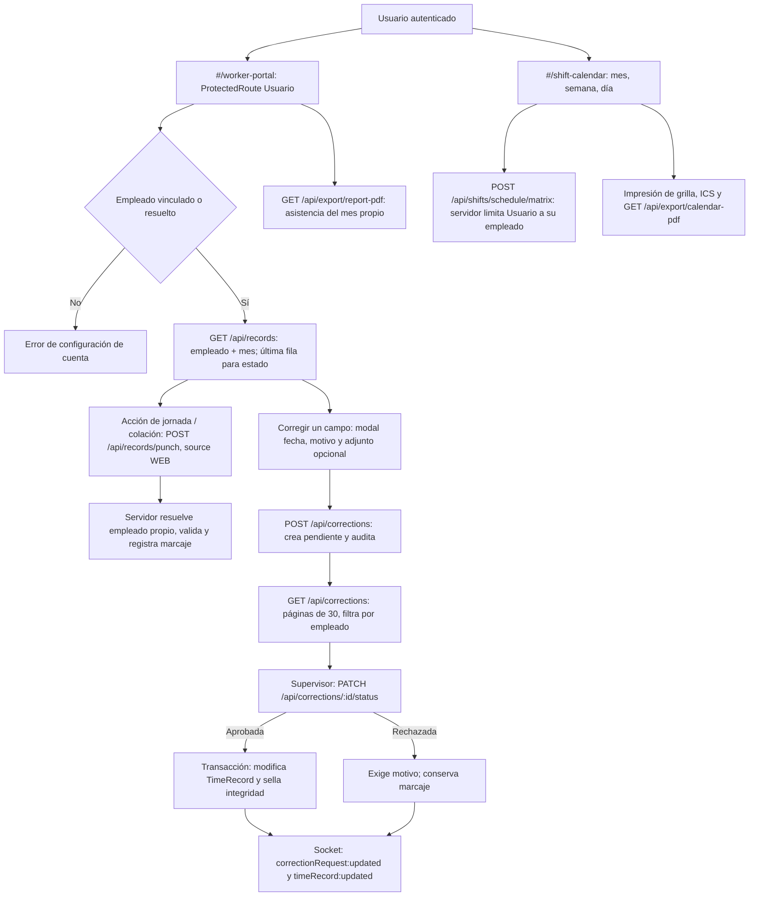

# Flujo: Portal del trabajador y correcciones (`portal-trabajador-y-correcciones`)

- **Estado:** `REPLICADO_CON_FALLAS` — Fase 2 en curso; replicación parcial.
- **Última actualización:** 2026-11-17.
- **Actores:** trabajador autenticado (`Usuario`) vinculado a un empleado; `Administrador`, `Supervisor_Elevado` o `Supervisor` que resuelve solicitudes. El calendario también admite `Reloj_Control` y los roles de supervisión indicados en `App.tsx`.
- **Alcance:** portal, marcajes propios, solicitud y resolución de correcciones, calendario y exportaciones relacionadas. Las reglas compartidas de marcaje se detallan en [marcaje-kiosco](marcaje-kiosco.md); la planificación y el control horario tienen flujos propios pendientes.
- **Evidencia:** lectura estática del código y primera ejecución parcial en staging local con Chromium y API el 2026-11-17. Los resultados observados se detallan en la sección 6; las demás anomalías siguen pendientes de replicación.

## 1. Diagrama AS-IS

## 2. Comportamiento observado en código

### 2.1 Acceso, identidad y asistencia

- `frontend/src/App.tsx` protege `#/worker-portal` para `Usuario`; `#/shift-calendar` admite `Usuario`, `Reloj_Control`, `Supervisor`, `Administrador` y `Supervisor_Elevado`. Ambos se montan bajo el layout protegido. El menú del trabajador enlaza a Portal y Calendario (`frontend/src/hooks/layout/sidebarMenu.ts`).
- `useWorkerPortalData.ts` busca `currentUser.employeeId` entre los empleados. Para `Usuario`, si solo hay un empleado disponible, lo usa como alternativa; si no lo encuentra, intenta refrescar y consultar directamente una vez. Durante la resolución muestra carga; si termina sin empleado, la vista muestra error de vinculación.
- El selector contiene el mes actual y los 11 anteriores. Los registros se consultan por empleado y límites del mes con `pageSize=-1`, únicamente cuando hay empleado; se filtran de nuevo y ordenan por fecha y entrada descendentes. La última fila propia se consulta aparte para derivar el estado, incluso si pertenece a otro mes. La vista muestra marcajes y métricas calculadas desde la respuesta y datos de programación (`useWorkerPortalData.ts`, `useTimeRecords.ts`, `mappings.ts`).
- Los cuatro botones corresponden a entrada, inicio y fin de colación, y salida; su habilitación depende del estado. El controlador serializa la acción con una referencia, envía `source: "WEB"` y `forcedType` en camelCase, y muestra resultado o error. No envía coordenadas. Para `Usuario`, `records/application/flows.ts` obtiene el empleado vinculado del servidor en lugar de confiar en el `employeeId` del cuerpo. Las reglas compartidas incluyen cierre contable, licencia, secuencia y cooldown (`PunchService`, `RecordFlows`).
- El botón de descarga del portal solicita `GET /api/export/report-pdf` para el mes seleccionado y el empleado. `importExport/application/flows.ts` exige que `Usuario` solicite su propio `employeeId` y elimina filtros de área, cargo y modo.

### 2.2 Solicitud, lista e historial

- En cada campo `entrada`, `inicioColacion`, `finColacion` o `salida`, la vista ofrece «Corregir»; si el mapa contiene una solicitud `pending` para ese registro y campo, muestra «Solicitud pendiente» y deshabilita el botón. Entre solicitudes cargadas prioriza pendientes y luego la más reciente (`WorkerPortal.view.tsx`, `useWorkerPortalData.ts`).
- El modal se carga de forma diferida. Inicializa la fecha con el valor original o la hora actual; exige fecha/hora local con formato y motivo no vacío, convierte horario de Chile a ISO, rechaza futuro y admite seleccionar un archivo de hasta 5 MiB, que convierte a base64. El cliente manda `employeeId`, `timeRecordId`, `recordField`, `originalValue`, `requestedValue`, `reason` y, si existe, `attachment` (`useCorrectionRequestModalController.ts`, `schemas/forms/correction.ts`).
- `POST /api/corrections` exige autenticación y valida `CorrectionRequestSchema`: los cuatro campos permitidos, fecha ISO con offset y no futura, y motivo de tipo cadena. El servicio exige propiedad para `Usuario`, verifica que el registro exista y corresponda al empleado, valida edición y límites de jornada/horas extras cuando aplica; crea la fila `pending`, emite `correctionRequest:created` y registra auditoría. El esquema HTTP nombra `currentValue`, mientras el servicio persiste `originalValue`; `validateRequest` valida pero no sustituye `request.body` por el resultado parseado. La columna existe en Prisma; el servicio no persiste el adjunto.
- `GET /api/corrections` devuelve `{ requests, total }`, con orden `createdAt` descendente, filtros `status` y `since`, `limit` y `offset`. Sin `since` excluye eliminados; con `since` incluye cambios posteriores, incluidos tombstones. `Usuario` sin empleado recibe `403`, y con empleado ve solo sus solicitudes. El cliente solicita páginas de 30 con `useInfiniteQuery`; `useScheduling` aplana las páginas cargadas.
- `GET /api/corrections/:id/history` devuelve `{ data: [...] }`, generado desde auditoría de creación y cambio de estado, con eventos de respaldo si no existen logs. Usuario solo puede consultar su solicitud; una ajena responde `403` y una inexistente `404`. Existe `correctionService.getHistory`, pero no se encontró una llamada desde la UI de este portal.

### 2.3 Resolución y actualización en tiempo real

- `PATCH /api/corrections/:id/status` exige autenticación y rol `Administrador`, `Supervisor_Elevado` o `Supervisor`; acepta `approved` o `rejected`, `resolvedBy` y motivo obligatorio no vacío para rechazo. Una solicitud ya resuelta se devuelve sin cambiarla. Para aprobación se rechaza un valor futuro, se comprueba propiedad y se vuelve a validar el registro.
- `CorrectionService.updateStatus` reclama atómicamente el estado `pending` dentro de `withDirectTransaction`; el ganador aplica el campo aprobado, puede cambiar una anomalía a `Completado` cuando entrada y salida existen, y llama `sealAfterMutation`. Al rechazar no modifica el marcaje. Tras resolver emite eventos de solicitud y, en aprobación, de registro; escribe auditoría. Los sockets aplican política de alcance por empleado y el cliente invalida las consultas de correcciones y registros (`eventPolicy.ts`, `useSocketEvents.ts`).
- `GET /api/corrections/stats` cuenta pendientes y aprobadas/rechazadas de los últimos 30 días, con alcance propio para `Usuario`. La resolución pertenece visualmente al tablero de supervisión; se incluye aquí para cerrar el ciclo de la solicitud.

### 2.4 Calendario y exportación

- `useShiftCalendarData.ts` inicia la vista mensual y, para `Usuario`, selecciona `currentUser.employeeId`; permite navegar mes, semana y día. `useCalendarData.ts` consulta `POST /api/shifts/schedule/matrix` por rango; el servidor reemplaza la lista solicitada por el empleado vinculado del usuario. El mapa muestra turno, descanso, justificación o feriado según la matriz.
- El calendario ofrece impresión de grilla generada en el cliente para mes/semana, descarga de PDF técnico del servidor y exportación ICS para el empleado seleccionado. `GET /api/export/calendar-pdf` exige que `Usuario` indique su propio empleado. El PDF usa el rango visible y modo; el ICS se construye a partir de las entradas cargadas en la matriz.
- La API `GET /api/shifts/schedule/employee/:id/month` existe y limita `Usuario` a su empleado, pero los controladores del portal y calendario examinados usan respectivamente datos de programación locales y la matriz; no se encontró que estas pantallas invoquen esa API mensual. La presencia del método en `schedulingService.ts` no demuestra su uso en ellas.

## 3. Anomalías y riesgos para replicación

Estas observaciones requieren pruebas y revisión de producto. Las anomalías 01 a 06 tienen resultados parciales en la sección 6. La política sobre solicitudes duplicadas sigue sujeta a revisión humana.

1. **[ANOMALÍA-01] Adjunto sin persistencia.** El modal acepta y envía archivo, pero `CorrectionService.create` y el modelo `CorrectionRequest` no guardan datos ni referencia de adjunto. Confirmar en UI, petición y base de datos si el usuario recibe éxito aunque el archivo se pierda. Fuentes: `useCorrectionRequestModalController.ts`, `CorrectionService.ts`, `backend/prisma/schema.prisma`.
2. **[ANOMALÍA-02] Pendientes fuera de la primera página.** El portal usa `requests` de páginas cargadas pero no invoca `fetchNextPage`; la consulta inicial limita a 30. Una solicitud pendiente anterior podría no bloquear «Corregir». Reproducir con más de 30 solicitudes propias, incluidas terminales recientes; comprobar también invalidación y paginación. Fuentes: `useCorrectionRequestsQuery.ts`, `useScheduling.ts`, `useWorkerPortalData.ts`.
3. **[ANOMALÍA-03] Duplicados pendientes.** El servicio de creación no muestra consulta de duplicados ni el modelo una restricción única para registro/campo/estado; la deshabilitación es de cliente y depende de datos cargados. Comprobar POST repetidos y concurrentes antes de decidir la regla deseada.
4. **[ANOMALÍA-04] Contrato de valores y respuesta.** El esquema declara `currentValue` y el cliente manda `originalValue`; el validador no reemplaza el cuerpo parseado y el servicio lee `originalValue`. La respuesta real de lista es `{ requests, total }`, mientras OpenAPI describe `CorrectionRequestListResponse` con `data`. Verificar comportamiento HTTP y SDK antes de cambiar contratos (`validation.ts`, `time-correction.schemas.ts`, `correctionService.ts`, `operations.ts`).
5. **[ANOMALÍA-05] Estado de marcaje durante carga.** Si todavía no hay última fila disponible el estado deriva como `fuera`; la vista habilita inicio según ese estado. Comprobar con respuesta de registros lenta o fallida si se ofrece una acción no correspondiente. La autorización y secuencia final siguen en el servidor.
6. **[ANOMALÍA-06] Validación desigual de consultas y motivo.** `GET /api/corrections` usa `z.unknown()` para query y convierte `limit`/`offset` con `Number`; el esquema de creación admite cualquier cadena como motivo, mientras el formulario exige texto no vacío. Probar valores negativos/no numéricos y POST con motivo vacío o espacios, registrando estado y persistencia sin anticipar el resultado.

## 4. Dudas abiertas para revisión humana

1. **[DUDA-01]** ¿El adjunto debe almacenarse, poder consultarse y estar disponible para quien resuelve? ¿Qué tipos, tamaño y retención corresponden?
2. **[DUDA-02]** ¿Debe existir como máximo una solicitud pendiente por empleado, registro y campo, incluso ante concurrencia o múltiples clientes?
3. **[DUDA-03]** ¿Debe el trabajador consultar el historial completo, incluido motivo de rechazo y quién resolvió, desde el portal?
4. **[DUDA-04]** ¿Qué reglas deben aplicarse al solicitar o aprobar correcciones de períodos contables cerrados y a solicitudes que quedan obsoletas por cambios posteriores del registro?
5. **[DUDA-05]** ¿El calendario e ICS deben limitarse al rango visible o permitir exportar un período seleccionado? ¿La impresión y el PDF técnico deben representar los mismos datos?

## 5. Inventario de pruebas y plan para Fase 2

| Capacidad | Pruebas existentes identificadas | Hueco a comprobar |
| :--- | :--- | :--- |
| Portal y marcaje | `frontend/src/tests/features/worker-portal/useWorkerPortalData.test.tsx`, `WorkerPortalView*.test.tsx`, `frontend/e2e/user-flows.spec.ts` | Reproducir carga lenta/fallo, cambio de mes, estados y denegaciones con datos reales; el E2E existente cubre entrada/salida, sujeto al entorno y cooldown. |
| Modal y solicitud | `useCorrectionRequestModalController*.test.ts`, `CorrectionRequestModal.lazy.test.tsx`, `backend/tests/unit/correctionSchemas.test.ts`, `backend/tests/fastify-integration/leavesCorrections.test.ts` | Flujo completo con adjunto, campos vacíos, más de 30 solicitudes y duplicados; comprobar persistencia y mensajes. |
| Resolución, integridad y aislamiento | `leavesCorrections.test.ts`, `backend/tests/integration/correction-approve-race.test.ts`, `backend/tests/unit/correctionServiceSeal.anti-regression.test.ts`, `frontend/src/tests/services/correctionService.test.ts` | Verificar en staging aprobación/rechazo, auditoría, historial, eventos de socket, solicitudes ajenas y efectos de cierre contable. |
| Calendario | `frontend/src/tests/features/shift-calendar/*`, `frontend/e2e/user-flows.spec.ts`, `business-flows.spec.ts`, `a11y.spec.ts` | Contrastar matriz, cambio de período, PDF, ICS, aislamiento y visualización móvil; las pruebas identificadas no acreditan que hayan sido ejecutadas en esta fase. |

Para Fase 2 usar datos de prueba aislados, observar respuestas HTTP, interfaz y persistencia, y limpiar únicamente los datos de prueba creados. Registrar cada resultado reproducido con pasos, evidencia y estado; no asumir que una anomalía es un bug ni que una prueba existente haya pasado en el entorno actual.

## 6. Replicación parcial en staging (Fase 2)

- **Entorno:** stack `compose.staging.yaml`, PostgreSQL aislado, backend y frontend reconstruidos desde el checkout `37df74d`, servicios saludables y `/api/health` HTTP `200`. La sobreescritura de ambos flags para la reconstrucción no modificó `.env.staging`, que conserva sus valores anteriores. La primera exploración se realizó con `BETTER_AUTH_ENABLED=true` y `VITE_BETTER_AUTH_ENABLED=true`. Después se reconstruyó con ambos flags en `false`, coincidiendo con el modo productivo documentado; los hallazgos siguientes se reprodujeron en ese modo. Se usaron trabajadores y jornadas QA aislados. Las operaciones generaron entradas normales de auditoría.
- **Portal y calendario:** la primera exploración, con ambos flags en `true`, abrió `#/worker-portal` y `#/shift-calendar` sin `pageerror` ni respuestas HTTP >= 400 durante la observación. En modo `false`, la apertura del portal y el envío del formulario también funcionaron. En Chromium a 390 × 844, `#/shift-calendar` abrió, permitió cambiar a semana y no mostró overflow horizontal del documento (`scrollWidth=clientWidth=390`); las peticiones de matriz para mes y semana incluyeron solo el empleado QA. El PDF semanal respondió `200` con `application/pdf`, rango del 16 al 22 de noviembre y el empleado propio. No se verificó el contenido visual del PDF ni el ICS.
- **[BUG-01] Paginación inválida produce errores internos (media, abierto; ANOMALÍA-06):** con sesión `Usuario` vinculada, `GET /api/corrections?limit=abc` y `GET /api/corrections?offset=-1` respondieron `500` / `INTERNAL_ERROR`; el listado sin parámetros respondió `200`. `limit=-1` también respondió `200`, sin acreditar que el valor sea válido. La ruta acepta la query con `z.unknown()` (`backend/src/modules/corrections/http/routes.ts:31`), el flujo usa `Number` sin validar (`backend/src/modules/corrections/application/flows.ts:19`) y el servicio entrega esos valores a Prisma como `take` y `skip` (`backend/src/services/CorrectionService.ts:76`).
- **[BUG-02] Contrato OpenAPI del listado difiere de HTTP (media, abierto; ANOMALÍA-04):** `GET /api/corrections` respondió `200` con claves `requests` y `total`; `backend/docs/swagger.json` define `CorrectionRequestListResponse` con `data` obligatorio, y el tipo generado lo refleja. Los clientes generados que confían en `data` no describen la respuesta observada.
- **[BUG-03] Adjunto ofrecido y enviado se pierde (alta, abierto; ANOMALÍA-01):** en el portal se adjuntó un PDF pequeño a una corrección y se envió el formulario. Se observó `attachment` con nombre y datos en el POST, respuesta `201` y solicitud creada; ni la respuesta ni el listado posterior incluyeron el adjunto. El servicio guarda explícitamente los campos sin adjunto (`backend/src/services/CorrectionService.ts:215`) y `CorrectionRequest` carece de columna o referencia de adjunto (`backend/prisma/schema.prisma:289`). La política de almacenamiento, tipos y retención queda en DUDA-01.
- **[BUG-04] Pendiente antigua no bloquea el botón (alta, abierto; ANOMALÍA-02):** se creó una solicitud pendiente para entrada y se sembraron 30 solicitudes rechazadas más recientes para el mismo trabajador y campo. En un contexto de navegador nuevo, el portal solicitó `?limit=30`, recibió `30` de `31` sin la pendiente y mostró cuatro botones «Corregir», con el primero habilitado. `GET /api/corrections?limit=30&offset=30` sí devolvió la pendiente. La vista construye el mapa con solicitudes cargadas (`frontend/src/features/worker-portal/hooks/useWorkerPortalData.ts:186`) y deshabilita según ese mapa (`frontend/src/features/worker-portal/views/WorkerPortal.view.tsx:138`).
- **[BUG-05] `currentValue` documentado no se conserva (media, abierto; ANOMALÍA-04):** un POST con `currentValue` no vacío, sin `originalValue`, respondió `201` con `originalValue: ""`. Al enviar `originalValue`, el valor sí se conservó. El esquema HTTP declara `currentValue` (`backend/src/models/schemas/time-correction.schemas.ts:139`), pero la persistencia lee `originalValue` (`backend/src/services/CorrectionService.ts:221`).
- **[BUG-06] API acepta motivos vacíos (media, abierto; ANOMALÍA-06):** dos POST con `reason: ""` y `reason: "   "` respondieron `201` y conservaron esas cadenas en las solicitudes creadas. El formulario exige motivo no vacío, pero el esquema de API solo requiere `z.string()` (`backend/src/models/schemas/time-correction.schemas.ts:141`).
- **[BUG-07] Fallo de carga habilita una acción de jornada incorrecta (alta, abierto; ANOMALÍA-05):** con una jornada QA abierta, una sesión normal mostró «Inicio jornada» deshabilitado y «Fin jornada» habilitado. En un navegador nuevo se simularon respuestas `503` para las lecturas `GET /api/records`: con seis solicitudes interceptadas, la vista mostró «Inicio jornada» habilitado y «Fin jornada» deshabilitado. No se pulsó ningún botón. El hook utiliza `fuera` si falta el último registro (`frontend/src/features/worker-portal/hooks/useWorkerPortalData.ts:107,182`); el servidor conserva la validación final de secuencia.
- **Comportamiento observado, pendiente de decisión:** dos POST adicionales para el mismo empleado, registro y campo respondieron `201` y crearon solicitudes pendientes distintas. No se clasifica la duplicidad como bug independiente hasta resolver DUDA-02.
- **Aislamiento y resolución comprobados:** el historial propio respondió `200`, el historial ajeno `403` y la creación apuntando a datos ajenos `403`. Rechazar respondió `200` con estado `rejected`. Aprobar otra solicitud respondió `200`, cambió la entrada al valor solicitado, produjo dos eventos de historial y un segundo PATCH respondió `200`; no se ha auditado exhaustivamente la carrera, los sockets ni el rechazo contra el valor anterior.
- **Limpieza:** los usuarios QA se eliminaron por API y sus sesiones se cerraron; las solicitudes, jornadas y empleados de prueba se eliminaron en PostgreSQL usando identificadores QA exactos. Las consultas posteriores devolvieron `0` solicitudes, jornadas, usuarios y empleados del lote. Se conservaron las entradas de auditoría. Los 30 registros de paginación eran fixtures insertados directamente en staging y se retiraron al terminar el escenario.
- **Observación fuera de este flujo:** al preparar una jornada, `POST /api/records` sin `employeeName` respondió `500` aunque el esquema de escritura no lo exige; al incluirlo respondió `200`. Corresponde investigarlo en `control-horario-y-asistencia`.
- **Pendiente:** carga lenta sin fallo, comportamiento y tamaño de adjuntos, concurrencia, cierre contable, verificación integral de rechazo e integridad, sockets y contenido visual del PDF, ICS, impresión y portal PDF. No se ha completado la replicación ni la revisión humana.

## 7. Historial de sincronización

- `2026-11-17`: Fase 1: extracción AS-IS estática, inventario de cobertura, seis anomalías para comprobar y cinco dudas pendientes. Sin replicación en vivo, decisiones TO-BE ni cambios de implementación.

- `2026-11-17`: Inicio de Fase 2: reconstrucción y comprobaciones parciales en staging; dos bugs abiertos reproducidos, cinco dudas pendientes.
- `2026-11-17`: Fase 2 continuada con ambos flags de autenticación en `false`: siete bugs abiertos reproducidos; duplicidad observada pendiente de DUDA-02. Replicación aún parcial.
