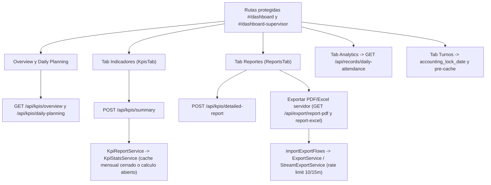

# Flujo: Tablero, KPIs y supervisión (`tablero-kpis-y-supervision`)

- **Estado:** `SINCRONIZADO_Y_VERIFICADO` — Spec 117 implementada, contratos OpenAPI/SDK sincronizados y verificada en staging (`http://127.0.0.1:8080`) con `0` bugs abiertos y `0` dudas.
- **Última actualización:** 2026-11-18
- **Módulos / actores:** `dashboard`, `supervisor-dashboard`, `kpis`, `importExport`, `records`, `config`. Operadores previstos en UI/API: `Administrador`, `Supervisor_Elevado`, `Supervisor`, `Reloj_Control` y `Fiscalizador` (con divergencia UI vs API detallada en sección 3).
- **Entradas:** UI `#/dashboard`, `#/dashboard-supervisor` (tabs `dashboard`, `kpis`, `analytics`, `employees`, `reports`, `shifts`); API `POST /api/kpis/summary`, `POST /api/kpis/detailed-report`, `GET /api/kpis/overview`, `GET /api/kpis/daily-planning`, `GET /api/export/report-pdf`, `GET /api/export/report-excel`, `GET /api/export/calendar-pdf`.
- **Alcance de evidencia:** código del checkout actual (`backend` y `frontend`). En Fase 1 no se ejecutaron pruebas ni se observaron respuestas HTTP o navegador; las anomalías registradas deben replicarse y confirmarse en Fase 2.

## 1. Diagrama AS-IS

## 2. Comportamiento observado en código

### 2.1 Acceso, navegación y permisos por rol

- `frontend/src/App.tsx` y `frontend/src/router/ProtectedRoute.tsx` protegen `#/dashboard` (solo montada si `isControlInternoEnabled` es verdadero) para `Reloj_Control`, `Administrador` y `Supervisor_Elevado`, y `#/dashboard-supervisor` para `Supervisor`, `Administrador`, `Supervisor_Elevado` y `Fiscalizador`.
- `frontend/src/hooks/layout/sidebarMenu.ts` oculta `Inicio` (`#/dashboard`) a `Supervisor` y `Fiscalizador`, y muestra `Supervisión` (`#/dashboard-supervisor`) a `Fiscalizador` además de los roles elevados.
- En backend (`backend/src/modules/kpis/http/routes.ts`), todas las rutas `/api/kpis/*` aplican `onRequest: [options.authenticate, supervisor]`, donde el middleware `supervisor` solo autoriza `Administrador`, `Supervisor_Elevado`, `Supervisor` y `Reloj_Control`. `Fiscalizador` queda excluido en API aunque la UI le permita entrar a `#/dashboard-supervisor`.
- En `frontend/src/hooks/useSupervisorPermissions.tsx` y `frontend/src/types/supervisor.ts`, `SupervisorRole` solo contempla `"Supervisor" | "Supervisor_Elevado"`. En `frontend/src/features/dashboard/components/widgetRegistry.ts`, los widgets incluyen `"Supervisor"` en `ALL_DASHBOARD_ROLES` aunque la ruta `#/dashboard` lo excluye.
- En `backend/src/platform/fastify/app.ts`, las rutas `/api/kpis*` y `/api/export*` devuelven `503 MAINTENANCE_MODE` durante mantenimiento activo, y `/api/export*` tiene un rate limit por IP de `10` peticiones cada `15` minutos antes de autenticación y mantenimiento.

### 2.2 `#/dashboard`, Overview y Daily Planning

- `DashboardContainer` (`frontend/src/features/dashboard/containers/Dashboard.container.tsx`) y `DashboardView` (`Dashboard.view.tsx`) renderizan widgets de `WIDGET_REGISTRY` filtrados por `module === "controlInterno"`, rol y visibilidad móvil, consumiendo `useDashboardData` (`useControlInternoEnabledQuery`, `useReportsQuery` y `useDashboardOverviewQuery`).
- `OverviewTab` y `LiveStatusPanel` (`frontend/src/features/supervisor-dashboard/`) consultan `GET /api/kpis/overview` y filtran en cliente por estado de marcaje y búsqueda por nombre.
- `KpiReportService.getDashboardOverview` (`backend/src/services/kpi/KpiReportService.ts`) consulta empleados `Activo` y registros de `yesterdayStr..todayStr` en horario de Chile (`America/Santiago` via `toBusinessDateChile` / `addBusinessDaysChile`), clasifica estados (`en_jornada`, `en_colacion`, `en_jornada_post_colacion`, `terminada`, `jornada_terminada_anomalia`, `no_programado`, `ausente`, `por_iniciar`) y detecta anomalías (turnos abiertos >14h, `AnomaliaManual` y faltas de marcaje de ayer sin licencia ni feriado).
- `GET /api/kpis/daily-planning` ejecuta `KpiReportService.getDailyPlanningSummary`, que resume empleados `Activo` para el día actual en Chile (`onVacation`, `onMedicalLeave`, `onSpecialPermit`, `onDayOff`, `scheduled`, `activeCount`). Ninguno de los dos endpoints soporta filtros por área ni alcance por supervisor.

### 2.3 Indicadores KPI, cálculo y caché mensual

- `KpisTab` y `useKpisController` (`frontend/src/features/supervisor-dashboard/`) permiten elegir rango por mes, trimestre, semestre, año o personalizado y filtros en cascada (`workdayType -> area -> employeeId`). Al cambiar fechas se resetean los filtros y la consulta se dispara manualmente mediante `useKpiCalculations` (`POST /api/kpis/summary`). En caso de error en la query no hay toast explícito en `useKpisController`.
- En backend (`backend/src/modules/kpis/application/flows.ts`), `createKpiFlows.normalize` valida el rango con `KpiSummaryRequestSchema` (`backend/src/models/schemas/core.schemas.ts`), transforma a rango exclusivo y limita el intervalo a 1 año (o 5 años cuando `employeeIds` tiene exactamente 1 elemento).
- `KpiReportService.getKpiSummary` y `getDetailedReport` obtienen `sourceRevision` desde 64 stripes (`kpiSourceRevision`), cargan empleados y precargan en paralelo `schedulingService.getSchedulingContext`, `timeRecord.findMany`, `systemConfig("accounting_lock_date")` y `monthlyEmployeeStats` en bloques de 3 meses.
- `KpiStatsService.calculatePeriodStats` (`backend/src/services/kpi/KpiStatsService.ts`) recorre mes a mes: si `kpiCache.isMonthLocked` es verdadero lee `monthlyEmployeeStats` o materializa con `ensureMonthlyCache` (upsert fuera de transacción); si el mes está abierto calcula por tramos de 10 días con `KpiEngine.calculateDailyMetrics` (tolerancia de atraso de 15 minutos, exención de `Artículo 22`, descuento de colación real o programada, tope de horas extra en turnos `>= 11h`).
- `KpiAggregationService` y `KpiFormattingService` consolidan totales, tasas y listas (`tardyRecords`, `absentEmployees` sanitizado con `toPublicEmployee`, `vacationRecords`, `medicalLeaveRecords`).

### 2.4 Reportes detallados y exportación PDF / Excel

- `ReportsTab` (`useReportsTabController.ts`) solicita `POST /api/kpis/detailed-report` al pulsar Generar. Aunque `ReportFilterPanel` ofrece filtro `workdayType` para acotar las listas desplegables, `useReportsTabController` solo envía `startDate`, `endDate`, `area` y `employeeIds` al reporte y a las exportaciones.
- La exportación de tabla local a PDF está deshabilitada con toast informativo; la exportación servidor usa `GET /api/export/report-excel` y `GET /api/export/report-pdf` (`mode: "summary" | "compiled_detailed"` cuando es reporte grupal, casteado `as never` en `kpiService.ts` porque el cliente OpenAPI generado no expone `mode`).
- En backend (`backend/src/modules/importExport/http/routes.ts` y `application/flows.ts`):
  - `ExportQuerySchema` (`backend/src/models/schemas/time-correction.schemas.ts`) valida query en Fastify, pero `importExportFlows` vuelve a validar con `ControllerExportQuerySchema` (`exportFilters.schemas.ts`).
  - `ExportService.generateDetailedReportPDF` (`backend/src/services/export/ExportService.ts`) y `StreamExportService.streamKpiReportToExcel` (`StreamExportService.ts`) delegan a `kpiService.getDetailedReport`.
  - Para rol `Usuario`, los endpoints de exportación restringen la consulta al propio `employeeId` del actor.

## 3. Anomalías, brechas y riesgos para replicación

1. **[ANOMALÍA-01] `Fiscalizador` admitido en UI pero bloqueado con `403` en API KPI.** `App.tsx:276-281` y `sidebarMenu.ts:49` permiten a `Fiscalizador` acceder a `#/dashboard-supervisor`, pero `backend/src/modules/kpis/http/routes.ts:13-25` restringe `/api/kpis/*` al middleware `supervisor` (`Administrador`, `Supervisor_Elevado`, `Supervisor`, `Reloj_Control`).
2. **[ANOMALÍA-02] `prepareExcel` convierte `403`/`400` en `500 EXPORT_REPORT_EXCEL_ERROR`.** En `backend/src/modules/importExport/application/flows.ts:64-76`, el `try/catch` de `prepareExcel` atrapa `ForbiddenError` (ej. `Usuario` solicitando otro `employeeId`) y `ValidationError` y responde `500` genérico en lugar de propagar el error de dominio.
3. **[ANOMALÍA-03] Desajuste en `mode=detailed` entre Fastify y el flujo de exportación.** `ExportQuerySchema` (`time-correction.schemas.ts:304`) acepta `"detailed"`, mientras `ControllerExportQuerySchema` (`exportFilters.schemas.ts:11`) solo permite `["summary", "compiled_detailed"]`, provocando fallo tardío (`400` en PDF, `500` en Excel). Además el cliente SDK en `frontend/src/services/kpiService.ts:111-112` usa `as never` para pasar `mode`.
4. **[ANOMALÍA-04] Filtros aceptados por contrato pero ignorados en cálculo/exportación.**
   - `KpiSummaryRequestSchema` acepta `employeeId` y `departmentId`, pero `createKpiFlows.normalize` (`modules/kpis/application/flows.ts:7,18`) los descarta y solo reenvía `employeeIds` y `area`.
   - `ExportQuerySchema` acepta `cargo` y `mode`, pero `generateDetailedReportPDF` y `streamKpiReportToExcel` ignoran `cargo` (y Excel también ignora `mode`).
   - `KpiReportService.getEmployees` (`KpiReportService.ts:363-369`) no filtra por `status: "Activo"` (posible inclusión de archivados/inactivos en KPIs/reportes según rango), a diferencia de `overview`, `daily-planning` y `calendar-pdf`.
   - `ReportFilterPanel` tiene `workdayType`, pero no se propaga al backend ni en `detailed-report` ni en exportaciones.
5. **[ANOMALÍA-05] Posible diferencia de horas extra entre meses cerrados y abiertos.** `KpiEngine.calculateDailyMetrics` (`KpiEngine.ts:136`) puede producir `overtimeHours < 0`. En meses abiertos `KpiStatsService.ts:146` aplica `Math.max(0, day.overtime)`, pero en meses cerrados (`KpiStatsService.ts:112`) suma `Number(day.overtime || 0)` directo desde `dailyBreakdown`, permitiendo que días con déficit resten horas extra acumuladas.
6. **[ANOMALÍA-06] `specialPermitCount` / `specialPermitRecords` / `specialPermitRate` siempre en 0.** `KpiAggregationService.ts:15,25,43-60` y `KpiFormattingService.ts:29` declaran métricas de permisos especiales pero `aggregateEmployeeSummary` nunca clasifica días con permiso especial.
7. **[ANOMALÍA-07] Alcance por área de `Supervisor` y manejo de errores en `KpisTab`.** `GET /api/kpis/overview` y `GET /api/kpis/daily-planning` no filtran por área asignada del `Supervisor`, y `useKpisController` no muestra feedback visual (toast/alerta) cuando falla `POST /api/kpis/summary`.
8. **[ANOMALÍA-08] Cache miss en meses cerrados fuera de transacción y `AnalyticsTab` con arrays vacíos.** `KpiStatsService.ts:102,168-216` materializa `monthlyEmployeeStats` por empleado sin transacción en cache miss; en frontend `useAnalyticsTabController.ts:1-9` devuelve `heatmapData = []` y `trendData = []` estáticos.

## 4. Resultados de replicación controlada (Fase 2)

### 4.1 Pruebas ejecutadas

- **Backend Fastify HTTP (PostgreSQL 18.4 aislado):** `node scripts/run-fastify-isolated.cjs tests/fastify-integration/kpis.test.ts tests/fastify-integration/importExport.test.ts` -> **2 archivos, 54/54 tests pasaron** (`kpis.test.ts`: 20, `importExport.test.ts`: 34).
- **Backend unitarios:** `npx vitest run tests/unit/kpiFlows.test.ts tests/KpiAggregationService.test.ts tests/KpiEngine.test.ts` -> **3 archivos, 15/15 tests pasaron** (`tests/integration/kpi.integration.test.ts` requiere harness con DB en `127.0.0.1:5432`).
- **Frontend Vitest:** `npx vitest run src/tests/services/kpiService.contract.test.ts src/tests/hooks/useKpiCalculations.test.tsx src/tests/features/supervisor-dashboard/ src/tests/features/dashboard/DashboardView.test.tsx src/tests/components/supervisor/` -> **10 archivos, 40/40 tests pasaron**.

### 4.2 Bugs y comportamientos confirmados

- **BUG-01 (`ANOMALÍA-02` confirmada):** En `GET /api/export/report-excel?employeeId=other-emp` como rol `Usuario`, `prepareExcel` (`backend/src/modules/importExport/application/flows.ts:64-76`) capturó `ForbiddenError` y devolvió `500` `{ code: "EXPORT_REPORT_EXCEL_ERROR" }` en lugar de `403`.
- **BUG-02 (`ANOMALÍA-03` confirmada):** Con `?mode=detailed`, `GET /api/export/report-pdf` devolvió `400 VALIDATION_ERROR` y `GET /api/export/report-excel` devolvió `500 EXPORT_REPORT_EXCEL_ERROR` por divergencia entre `ExportQuerySchema` y `ControllerExportQuerySchema`; en frontend `kpiService.ts` usa `as never` para enviar `mode`.
- **BUG-03 (`ANOMALÍA-05` confirmada):** Con una jornada de 4h sobre turno de 8h, en mes cerrado (`2020-01`) `POST /api/kpis/summary` devolvió `totalOvertimeHours: -4` y `overtimePercentage: -100`, mientras en mes abierto devolvió `totalOvertimeHours: 0`.
- **BUG-04 (`ANOMALÍA-06` confirmada):** Con un `TimeRecord` de `status: "Permiso Especial"`, `POST /api/kpis/summary` devolvió `specialPermitCount: 0`, `specialPermitRate: 0` y `kpiDetails.specialPermitRecords: []`.
- **BUG-05 (`ANOMALÍA-07` UI confirmada en Playwright):** Al simular `500` en `POST /api/kpis/summary` desde `KpisTab` en `http://127.0.0.1:8080/#/dashboard-supervisor`, `useKpiCalculations` / `useKpisController` no mostró toast ni `[role="alert"]`, silenciando el fallo con métricas en `0` y el mensaje falso `"PERIODO SIN REGISTROS: NO HAY DATA OPERATIVA DISPONIBLE EN LA VENTANA SELECCIONADA."`.
- **BUG-06 (`ANOMALÍA-04` confirmada):** `POST /api/kpis/detailed-report` con `{ employeeId: "emp-1", departmentId: "Ops" }` ignoró ambos filtros e incluyó empleados `Archivado`. En `ReportsTab`, seleccionar `workdayType: "Ordinaria"` no lo envió en el body de `POST /api/kpis/detailed-report` ni en las exportaciones PDF/Excel. En `Excel`, `cargo` también se ignora.
- **Confirmado sin error en flujo feliz staging (`admin`):** `#/dashboard` y todas las pestañas de `#/dashboard-supervisor` (`Resumen Hoy`, `Indicadores`, `Analytics`, `Reportes` con descarga PDF `summary`/`compiled_detailed` y Excel, `Turnos`) operaron con `200 OK` y `0` errores de consola. Se confirmó también que `useAnalyticsTabController.ts` devuelve `heatmapData = []` y `trendData = []` estáticos.

## 5. Decisiones resueltas y verificación final (Spec 117)

1. **`DUDA-01` (`1.B`):** `Fiscalizador` (`ROLES.AUDITOR`) fue retirado de `#/dashboard-supervisor` (`frontend/src/App.tsx`) y de `Supervisión` en el sidebar (`sidebarMenu.ts`), manteniendo `/api/kpis/*` restringido en backend.
2. **`DUDA-02` (`2.A`):** `KpiReportService` incluye empleados `Archivado` únicamente cuando tienen `TimeRecord`, `LeaveRecord` o `AssignedShift` en el rango consultado (manteniendo `status: "Activo"` en `overview`, `daily-planning` y `calendar-pdf`); `workdayType` y `cargo` se propagan desde `ReportsTab` hasta `detailed-report`, PDF y Excel.
3. **`DUDA-03` (`3.A`):** `overview`/`daily-planning` permanecen globales y `AnalyticsTab` quedó fuera del alcance de Spec 117.
4. **Cierre técnico (`BUG-01..06`):** `prepareExcel` propaga `AppError` (`403`/`400`), `ExportQuerySchema` y `ControllerExportQuerySchema` unificaron `mode` (`"summary" | "compiled_detailed"`) junto con `swagger.json` y `api-schema.ts` (eliminando `as never`), `KpiStatsService` aplica `Math.max(0, ...)` en meses cerrados, `KpiAggregationService` acumula `Permiso` y `Permiso Especial`, `KpisTab` expone errores con toast + `[role="alert"]`, y `createKpiFlows` mapea `employeeId` y `departmentId`.
5. **Verificación posterior al último cambio:**
   - Backend: `npm run check`, `npm run check:sdk` (`✅ SDK is fully synchronized`), `npm run test:schemas-refactor` (3 archivos, 12/12), `vitest` unitarios KPI (3 archivos, 16/16), `run-fastify-isolated.cjs` `kpis.test.ts` + `importExport.test.ts` (2 archivos, 57/57).
   - Frontend: `npm run check`, `npm run lint`, `vitest` KPIs/Dashboard/Sidebar (8 archivos, 30/30).
   - Global: `npm run lint:budget` (`0/0`), `npm run docs:check` (`OK`), Playwright + HTTP en `portal-control-staging` (`http://127.0.0.1:8080`) PASS completo.
